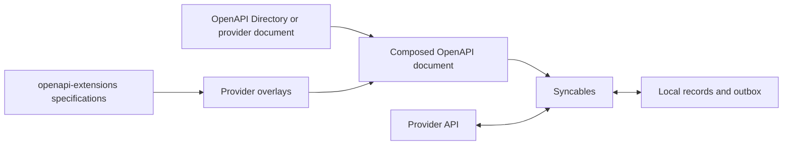

# Syncables

**Give an existing API a local-first interface.** Syncables is a TypeScript
library that joins the pages of API collections into a local copy, lets your
application read and edit that copy, and sends local changes back in the
background. Your application can work with already-synced data while the API
is slow or unreachable. The provider does not need to install Syncables or
change its API.

Use it to build an offline-capable editor, a local dashboard over several
services, or a data import that follows every declared page. It runs in Node
and browsers, with direct HTTP or a custom transport such as integration-proxy.
Supply persistent storage when records and pending writes need to survive a
restart; the default storage is in memory.

## From an API description to a local copy

Syncables builds on three complementary projects:

| Project | What it contributes |
| --- | --- |
| [OpenAPI Directory](https://github.com/APIs-guru/openapi-directory) | Machine-readable descriptions of existing APIs: URLs, operations, parameters and schemas. You can also use a provider's own OpenAPI document or write one for a private API. |
| [openapi-extensions](../openapi-extensions/README.md) | Shared vocabulary for the missing behavior: [Pagination Schemes](../openapi-extensions/spec/pagination-schemes/README.md) describe how to reach the next page; [CRUD Causality](../openapi-extensions/spec/crud-causality/README.md) describes collections, record identities and operation effects. Syncables implements a subset of these specifications. |
| [overlays](../overlays/README.md) | Reusable additions to API descriptions, so collection and pagination metadata can be maintained separately from the provider's document. Dated catalogs pair documents with their overlay revisions. |

The extension versions this source reads, against the specifications in
[`openapi-extensions/spec/`](../openapi-extensions/README.md):

| Extension | Version | What Syncables reads |
| --- | --- | --- |
| [Pagination Schemes](../openapi-extensions/spec/pagination-schemes/README.md) | 0.9.0 | `components.paginationSchemes` and `x-pagination`: the `pageNumber` (with `start` and `shortPage`), `pageToken`, `nextLink` and `rangeWindow` types, an `offset` field's `advance`, `linkResolution`, a scheme's `response.envelope` (with `emptyWhenAbsent`) its `response.incomplete`, and a cursor read from the last item (`fromLastItem`, with `hasMore`) ([below](#reading-in-a-browser-syncablesbrowser)). Not `incrementalSync`, and auto-detection only by query parameters and body fields (not `matchHeaders` or `matchResponseFields`). |
| [CRUD Causality](../openapi-extensions/spec/crud-causality/README.md) | 0.6.0 | `components.crudResources`: collections with their fixed reads (`listMethod`, `listQuery`, `listBody`) and `envelope`, identities (optional for a list-only resource, one that no `x-crud` operation or Reference Object addresses; it is read-only, §4.1) and bindings, and `x-crud` operations for writes, with created identities (§4.3.2) and compound creates (`followUps`, §4.7). Not its request, patch or mint semantics. |
| [Throttling](../openapi-extensions/spec/throttling/README.md) | 0.3.0-draft, plan tiers from 0.5.0-draft | The root `x-throttling` (`headers`, `bodyFields`, `signals`, `limits` with plan `tiers`, `applies`) and an operation's bucket list. Requests are paced under the `limits` that state `requests`, or every tier in force. Not yet 0.4.0's `blocked` meaning (#533): a signal that declares it is not read, so such a refusal is retried. |
| [Collection Completeness](../openapi-extensions/spec/collection-completeness/README.md) | 0.3.0-draft | `x-completeness`: `absent` (only `deleted` changes what the client does without a read), `notFound` and `gone` (what a 404 or 410 of a record's read means, resource-wide; an unrecognised `absent` or value fails closed to `unavailable`) and `parentAbsent`. |
| [Deletion Feeds](../openapi-extensions/spec/deletion-feeds/README.md) | 0.3.0-draft | `x-deletion-feed`, `x-read-tombstone` and `x-list-tombstone`. |
| [Runtime Schemas](../openapi-extensions/spec/runtime-schemas/README.md) | 0.1.0-draft | `x-runtime-schema` on a CRUD resource, in `readCollections` ([below](#reading-in-a-browser-syncablesbrowser)). Not writes or value conversion. |
| [Filtering](../openapi-extensions/spec/filtering/README.md) | 0.2.0-draft | `x-time-zone` on list query parameters, with their `x-filter` field and operator for the covered spans. Not `x-filter` or `x-collection-scope` otherwise. |
| [Write Preconditions](../openapi-extensions/spec/write-preconditions/README.md) | 0.1.0-draft | `x-write-precondition` on create, update and delete operations: `ifMatch`, `readVerify` and `refuseWhen` ([below](#write-preconditions-x-write-precondition)). Not on a compound create's follow-up operations. |
| [Produced Classes](../openapi-extensions/spec/produced-classes/README.md) | 0.1.1-draft | `x-produces` on a CRUD resource, as read-only metadata ([below](#produced-classes-x-produces)). Nothing is fetched or mapped. |
| [Webhook Deliveries](../openapi-extensions/spec/webhook-deliveries/README.md) | 0.1.0-draft | The `events` of `x-webhook-deliveries`, read by `scopedReads` only (the webhook inbox consumer). Not signature checks or hook registration, which are the receiver's. |
| [Webhook Subscriptions](../openapi-extensions/spec/webhook-subscriptions/README.md) | 0.1.0-draft | The consumer routes, through `InboxClient` and `InboxConsumer`. The root `x-webhook-subscriptions` field is not read. |

The other specifications there (the authentication extensions) are not read
by Syncables.

These are sources of descriptions and conventions, not three npm packages
you must install. Once you have a composed document, Syncables uses it locally;
it does not look up a directory or catalog on each request. An API whose document
already contains the necessary metadata needs no overlay.



To **local-firstify an API**, describe the collections you want, their stable
identities, pagination and supported writes; choose authentication and storage;
then point your application at `client.list`, `client.get` and the local write
methods. Syncables handles collection traversal, page assembly, refreshes and
the write queue. "Any API" means an API whose needed operations can be expressed
in the supported model: a read-only API gives you a local read-only copy,
and custom mutation protocols may need an adapter.

Start with the [local-first guide](docs/local-first.md): it includes a runnable
offline-edit example, the document/overlay workflow, direct and proxy transports,
persistence and write recovery. The API details below serve as a reference.
This README describes current source, including any **Unreleased** changes;
the guide explains how to run that source before an npm release.

## Usage

For published releases, install with `npm install syncables`. To build the
current source, run these commands from `syncables/` with Node 22:

```sh
npm ci
npm run build:release
```

```ts
import { loadOpenApiDocument, createMockServer, createApiClient } from 'syncables';

const document = await loadOpenApiDocument('./petstore.yaml');

const server = createMockServer(document);
const { url } = await server.listen();

const client = createApiClient(document, { baseUrl: url, credentialPrefix: false });
await client.sync(); // pulls every discovered resource collection into local storage

const pets = await client.list('/pets'); // a local read, with no API request
```

The mock server makes it possible to try the workflow without credentials. It
uses an in-memory CRUD store and synthetic records generated from the schemas.
For a real provider, load its composed document and configure a
[transport and authentication](#transports-and-direct-authentication) instead.
The mock server uses legacy path-pair discovery and does not implement all
metadata-driven behavior of a real provider.

When `components.crudResources` is present, the client and reader use its
collection names, identity bindings and nested collection graph. Without
that metadata, the client retains legacy discovery by paired collection
and item paths, e.g. `/pets` and `/pets/{petId}`; the mock server still uses
that legacy model. The browser reader requires CRUD metadata. This is a
subset of CRUD Causality, not a complete implementation of its write semantics.

## Keeping in sync

`sync()` can be called on a timer: it conditionally re-fetches using
`ETag`/`Last-Modified` (or a fallback comparison against the previous sync
when a server doesn't support conditional requests) and only touches local
storage for items that actually changed.

```ts
const handle = client.startPolling({
  intervalMs: 30_000,
  onSync: (result) => console.log('changed:', result.changed),
  onError: (error) => console.error('sync failed:', error),
});

// later
handle.stop();
```

### Wall-clock date-time parameters (`x-time-zone`)

Some APIs read a date-time query parameter as wall-clock time in a zone the
request does not carry (Clockify's time-entry `start` and `end`, in the
user's profile zone). A parameter that declares `x-time-zone` (Filtering
0.2.0-draft, `openapi-extensions/spec/filtering/`) is sent as the spec's
client steps say, when a `selection` gives it a value:

- The value must be an instant with `Z` or an offset
  (`2026-01-01T00:00:00Z`); anything else fails that collection's read.
- The zone is read before the list request: a fixed `zone.name`, or a GET of
  `zone.operationId` with the request's own path values (matched by name),
  at `zone.pointer`. One read per zone source and bound path values per
  `readCollections`/`sync()`, through the read's budget (and its
  `storeResponse` hook, like any read response). Conversion uses `Intl`, so
  it is as accurate as the runtime's time zone data.
- The value sent is the wall-clock digits in that zone,
  `yyyy-MM-ddTHH:mm:ss` (whole seconds, truncated), plus `suffix`.
- The UTC span covered is computed from the digits sent, one span per
  `x-filter` field (bounds of different fields are never merged): `gte`/`gt`
  parameters give the lower end, `lte`/`lt` the upper one (the tighter one
  when several bound the same end), with `fromInclusive`/`toInclusive` from
  the operator, and `ambiguous` picks the offset in a repeated or skipped
  hour (`unspecified`: the reading that covers least).
- The rest of the same request's query counts too. A range `x-filter`
  parameter without `x-time-zone` whose value is an instant (`Z` or an
  offset) adds its bound to its field's span, merged by the same
  tighter-bound rule (its instant is in `instants`). Any other value that
  narrows the read (an `eq` `x-filter`, a parameter without `x-filter`, a
  range bound that is not an instant) makes the coverage unknown
  (`otherFilters`): the read asked for less than the spans say. Not
  counted: the pagination scheme's fields that `walkPages` overwrites or
  that only size the pages (roles `pageSize`, `offset`, `page`; a
  `pageToken` or `cursor` a selection sets is `otherFilters`, and so is any
  of them under a `rangeWindow` scheme, which sets its window fields
  instead), and the
  collection's own fixed `listQuery` values, which define the collection
  (a fixed range bound that is an instant still adds to its field's span).
- A zone that cannot be read (an error status, nothing at the pointer, not
  an IANA name this runtime knows, a zone operation that needs a parameter
  the request does not have) is not taken as UTC: the UTC digits are sent
  and each bound covers 14 hours less, so a window of 28 hours or less
  covers nothing.
- After the read, each operation zone source is read again; if the zone
  differs or cannot be read, the spans are discarded (`zoneChanged`). The
  items are kept. syncables does not read again by itself: the caller
  decides.
- A `rangeWindow` read with a range (`ranges`) whose window fields include
  `x-time-zone` query parameters splits the range as instants and sends
  each window bound to such a parameter as wall-clock digits in its zone
  (`PageWalk.windowValue`); the other window fields get the bound as it is.
  Its coverage is that of the outer range (the range's start in each
  `windowStart` parameter, its end in each `windowEnd` one, with the rest
  of the query as above): adjacent windows share their bounds, so with an
  unknown zone only the outer ends narrow by 14 hours. A window field
  without `x-time-zone` counts like the rest of the query: with a range
  `x-filter` its outer end adds to its field's span, and without one (or
  as a `windowRange` field, whose value is not an instant) it gives
  `otherFilters`. A windowed read is never complete, so a finished one
  keeps its spans with `reason: 'incomplete'`. A window `format` other
  than `dateTime` on such a parameter fails the read. A zoned
  `windowRange` parameter (both ends in one value) gives
  `noRangePredicate`, with the outer range's value in `parameters` (the
  template over both wall-clock ends) and its two instants as an ISO 8601
  interval (`start/end`) in `instants`.

The result is on `CollectionSnapshot.coverage` (from `readCollections`) and
on `SyncResult.coverage` (per collection and bound context):

```ts
const { coverage } = await client.sync();
// [{ collection: 'entries', context: {...},
//    parameters: { start: '2026-01-01T01:00:00Z', end: '2026-02-01T01:00:00Z' },
//    instants: { start: '2026-01-01T00:00:00.000Z', end: '2026-02-01T00:00:00.000Z' },
//    zones: { start: 'Europe/Amsterdam', end: 'Europe/Amsterdam' },
//    spans: [{ field: '/timeInterval/start',
//              from: '2026-01-01T00:00:00.000Z', fromInclusive: true,
//              to: '2026-02-01T00:00:00.000Z', toInclusive: false }] }]
```

`parameters` holds the values sent (wall-clock digits plus `suffix`), and
`instants` the instants they were written from. Coverage describes the
query, per request: the provider was asked for the collection's items whose fields lie in
every span at once. It does not say that every such item is in the local
copy (an incomplete or failed read, a record the caller dropped). `spans` is
null when the request covers nothing known; `reason` is then `empty` (some
field's lower end is not before its upper end), `zoneChanged`,
`noRangePredicate` (an `x-time-zone` parameter with a value but no range
`x-filter`), `otherFilters` (above) or `incomplete` (the read failed, or
finished without being complete, as one ended by a short page whose end
is `observed` or `assumed`). Only a finished read by range windows over
`x-time-zone` window fields keeps its `spans`, with `reason:
'incomplete'`. An open end is left out. A `probe` read reads no zone and
converts nothing.
`readPlatform` does not report coverage. Only query parameters are read;
an `x-time-zone` in a request body or path is ignored.
`wallClockParam`, `instantsOf` and `coveredSpan` are exported (the spec's
`wall_clock_param`, `instants_of` and `covered_span`); `instantsOf` takes
the offsets a day either side of the wall-clock time, so two offset
changes within two days are not told apart.

## Writing

`create`/`update`/`remove` are local-first: they update local storage
immediately and return, then apply themselves against the server in the
background. Confirmed provider state is separate from pending local intent;
refreshes and older write responses replay remaining mutations rather than
replacing newer local edits. Updates use the item path's operation that
declares CRUD Causality `x-crud: { action: update }` for the record's
resource: when exactly one of its PUT and PATCH does, that one; when both
do, the PUT; when neither does (or in a legacy document, without
`components.crudResources`), the PUT, or the PATCH when there is no PUT.
The chosen operation's `x-crud` (§4.3 `mode`, §4.6 `patchFormat`) sets the
body:

- `mode: replace`, no `x-crud`, or a legacy document (no
  `components.crudResources`): the last known record with the changes on
  top, as JSON.
- `mode: patch, patchFormat: jsonMergePatch`: the changes alone, as an
  [RFC 7396](https://www.rfc-editor.org/rfc/rfc7396) JSON Merge Patch, with
  `Content-Type: application/merge-patch+json` when the operation's
  `requestBody.content` declares that media type, else `application/json`.
  The local copy follows RFC 7396 too: `null` removes the field, and a
  nested object merges into the existing one (on other routes `null` is a
  value and a nested object replaces the field). Each queued edit sends only
  its own changes, in order, also after a restart. `mergePatch(target,
  patch)` is exported.
- `mode: patch, patchFormat: jsonPatch` (RFC 6902): `update()` throws
  ("declares its PATCH update with patchFormat jsonPatch (RFC 6902), which
  this client does not send") before any local change; create and delete
  are unaffected.
- `patchFormat: custom`, or `mode: patch` without `patchFormat`: the full
  record, as for `replace`. Whether the provider accepts that is not checked.

With both declared, the PUT is chosen even when the PATCH is declared as a
merge patch, so such a document still sends full records; preferring the
merge patch there is a possible follow-up, not done. A PATCH declared with
`patchFormat: jsonPatch` beside an undeclared PUT is followed: `update()`
throws.

A merge-patch edit records the confirmed values of the top-level fields it
names, so a remote change anywhere inside a nested object it patches is
reported as a `WriteConflict` on that field, even when the two changes touch
different nested members. A refresh is compared with the field as the
client's own patches leave it, applied in order (a `null` matches an absent
field), so a refresh that shows the client's own merge patch applied before
its response arrived is not a conflict, for that write or a later queued
one. A failed merge-patch update loses only the nested members a later
settled merge patch sets, and `resolveWrite` `retry` strips only those of
newer queued merge patches; other routes do this by top-level field.

Each update stores the body format it was made with (`updateBody` in the
outbox). A client restarted on a document that now declares another format
for the route does not send or replay the update under the new one: the
update, and every write queued before it, becomes `failed` with a
`lastError` that says so; it stays visible as made, `retry` throws, and
`discard` drops it. When a create is queued before such an update, the
record's writes are kept unrestorable instead (written back unchanged).
An update's response is merged over the record it sent (a shallow spread,
on merge-patch routes too: a `null` in a response is stored as a value,
not read as a removal), so a provider that
answers with only some fields (or only bookkeeping such as `updatedAt`) does
not shrink the confirmed record or revert the edit. The trade-off: a field
that the provider removed in that response, rather than omitted, stays in the
local copy until the next refresh, and is sent again in later PUT or PATCH
bodies until then; a strict provider could reject those, for example after a
field rename.

A write the server refuses for good (most 4xx) fails at once, a write whose
credentials are refused (401, 403) pauses all writes until the app renews
them, and other failures retry with exponential backoff, unlimited by
default; set `retry.maxAttempts` to bound attempts. See
[Failure classes](#failure-classes). Unsettled writes are kept in a durable
outbox in the client's storage adapter, so a client built later on the same
storage resumes them (see [Durable outbox and restarts](#durable-outbox-and-restarts)).

```ts
const pet = await client.create('/pets', { name: 'Milo', tag: 'cat' });
// `pet` is already in local storage — the POST to the server is still
// happening (and retrying, if needed) in the background.

client.pendingWrites('/pets'); // writes not yet confirmed by the server
```

Each entry of `pendingWrites()` has a `state`:

| `state` | Meaning | What the client does |
| --- | --- | --- |
| `pending` | Queued, in flight, waiting for a retry, or held for a refresh (`awaitingRefresh: true`) | Retries automatically; a held update waits for a `sync()` |
| `uncertain` | A create may or may not have reached the server | Nothing, until `resolveWrite` |
| `failed` | The server refused it, retries stopped at `retry.maxAttempts`, or a refresh no longer returned its record (`missingRecord`, [below](#records-a-refresh-no-longer-returns)) | Nothing, until `resolveWrite` (see below) |
| `blocked` | The server refused the client's credentials for it | Sends no write at all, until `authRenewed()` |

Entries carry `attempts`, `lastError` (for an HTTP failure: the path, the
status and up to 200 characters of the response body, whitespace collapsed)
and `lastStatus` (the HTTP status behind `lastError`, absent when `lastError`
does not describe a response). A failed update whose record a refresh no
longer returned also carries `missingRecord` (`deleted`, `unavailable` or
`unknown`).

A new `create`/`update`/`remove` does not drop a failed write. A failed create
holds back later writes to the record, like an uncertain one. A failed update
or delete does not; later writes go ahead, and once one of them settles, it
replaces the fields it set in the failed update. A failed update with no
fields left, and a failed delete followed by any settled write, are dropped.
Whatever is left stays listed, and visible locally, until `resolveWrite`.

### Failure classes

A write the server answers with a non-2xx status is classified. The defaults
(`defaultWriteFailureClass`, exported) are:

| Response | Class | What the client does |
| --- | --- | --- |
| 404 or 410 to a delete | `satisfied` | The record is already gone, so the delete settles as if it had succeeded |
| A response that is throttling under the document's `x-throttling` ([below](#throttling)): a matching signal, or any 429 | `retry` | Sent again no earlier than the earliest retry time the response gives, else after the backoff |
| 401 | `auth` | The write becomes `blocked` and the client stops sending writes (below); no attempt is counted |
| 403 with `Retry-After` or `x-ratelimit-remaining: 0`, when the document declares no `x-throttling.signals` | `retry` | A rate limit, as GitHub sends it; with signals declared, a 403 is throttling only when a signal matches |
| Other 403 | `auth` | As 401, except for a request sent after `authRenewed()` before any response showed the renewed credentials accepted (below): then `permanent` |
| 408, 425 | `retry` | Backoff retry, or the `Retry-After` delay |
| Every other 4xx: 400, 404 or 410 to a create or update, 405, 409, 413, 415, 422, ... | `permanent` | The write becomes `failed` at once, after 1 attempt |
| Anything else: 5xx, and a 1xx or 3xx the transport passed on | `retry` | Backoff retry, or the `Retry-After` delay; a create's 5xx other than 503 becomes `uncertain` without a usable idempotency key ([Uncertain creates](#uncertain-creates)) |

Failures without a status keep their earlier handling: a transport that
throws (`uncertain` for a create without a key, otherwise retried), a 2xx
with an unusable body (`uncertain` for a create), and an error before the
request was handed to the transport, such as an `authenticate` adapter that
throws (retried with backoff).

`retry` counts an attempt and sends the write again after the backoff delay
(`retry.baseDelayMs`, doubled per attempt, at most `retry.maxDelayMs`). A
`Retry-After` header (delay-seconds or an HTTP date) can only lengthen that
wait: the delay is the longer of the backoff and the `Retry-After`, which
may exceed `retry.maxDelayMs` but is cut to `retry.maxRetryAfterMs`
(default 3600000, 1 hour). `Retry-After: 0`, a date in the past, or a server
clock behind the client's therefore waits the backoff, so they cannot cause
a tight loop. The cap is a trade-off: a provider that asks for more than an
hour is asked again after an hour, which it may answer with another 429;
raise the cap to wait as long as such a provider asks, at the cost of a queue
that can stay held that long. A value that is neither delay-seconds nor a
date (such as `1.5`) is ignored. `retry.maxAttempts` applies to `retry`
failures. The delay is not stored; after a restart the first resend is
immediate.

`permanent` counts an attempt and makes the write `failed` at once, as if
`retry.maxAttempts` were reached: a failed create holds back the writes
queued behind it, a failed update or delete joins the record's failed writes
while later writes go ahead, and `resolveWrite` retries or discards them.
Only the write at the head of its record's queue is sent, so a failed write
is always older than the record's queued writes.

A 404 or 410 to a delete is the one default that settles a write without a
2xx. If the delete path itself is wrong (a misconfigured document), deletes
then settle locally and the next `sync()` brings the records back; classify
such responses as `permanent` to catch that.

Set `classifyWriteFailure` to change the classes. It receives the write's
`type`, the HTTP `method`, `status`, lower-cased `headers`, the response
`body`, `resource`, `id`, `afterRenewal`, `throttling` (the verdict below,
when the response is throttling) and `signalsDeclared`, and returns
`'retry'`, `'permanent'`, `'auth'` or `'satisfied'`. A classifier that
throws or returns another value gets the default class; `satisfied` for a
create or update counts as `permanent`.

#### Throttling

The draft [Throttling extension](../openapi-extensions/spec/throttling/README.md)
(0.3.0-draft) lets a document say, at the root `x-throttling`, which
response headers report the rate limit (`headers`: roles `limit`,
`remaining`, `used`, `reset` and `retryAfter`, the last two with a time
unit), which JSON body fields report the same roles (`bodyFields`, since
0.3.0, keyed by a dot-path such as Todoist's `error_extra.retry_after`) and
which responses are rate-limit refusals (`signals`: a status
list plus a header or JSON-body predicate, with the meaning `throttled` or
`quotaExhausted`, an optional `bucket` of `limits` and `minDelaySeconds`).
`declaredThrottling` reads it and `classifyThrottling` (both exported)
applies it to a response, after the spec's `classify()`: the first signal
that matches decides; without one, a 429 is `throttled` (with or without a
declaration) and nothing else is throttling. The earliest retry time is
the later of the `retryAfter` time and, for `quotaExhausted` or
`remaining: 0`, the `reset` time; else the response time plus the signal's
`minDelaySeconds`; else, for `quotaExhausted` with a bucket whose window is
declared, plus that window; else the client's own backoff. An absolute time
is measured against both the client's clock and the response's `Date`
header, taking the later, so neither a wrong clock nor a wrong `Date` makes
it earlier; a header value that does not parse in its declared unit is
ignored. When no `retryAfter` header role is declared, the standard
`Retry-After` header is read as RFC 9110 defines it, as before the
extension. A body field is read only from a throttling response whose body
is JSON: its dot-path's names are matched literally (a name holding a `.`
cannot be addressed; `a..b`, `.a` and `a.` are left out of the
declaration), a string is trimmed, a number counts only when it has no
fractional part (`3.0` reads as `3`), and a boolean, `null`, an array or
an object does not parse. For headers and body fields alike, only space,
tab, CR and LF are trimmed (a value carrying U+00A0 or another Unicode
space does not parse), an integer above 2^53 − 1 does not parse
(`1e21` in a body, a 400-digit `Retry-After`), and an HTTP-date parses only
in one of RFC 9110's three exact forms (IMF-fixdate, the obsolete RFC 850
form, asctime), never through a lenient date parser (so no ISO date, no
`UTC` for `GMT`, nothing with another whitespace character or a
byte-order mark); the client's own `Retry-After` reading for other
retryable answers, and the `Date` header, follow the same rules. A role read from both a header and a body field
counts once: the later time for `retryAfter` and `reset`, and the bucket is
exhausted when either `remaining` is `0`. A body `retryAfter` or `reset`
that gives no wait (`0`, or a time not after the response) counts as
absent, so `minDelaySeconds`, the bucket window or the backoff still
applies; those are fallbacks, not floors.

For a write, a throttling verdict means `retry`, sent again no earlier than
that time and never below the backoff. The time is stored with the queued
write (`notBefore` in the outbox), so a restart or a `resolveWrite` `retry`
keeps it: a restored or retried write waits it out too. A time further away
than `retry.maxRetryAfterMs` is not cut short: the write becomes `failed`
with `lastError` naming the time and the cap, since the extension forbids
retrying earlier and allows giving up; `resolveWrite` `retry` queues it
again, and it fails again at once while the time is still that far away. A
`quotaExhausted` answer, to a write or to a read, also holds back every
other request counted against the same bucket (the operation's
`x-throttling` selection, else the root `applies`; every request when the
signal names no bucket) until that time, or, when it carries no time and
its bucket has no declared window, until the throttled write's own
backoff; the paused buckets are stored in the outbox too. A write held
that way longer than `retry.maxRetryAfterMs` fails with `lastError` "Held
until … not sent" rather than waiting unseen. A create answered by a 5xx
stays `uncertain` even when a declared signal matches the response: the
extension says such a response may follow partial processing, and that
"not applied" is only an inference ([Uncertain creates](#uncertain-creates)).
For a read, the client's transport first waits out a paused bucket of the
request's operation (through `sleep`; a pause longer than `limits.timeoutMs`
stops the read with an error), then the budget waits the earliest retry
time of a throttled answer and sends the request again, up to
`limits.maxRetries` times, or stops with "API retry delay exceeds the
remaining read time"; a throttled answer without a time is returned to the
read as before. Nothing here has been checked against a real provider.

##### Pacing under announced quotas

Where a Limit Object in `x-throttling` states `requests`, the client paces
itself, so it does not have to run into the limit first (pieces.md K2). It
sends at most `paceFraction` of `requests` (default 0.8, rounded down, at
least one) in any window of the bucket. Moneybird's 150 per 300 s becomes
120 per 300 s. The buckets a request counts against are its operation's
`x-throttling` selection, else the root `applies`. An operation whose
selection leaves a bucket out (`x-throttling: []`, say) is not paced by
it. Buckets without `requests` are not paced. Documents without such a
Limit Object behave as before.

- **Windows.** A `sliding` or `unspecified` window counts the preceding
  `seconds`. A `fixed` window with an `anchor` counts from its boundaries.
  **A `fixed` window without an `anchor` is paced as sliding.** Its phase
  is unknown, and pacing it as sliding keeps under the quota whatever the
  phase is.
- **Counting.** A request counts when it is sent, not when it is answered,
  so requests in flight count and concurrent write queues cannot overshoot.
  A request that finds no room waits.
- **Reads** wait through `sleep` within their time limit, as for a paused
  bucket. A wait past `limits.timeoutMs`, or past what is left of the
  sync's budget, stops the read with an error before the request is sent.
- **Writes** are held like a `notBefore`. Pacing alone never fails a write,
  however long the hold, and waiting does not count an attempt.
- **Only this client's own requests are counted**, in memory, so a restart
  starts the count afresh. A bucket partitioned by `sourceIp` behind a
  shared proxy, or shared with other clients of the same user, can still
  run out. Pacing those across clients is the proxy's job (pieces.md P4).
  The reaction to a throttled answer described above stays in place.

Turn pacing off with `pace: false`. `paceFraction` must be greater than 0
and at most 1.

```ts
import { createApiClient, defaultWriteFailureClass } from 'syncables';

const client = createApiClient(doc, {
  classifyWriteFailure: (failure) =>
    // This provider answers 409 while a record is locked for a moment.
    failure.status === 409 ? 'retry' : defaultWriteFailureClass(failure),
});
```

##### Plan tiers

A Limit Object may declare `tiers` instead of `requests` and `window`
(Throttling 0.5.0): one bucket whose amount and window depend on the
account's plan, as Clockify documents (30 requests per hour on FREE, 20
per second on TRIAL, BASIC, STANDARD and PRO, 50 per second on
ENTERPRISE), each tier naming its `plans`. With `throttlingPlan` set to
the account's plan, as the provider names it (`'PRO'`), the client paces
by the tier whose `plans` include it, as by a plain limit. Without one, or
with a plan no tier names, it keeps within every tier at once, each
counted separately over the same requests (the spec's `limits_in_force`):
no single tier is safe on its own, since a lower average rate over a
longer window (30 per hour) still allows a burst a shorter tier forbids
(20 per second). The window a time-less `quotaExhausted` answer waits out
is the plan's tier's, else the longest (`fallback_window`). A limit whose
tiers fail the checks that decide which tier binds (no `plans`, an empty
or repeated plan, a `requests` or `window.seconds` that is not a positive
integer) is left out, as other entries that do not parse are. The client
is more lenient than the spec's validator elsewhere: a window `kind` it
does not know is read as `sliding`, an `anchor` that does not parse is
left out, and unknown fields, or `requests` and `window` beside `tiers`,
are ignored (the tiers are read). `throttlingPlan` is an option
of `createApiClient`, `readCollections`, `readPlatform` and `paginate`;
`declaredThrottling(document, plan)` gives the tiers in force in
`tieredQuotas` (a plan's tier goes into `quotas`), and `parseTiers`,
`limitsInForce` and `fallbackWindow` are exported. How a client learns
its plan is up to the caller. Pacing counts only this client's requests
(above).

#### Refused credentials

An `auth` failure stops every write of the client, for every record and
collection: a client has one server URL and one set of credentials (one
`transport`, `credentials` and `authenticate`), so a refusal is taken to
apply to all of its writes. The write that met it becomes `blocked`, without
counting an attempt; the other writes stay `pending` but are not sent, and
writes made meanwhile are queued as usual and visible locally. A request
already sent completes, and its write is marked `blocked` too if it is
refused. A write whose in-flight mark was still being stored when the block
began is not sent and keeps its attempt count. Reads (`sync()`) are not
affected by the block.

```ts
const client = createApiClient(doc, {
  authenticate,
  onAuthBlocked: ({ status, lastError, resource, id }) => {
    // ask the user to sign in again, then:
    renewToken().then(() => client.authRenewed());
  },
});
client.authBlocked(); // { status, lastError, resource, id } while blocked
```

`authRenewed()` makes the `blocked` writes `pending` again and resumes every
queue in its order; it does nothing when the client is not blocked. The
client cannot tell by itself that credentials were renewed: the
`authenticate` adapter returning a request does not show that the server
accepts it. Do not call `authRenewed()` from `onAuthBlocked` without
renewing: a write refused again blocks the client again, one request per
call. After a renewal, a 401 blocks again. A 403 (without rate-limit
headers) fails its write instead of blocking, if it answers a request sent
after the renewal and before any response showed the renewed credentials
accepted, so a permission that new credentials do not grant cannot hold all
writes back. Accepted means: a response to a request sent after the latest
renewal that is not a refusal, that is a 2xx or a failure classified
`retry`, `permanent` or `satisfied`, except a failure that the classifier in
use (`classifyWriteFailure`, or the defaults) calls `auth` when asked again
with `afterRenewal: false`, such as the 403 that this rule makes
`permanent`. A refusal never counts as acceptance, so several writes the
renewed credentials may not make all fail rather than block again. For a
failure of a request sent after a renewal that it does not call `auth`, a
custom classifier is therefore called a second time, with `afterRenewal:
false`; one that returns a class other than `auth` regardless of
`afterRenewal` makes that response count as acceptance. Whether a request
counts as sent after the renewal is decided when it is sent, not when its
answer arrives. A 401
or 403 for a request sent before the latest renewal is sent again at once,
without counting an attempt.

`resolveWrite` `discard` drops a blocked write (a blocked create together
with the writes queued behind it, as for an uncertain one) and leaves the
client blocked; the record's later writes stay queued. `retry` on a record
whose queue starts with a blocked write throws unless the record also has
failed or waiting writes: it then retries the failed writes behind the queued
ones, or stops the waiting updates from waiting for a refresh; a blocked
write itself is resent only by `authRenewed()`.

For an `authenticate` adapter that renews tokens by itself, set
`onAuthFailure: 'retry'`: an `auth` failure is then retried with backoff like
a `retry` failure (counting attempts, `retry.maxAttempts` applies), nothing
is blocked and `onAuthBlocked` is not called. A client with `'retry'`
restored from an outbox stored while blocked drops the stored block and
sends the `blocked` writes as `pending` ones. The default is `'block'`.
Under either setting, a create that a classifier calls `auth` but that may
have been applied (a 5xx other than 503) becomes `uncertain` without a
usable idempotency key, instead of being resent.

The block is stored in the durable outbox. A client restored from a blocked
outbox is blocked, calls `onAuthBlocked` once the restore is done, and sends
no write before `authRenewed()`. Whether credentials were just renewed is
not stored, so after a restart a 403 blocks again. While blocked, `sync()`
calls do not count
towards failing a restored update that waits for a refresh; a complete
refresh still releases it, and after `authRenewed()` it is sent on the
newest confirmed record.

### Refresh during a pending update

A refresh (`sync()`) never hides a pending local edit: the visible record is
the newest confirmed remote record with the pending changes replayed on top.
When a refresh shows that a field with a pending update also changed remotely
(its remote value differs from the value the client had confirmed when the
edit was made, or when an earlier write to that field settled, and from every
value this client has queued, or holds as failed, for that field), the client
records a conflict.
A refresh that shows an earlier queued edit applied, before or after its
response arrives, is not a conflict.
For a JSON Merge Patch update, conflicts are per top-level field: a remote
change to any nested member of an object the patch touches is reported on
the whole field, even when the patch sets other members. Its expected value
is the patch applied to its own base, or to what the queued patches before
it leave; failed patches are not counted as applied.
The local value stays visible, the queued write still sends it (local wins on
acknowledgement), and the conflict is observable in two ways:

```ts
const client = createApiClient(doc, {
  onConflict: ({ resource, id, field, base, remote, local }) => {
    // called once per newly observed remote value
  },
});
client.pendingWrites('/pets')[0]?.conflicts; // [{ field, base, remote, local, ... }]
```

The conflict is listed until its write settles or is discarded, and is
dropped if a later refresh shows the remote value equal to the local one. To
keep the remote value instead, call `update` again with it. Not covered:
conflicts that arrive only in a write's own response, and deletes. A refresh
that no longer returns the record at all is handled below.

### Records a refresh no longer returns

**Presence: tell before prune, and marks.** When a complete `sync()` no
longer returns a record that has no unsettled writes, the client either
removes it from the local copy or keeps it with a presence mark, by the
collection's declaration:

| Collection | The record is |
|---|---|
| `x-completeness: { absent: deleted }` | `deleted` (`source: 'declaration'`): removed, or kept marked `deleted` under `retainDeleted: true` |
| `x-completeness: { absent: removed }`, or wherever a check will be made (`missingRecordChecks: 'all'`, a parent whose nested collection declares `parentAbsent`) | kept, marked `unconfirmed`, until a check (a GET of the record) settles it |
| no declaration, default checks | `removed` (no longer returned; whether it still exists is not known): removed |

A check settles an `unconfirmed` record: a 404/410 under `notFound:
unavailable` marks it `unavailable` (kept); deleted (a 404/410 under the
default `notFound`, a read tombstone, a feed tombstone) removes it, or keeps
it marked `deleted` under `retainDeleted`; the record found but not in the
list (`filtered`) removes it from this collection (`removed`, with the
record as that check read it); an error or no check leaves it
`unconfirmed`. The marks persist in the outbox. A retained `deleted` mark
stays until a read returns the record again or the app removes it (a
`remove()` is held and checked like any write to a marked record); the
client does not expire or cap them. A read
that returns a marked record again drops the mark (`present`). Checks of
records without writes are capped at `maxMissingRecordChecks` per sync
(default 50), one limit shared by all collections, spent in the order the
sync reads them (and within a collection, records left `unconfirmed` by an
earlier sync before newly vanished ones); the rest stay `unconfirmed`, and
the next sync checks `unconfirmed` records first, even when the list did
not change. Only a check that makes a request counts. Records with writes
are always checked. Under `missingRecordChecks: 'none'`, or without an item
GET, nothing is checked, reported or counted, and an `absent: removed`
record stays `unconfirmed` until a read returns it. `client.presence(resource?)`
lists the current marks (`PresenceMark`: `presence`, `source`, `detail`,
`record`, and `lastSeen`: when a read last returned the record, the start
of that sync, absent when no read of this client returned it, such as a
record kept from storage written before a restart); a record without a mark
is present as far as the client knows. The read times are kept in memory
for every record read; only a mark stores its `lastSeen` (in the outbox).
A new `update()` or `remove()` of a marked record is held for the next
refresh, which checks it.

**The app is told before anything is removed.** `onPresence(changes)` is
called, and awaited, before a record is removed from the local copy, with
one `PresenceChange` per record (`collection`, `context`, `id`, `presence`,
`source`, `record`, `pruned: true`). Marks set or cleared on kept records
(`pruned: false`; `present` when a mark is dropped) are held and told at
the end of the sync. Each record is told once per sync, with its latest
change (a record marked `unconfirmed` and settled in the same sync is told
only as settled; a removal replaces a held mark change of the same
record). Held changes that are not told (the sync throws, the handler
throws at the end, or it threw earlier in the sync, which skips the end
call) are kept, the latest per record, and told at the end of a later
sync; they are kept in memory only, so a restart loses them though not the
marks. A removal the handler refused keeps the record and its mark; an
`unconfirmed` one is checked again by a later sync. A mark dropped because
a read returned the record, a write to the record settled, or a check
found the record while a write or confirmed copy keeps it, drops its held
change too; if the app had
been told a mark of the record (or the mark was restored from storage), it
is told `present` instead (not after a delete the app made). The same changes are on
`SyncResult.presence` (absent when there are none). If the handler throws
or rejects, the records are not removed (for the read's own removals, that
collection's read is not applied: its records do not replace the confirmed
copy, though marks the read settles still clear), its held writes do not
count a refresh miss, `sync()` rejects with the error, and a later sync
tells again. A write that settles while the handler runs makes the read
older than it: its records are then only added or updated and nothing is
removed. A record that has a write when the handler returns (queued during
the handler, or still being stored) is not removed: its change is listed
with `pruned: false`, although the handler was told `pruned: true`. A
removal after a check, for a record kept earlier (`unconfirmed`,
`unavailable`) that a check, the deletion feed or its parent now settles,
is told the same way, with that `source` (`read`, `feed`, `parent`). A
read that fails or is incomplete removes nothing and tells nothing.

A complete `sync()` of a collection (every page read, within the read budget)
can lack a record that has queued updates. The provider may have deleted it,
or the list may just not return it (a default filter, a view that depends on
the credentials). The client does not send such an update on the record's
last known copy: a PUT built on it could recreate a deleted record on some
providers, or write back fields that changed remotely. That applies to PATCH
too: unless its operation declares `patchFormat: jsonMergePatch`, the
client's PATCH body also carries the whole last known record with the
changes on top, and a PATCH to a deleted record (merge patch included) is a
404 at best and recreates it at worst.

When a complete read lacks the record (and no write to it settled during the
read), every queued update of the record up to its first create, apart from
one already in flight, is held: it is not sent, and its `pendingWrites()`
entry shows `awaitingRefresh: true` (a `blocked` one is held too, shows it
once `authRenewed()` makes it `pending`, and is checked only then). Updates queued behind a create of
the record are not held, since the record is not expected in the list before
the create settles. When the first queued write of the record is a held
update that is not in flight, the client looks for evidence:

| Evidence | Found by | The held updates |
| --- | --- | --- |
| `deleted` | The collection is declared complete with `x-completeness: { absent: deleted }` (no request is made), a tombstone the collection's [deletion feed](#deletion-feeds) reported in an earlier sync is stored for it and this sync's feed read does not report it restored (no GET is made), a GET of the record answers 404 or 410 (unless the collection declares `notFound: unavailable`, next row), or 2xx with the record carrying the resource's [read tombstone](#read-tombstones) marker, or the GET did not decide and this sync's feed read has a tombstone for it | Fail, oldest first: `state: 'failed'`, `missingRecord: 'deleted'`, `lastError` "Record <id> was deleted at the provider (...)", `lastStatus` the GET's status (none without a GET) |
| `unavailable` | The collection declares `x-completeness: { absent: removed, notFound: unavailable }` and a GET of the record answers 404 or 410: this caller can no longer read the record, and the API does not say whether it was deleted, moved out of reach, or access was lost (Collection Completeness 0.2.0 §4.3); for a collection with a deletion feed, only once this sync's feed read has no tombstone for it | Fail as for `deleted`, with `missingRecord: 'unavailable'` and `lastError` "Record <id> is unavailable at the provider (...)"; never reported as deleted. Every other write queued for the record fails too, deletes included (a create is parked in place, as a refused create is), so nothing is sent without a decision. The last known values stay, with the edits on top; after a discard the last known values alone stay, marked, until a later read settles the record (see below). A later complete read that returns the record, or a 2xx GET of it when a new update of the record is checked, supersedes the mark for new updates; the failed ones still wait for the decision |
| `filtered` | A GET of the record answers 2xx with a JSON object whose identity field is the record's id, and that is not a read tombstone | Stay `pending` and are sent on the returned record, which becomes the confirmed copy; a field it changed under an update is a conflict (`onConflict`), as for any refresh |
| `unknown` | The GET answers any other status, its 2xx body is not that record, it throws, the item path declares no GET, or `missingRecordChecks` is `'none'`; for a collection with a deletion feed, only once this sync's feed read has no tombstone for it | Fail as for `deleted`, with `missingRecord: 'unknown'` and `lastError` "Record <id> is not in the refreshed collection <collection> (...)" |

`x-completeness` is the draft [Collection Completeness extension](../openapi-extensions/spec/collection-completeness/README.md) (0.1.0-draft),
read from the collection's CRUD Causality definition, which covers its fixed
`listQuery`/`listBody` (or the older `x-list-query`/`x-list-body`), else from
its list operation, which counts only
for a collection with neither (the operation may serve several collections;
this also serves a document without `crudResources`). A `selection` that adds
or changes a query parameter of the collection makes its reads narrower than
the declaration, so its `absent` is not used for that collection. `absent: removed`,
like no declaration, leads to a GET (unless a stored tombstone of the
collection's deletion feed decides first). A wrong `deleted` declaration makes filtered
records count as deleted; no overlay declares one yet, and the behaviour has
not been verified against a real provider.

What that GET's 404 or 410 means is the `notFound` the record's
**resource** states (0.2.0 §4.3), through any of its collections: the one
this record was read in, another one, or the operation that lists one (its
list path's, or one whose `x-crud` is a `list` of that collection). So a
record that vanished from a collection with no declaration still follows a
`notFound` another collection of its resource states. When collections state
different values, or one the client does not recognise, it is
`unavailable`; when none states it, `deleted` (the default, as 0.1.0
consumers read it). A `notFound` stated beside an `absent` the client does
not recognise still counts, though the rest of that declaration is ignored.
Since Collection Completeness 0.3.0, a `410` follows the resource's `gone`
instead, when one is stated (`notFound: unavailable, gone: deleted` for a
provider whose 410 means deletion and nothing else), read the same way:
resource-wide, conflicting or unrecognised values `unavailable`; without
`gone`, a 410 means what `notFound` says. Under an `absent` the client does
not recognise on the record's own collection (§7), the order is the same: a
`410` by a stated `gone`, else a stated `notFound`; a `404` by a stated
`notFound`; and what neither classifies is `unavailable`, never the
`deleted` default.
`unavailable` means the
record is kept with its last known values and its queued writes fail with
`missingRecord: 'unavailable'`, so that nothing is sent, and nothing is
reported as deleted, until the app decides (`resolveWrite`). The record is
kept, not pruned, also without writes (a vanished record read under
`missingRecordChecks: 'all'`) and after its writes are discarded: its last
known values stay visible, marked by the `onMissingRecord` report and
stored in the outbox (`unavailable`, added within version 1), until a later
read settles it (a complete read that returns it, a GET that answers 2xx,
or evidence of its deletion, after which the record is removed again; a
write to it that the provider accepts also ends the mark). A kept record
without writes is read again by later syncs wherever the collection makes
checks (the same rule as for a vanished record: `missingRecordChecks:
'all'`, `absent: removed`, or a parent of a `parentAbsent` collection;
never under `'none'`). A kept record with queued or failed writes is not:
its writes say what became of it, and a failed one is resolved with
`resolveWrite`. The re-reads come in a second pass, after every
collection's unconfirmed records and the records its read newly lacks
(those go first within each collection), and share what is left of
`maxMissingRecordChecks`, a limit per sync across all collections. Within
that pass the record checked longest ago goes first (one never checked
before any other; the time is stored with the mark), so a small limit
reads each kept record in turn rather than the same one every sync. The
time moves only when a check ran: a record that the request budget
(`limits.maxRequests`, the timeout) or a 429 left unread keeps its place
and goes first next time. Each
re-read is reported to `onMissingRecord` again, whatever it finds. A 404
under `notFound: unavailable` keeps it kept, and tells `onPresence` nothing
again; a 2xx shows
it exists outside the collection, so it leaves the copy (told `removed`);
an answer the document concludes as deletion removes it (told `deleted`).
A new `update()` or `remove()` of a kept record
is held for the next refresh, which checks the record again. A queued
delete of a record a complete read no longer returns is held like an update
and checked first: released and sent when the read says deleted, present
(`filtered`) or, for a record not kept as unavailable, unknown; failed
(held for a decision) when it says unavailable; still held when the record
is kept as unavailable and the read is unknown. It still
applies when a `selection` narrows the read, since it says what the record's
own read means. A `notFound` on the list operation counts even for a
collection with fixed reads (the safe reading). With `absent: deleted`, where the spec does not allow it, no GET is
made, so it has no effect. A tombstone in the collection's deletion feed is
positive evidence of deletion and stands over an `unavailable` answer. No
overlay declares `notFound` yet; not verified against a real provider.

A nested collection (one whose URL has a path variable that another
resource's `identity.bindings` binds, `/lists/{listId}/tasks` under task
lists) can declare `parentAbsent` on its Collection Object (0.2.0 §4.4;
`unavailable` is its one value, and any value is read as `unavailable`;
ignored on the list operation, on a collection whose `absent` the client does
not recognise, for a variable a
`constants` entry fixes, and on a collection whose path variables two or
more other resources bind, which the spec does not describe). Once a record
of the parent collection is concluded gone, by its declaration
(`absent: deleted`), by the GET (404/410 per `notFound`, or a read
tombstone) or by a feed tombstone, the records last read under it in that
nested collection are concluded `unavailable`, never `deleted`, without a
request: deleting a member needs evidence about the member itself (0.2.0
has no deleted cascade). A member is exempt only when this sync's read
returned it under the same identity, its parent variable included; the
same bare id under another parent is still marked (when in doubt, mark). Each member is reported to `onMissingRecord` with `source: 'parent'`, its
`context` and its last known values, and its held updates fail with that
`missingRecord`, as above (under `unavailable`, every write queued for it,
as above); a parent whose GET shows it still exists (`filtered`), or whose
fate is `unknown`, concludes nothing. Nothing is pruned: the records keep
their last known values until the parent returns in a complete read and the
nested collection is read again. Until then the nested scope is marked: a
new `update()` or `remove()` of a member is concluded at once like the
earlier writes were (failed, not sent on a record the caller cannot read),
and a new `create()` into the scope is parked the same way. The mark is in memory only: after a restart, a member's failed
writes still carry `missingRecord` and hold a new edit, but a member without
writes is not marked until the parent is concluded again.
So that a queued edit under a vanished parent is not sent blindly, the
default `missingRecordChecks: 'pending'` also checks a vanished parent
record without writes of its own when a nested collection declaring
`parentAbsent` has records with unsettled writes under it. A record
concluded through `parentAbsent` is not itself taken as a gone parent for
collections nested under it. No overlay declares `parentAbsent` yet; not
verified against a real provider.

The GET uses the record's item path, the client's transport and
authentication, the conditional-request cache and `storeResponse`, and counts
against the same budget as the sync's read (`limits`: requests, time and 429
retries). It runs after all collections are read, so it gets what the read
left. Records the budget does not cover are not checked in that sync; their
updates stay held and the next sync checks them. A 429 counts as the budget
being spent too: one whose `Retry-After` reaches past the read's deadline,
and any 429 the budget hands back (it waits out a usable `Retry-After` up to
`limits.maxRetries` times, and returns a 429 without one at once). A held update that is the
first queued write of its record fails after three syncs that did not release
it, with `lastError` "Waiting for a complete refresh", as a restored update
does ([below](#durable-outbox-and-restarts)).

A record whose first queued write is a delete, with no update ahead of it,
is not checked: the delete is sent, and a 404 or 410 settles it
(`satisfied`, see [Failure classes](#failure-classes)).

Only the first queued write of a record is failed, and only when no earlier
write of the record is in flight. An update already in flight when the read
shows its record missing is left to its response (a 404 makes it `failed`,
see [Failure classes](#failure-classes)). If that response leaves it queued
(a `retry` answer such as a 503, or `blocked`), it is held too and is not
resent before a sync checks the record. The held updates behind it wait for
that response and then for the next sync, which checks the record if it is
still missing; they are not sent when the in-flight one settles. Updates
held behind another queued write (a delete, say) likewise wait until they
are first. This keeps the order the client relies on: a failed write is
never newer than a queued write of the same record. (A settled write takes
its fields out of older failed writes, so a failed write newer than it would
lose its edit; an earlier attempt at this feature did that.)

Nothing is deleted locally because of the evidence: the failed updates stay
visible, as failed updates do, and records without writes are pruned from
the visible copy by a complete read exactly as before. What a deleted record
means for the app is its decision. `resolveWrite` `retry` sends the failed
updates on the record's last confirmed copy (a PUT may then recreate a
deleted record; that is the caller's choice), and `discard` drops them. A new
`update()` of such a record, while its failed writes carry `missingRecord`
and no refresh, GET or write response has confirmed the record since, is
held too and checked by the next sync.

```ts
const client = createApiClient(doc, {
  onMissingRecord: ({ resource, id, evidence, source, status, record }) => {
    // evidence: 'deleted' | 'filtered' | 'unavailable' | 'unknown'
    // source: 'declaration' | 'feed' | 'read' | 'parent' | 'none'
  },
  missingRecordChecks: 'pending', // default; or 'all', or 'none'
});
```

`onMissingRecord` is called for every record checked, with the GET's status
(when a GET answered) and, for `filtered`, the returned record; for
`unavailable`, `record` holds the last known values when the client has
them (the copy confirmed before the read, or the last known copy of the
record's writes). `missingRecordChecks: 'all'` also
checks records without unsettled writes: those the client had confirmed and
that a read drops from its confirmed copy, once, in that sync (a record the
budget did not cover is not checked later); the report changes nothing in
the client. `'none'` makes no GET and reads no deletion feed: without an
`x-completeness` declaration the evidence is `unknown`, so the updates fail. (Before this, an update made in the running
client was sent on the last known copy.)

### Deletion feeds

A collection can declare the operation that reports its deletions, with the
draft [Deletion Feeds extension](../openapi-extensions/spec/deletion-feeds/README.md) (0.2.0-draft):
`x-deletion-feed` on its CRUD Causality definition, else on its list
operation.

```yaml
collections:
  pets:
    urlTemplate: /pets
    x-deletion-feed:
      operationId: listPetChanges # a GET operation of the document
      envelope: { itemsField: changes } # default: the body is the array
      cursor:
        parameter: since # the query parameter the cursor is sent in
        responseField: next # where the last page holds the next cursor
        expiredStatuses: [410]
      tombstone: { field: state, values: [deleted] } # default: every item is one
      idField: id # default: the collection's identity field
```

After a complete read of a collection, `sync()` reads its feed once per bound
context (a collection under `/owners/{ownerId}/pets` has one feed read per
owner). It does so in every such sync, whether or not a record is missing, so
that the cursor stays recent. Every feed is read at the end of the sync,
after all collection reads and all GETs of missing records, from the budget
(`limits`) they left, so a feed read never takes a request those GETs need.
The feed is not read when the collection's `x-completeness: { absent:
deleted }` applies, which settles every missing record without a request, or
with `missingRecordChecks: 'none'`.

The read binds the feed operation's path parameters from the collection's
bound context, sends `cursor.parameter` with the stored cursor if there is
one, and follows every page as for a collection read (Pagination Schemes).
The items are the array at `envelope.itemsField`. Each feed read counts its
own items against `limits.maxRecords`, from 0: more makes it incomplete
(below). A sync therefore reads at most `limits.maxRecords` collection
records plus `limits.maxRecords` items per feed read. An item
is about the record whose identity is the value at `idField`; items that are
not objects, or have no such value, are skipped. For each record, its last
item in the read decides: it is a tombstone when the value at
`tombstone.field` equals one of `tombstone.values` (same JSON type).

For a record the complete read lacked, in a collection with a feed, the
client looks in this order:

1. a tombstone stored from an earlier sync's feed read (below): no GET; the
   record is `deleted` (`source: 'feed'`) at the end of the sync, unless
   that sync's feed read completes with a later item about it that is not a
   tombstone (restored), which drops the tombstone and leaves the updates
   held, for a GET in the next sync. A feed read that fails or does not
   complete leaves the stored verdict standing;
2. a GET of the record, as above: a 404 or 410 (`deleted`), a read
   tombstone (`deleted`, [below](#read-tombstones)) or another 2xx with the
   record (`filtered`) decides;
3. when the GET did not decide (another answer: `unknown`; or not made,
   because the budget was spent or a 429 came back), this sync's feed read:
   a tombstone makes it `deleted` with `source: 'feed'`; without one, an
   `unknown` answer fails the updates as `unknown`, and a record the GET did
   not reach stays held for the next sync.

A record failed through the feed has `lastError` "Record <id> was deleted at
the provider (the deletion feed <operationId> reports it deleted); not sent"
and no `lastStatus`. For an API that fits the spec, the GET and the feed
agree: a record with a tombstone answers 404 or 410 to its GET, or a read
tombstone where the resource declares one (spec §4.3).
A missing record without a tombstone is never taken as `filtered` from the
feed alone: the update needs a fresh copy of the record to be sent on, and
the feed does not show that the record was not deleted between the read that
last returned it and the feed read that issued the cursor (spec §5).

A complete feed read stores the ids whose last item is a tombstone, but only
for records with unsettled writes (queued or failed), in the
[outbox](#durable-outbox-and-restarts) next to the cursor. A later item that
is not a tombstone, a collection read that returns the record, a GET that
finds it (`filtered`, which happens for a stored tombstone only when the
feed is not read, a document without the declaration, say), a write to it
that the provider answers with a 2xx, or the record's writes all settling
removes the id. The feed read does not store a tombstone for a record that
a write settled on earlier in the same sync (a PUT answered 200 while the
feed was being read, say), or whose stored tombstone a read returning the
record dropped earlier in the same sync: the tombstone in the feed may be
older than that evidence that the record exists. This covers a record deleted
between the collection read and the feed read of one sync, and a sync whose
GETs used up the budget: the next sync, also in a new client on the same
storage, uses the stored tombstone before any GET.

The cursor is the value at `cursor.responseField` in the body of the last
page (a string or a number, kept as text). When it differs from the stored
one, it is stored in the outbox, per collection and bound context,
with the feed's `operationId`; a stored cursor of another operation is not
sent. The first read has no cursor (a change list may then leave out
deletions; YNAB's and Google Calendar's documents say theirs do). Without a
`storage` adapter, or with `outboxNamespace: false`, the cursor is kept in
memory only and a new client starts without one.

A read that does not complete is not used: a page answered non-2xx (a 429
the budget hands back included), a body that is not JSON, no array at
`envelope.itemsField`, no string or number at `cursor.responseField`, a path
parameter without a value, more items than `limits.maxRecords` leaves, or
the budget spent before or during it. Its items are ignored and the stored
cursor stays, so the next sync reads from it again: a backlog since the
cursor of more than `limits.maxRecords` items is read again in every sync
and never completes, until the limit is raised (the provider's cursor does
not move past it by itself). The exception is a status listed in
`cursor.expiredStatuses`: the value at `cursor.responseField` in its JSON body
becomes the cursor, and without one the cursor is dropped, so the next read
has none. A declaration that does not parse (no GET operation with that
`operationId`, a cursor without `parameter` or `responseField`, `tombstone`
`values` that are not a non-empty list of strings, numbers and booleans, and
so on) is ignored. Which overlays declare `x-deletion-feed` is listed in
[`overlays/`](../overlays/); the behaviour has not been verified against a
real provider.

### Read tombstones

Some providers keep a deleted record readable: its GET answers 2xx with a
marker (an invented calendar whose deleted events read as
`{ "id": "e1", "status": "cancelled" }`; Google Calendar's documents
describe this for events, which is not verified and not declared in any
overlay). Without a declaration, such an answer looks like the record, so
the missing record would be `filtered` and its held updates sent on the
deleted record. The draft [Deletion Feeds extension](../openapi-extensions/spec/deletion-feeds/README.md#44-read-tombstones)
declares the marker with `x-read-tombstone`, a Tombstone Object on the
resource's CRUD Causality definition, else on the GET operation of its item
path (the resource's wins; a declaration on a collection is ignored, since
every collection of the resource shares the item read):

```yaml
crudResources:
  event:
    identity:
      urlTemplate: /calendars/{calendarId}/events/{eventId}
      bindings: { eventId: { field: id } }
    x-read-tombstone: { field: status, values: [cancelled] }
```

When the GET of a missing record answers 2xx with a JSON object whose
identity field is the record's id and whose value at `field` (a dot-path)
equals one of `values` (same JSON type), the record is `deleted` with
`source: 'read'` and the GET's status: its held updates fail as for a 404,
with `lastStatus` that 2xx and `lastError` "Record <id> was deleted at the
provider (GET <path> answered <status> with a tombstone: <field> is
<value>); not sent". `onMissingRecord` gets no `record` for it. A body with
the marker about another id is `unknown`, as before. A declaration that does
not parse (no `field`, `values` empty or not strings, numbers and booleans)
is ignored; when the resource's does not parse, the item GET operation's
applies.

The order of the checks does not change: `x-completeness: { absent:
deleted }` first (no GET), then a stored feed tombstone (no GET), then the
GET, then this sync's feed read for a GET that did not decide. A read
tombstone decides, so the feed read at the end of the sync (still made, for
its cursor) does not report the record again, and a later item in that feed
read that is not a tombstone does not undo the GET's verdict.

A read tombstone is not stored, unlike a feed tombstone: a GET in a later
check shows the record's state at that time, a restore included, where a
kept tombstone could outlive it. An update of the record that is still held
(a new `update()` of it is, as after any missing-record failure) is checked
with a GET in a later sync. One exception: when the collection also has a
deletion feed and this sync's feed read reports the record deleted, that
feed read stores a feed tombstone for it (its failed writes are unsettled),
and the next check uses the stored tombstone before any GET, as described
[above](#deletion-feeds), until a feed item that is not a tombstone, a read
returning the record, or a 2xx write drops it. A provider may let a deleted record be restored (Google Calendar's
documents say an organizer's cancelled events can be); a GET after the
restore answers without the marker, so the new update is `filtered` and
sent. The failed updates stay failed until `resolveWrite`: `retry` sends
them on the last confirmed copy, which on such a provider may restore the
record or change a deleted one; that is the caller's choice. Records in a
list read, and write responses, are not checked for the marker.

### List tombstones

Some lists return deleted records among the others, with a marker (an
event list read with `showDeleted=true` that returns deleted events with
`status: cancelled`). The draft [Deletion Feeds extension](../openapi-extensions/spec/deletion-feeds/README.md#45-list-tombstones)
0.3.0 declares the marker with `x-list-tombstone` on the CRUD Causality
Collection Object, else on its list operation: a Tombstone Object's
`field` and `values`, plus `except` conditions (`{ field, values }` or
`{ field, present: true }`) for marked items the provider documents as
something else (a cancelled exception of a recurring event, an item with
`recurringEventId`, which is kept). Since 0.3.0 every Tombstone Object takes
the same `except` conditions, and the client applies them to feed items and
read tombstones too, so a provider state has one reading wherever it is
answered; a Tombstone Object whose `except` does not parse is ignored.

An item that is a list tombstone is not a member: `readCollections` leaves
it out of `items` and lists its id in the snapshot's `tombstones` (an item
with the marker and no id is skipped), and `readPlatform` makes no record of
it. In `sync()`, a complete read that returns a record only as a list
tombstone concludes it deleted without a request (`source: 'list'`): a
record without writes is told to `onPresence` as `deleted` and removed, or
kept marked `deleted` under `retainDeleted` (`client.presence()`); a kept
`unconfirmed` or `unavailable` mark is settled the same way; no check is
counted against `maxMissingRecordChecks`; a held update fails as
`missingRecord: 'deleted'`, before any declaration or GET, and a held delete
is released and sent (its 404 or 410 settles it); and the members of a
nested collection declaring `parentAbsent` are concluded as for any deleted
parent. A read that ends without an error but is not complete (range
windows, an undocumented short page) removes nothing, but its list
tombstones still fail a held update as deleted and release a held delete. A
read that ends with an error reports no list tombstones (`tombstones` is
empty); an object returned twice in one read, as a member or as a list
tombstone, fails it as a repeated identity (a restore between pages, say),
so neither copy is evidence. A later read that returns the record, not as a
tombstone, brings it back. A Collection Object's declaration that does not
parse is ignored, and the list operation's, if any, applies; with neither,
every item stays a member. Not verified against a real provider.

### Uncertain creates

POST is not idempotent in general, so the client does not resend a create
whose outcome it cannot know. A create becomes `uncertain`, and is not retried
automatically, when:

- the transport throws, so no response arrived (the request may have been
  processed). An `authenticate` adapter that throws before the request is
  handed to the transport does not count: nothing was sent, so the create
  keeps the ordinary retry;
- the server answered 2xx but the body is not JSON or has no record identity;
- the server answered a 5xx other than 503, which can follow a committed create
  (a gateway error or timeout, for example).

A 503 or 429 conventionally means the request was not processed; those keep
the automatic backoff retry. Other 4xx responses mean it was refused; they
follow [Failure classes](#failure-classes), and most fail at once. Updates
(PUT, or PATCH with the full record) and deletes are resent as before. This
classification is a convention, not a guarantee: a provider that commits a
create and then answers 503 can still get a duplicate.

Writes to the same record queue behind an uncertain create. The local record
stays visible. Settle it with `resolveWrite`:

```ts
await client.sync(); // look for the record on the server
const local = client.pendingWrites('/pets').find((w) => w.state === 'uncertain');
// The app decides what "the same record" means, for example by field values:
if (local)
  await client.resolveWrite('/pets', local.id, { action: 'confirm', id: 'server-id' });
// or: { action: 'retry' }   send the POST again (may duplicate)
// or: { action: 'discard' } drop it and the writes queued behind it
```

`confirm` moves the local record and its queued follow-up writes to the server
id without sending anything. `retry` and `discard` also apply to `failed`
writes. A failed create behaves like an uncertain one. Failed updates and
deletes of the record are retried or discarded together. A retried one is
queued behind any newer writes to the record, without the fields those set, so
an older edit cannot overwrite a newer one. `retry` drops the failed writes
that newer queued writes make obsolete (a failed delete, once any newer write
is queued); if none are left, it throws and changes nothing.

When the create operation (or its path item) declares an `Idempotency-Key`
header parameter, the client sends a fresh key with each create and reuses it
on every retry, and an uncertain create is retried automatically instead. Set
`idempotencyKeyHeader: 'X-Some-Header'` to use another header for every create
when the provider documents one elsewhere, or `false` to never send one. Whether
the provider actually deduplicates on that key is the provider's contract; it is
not verified here. A 2xx response with an unusable body stays `uncertain`
even with a key.

#### Declared create results (CRUD Causality §4.3.2, §4.4–4.5)

When the create operation declares an `x-crud` `create` for the resource
(not in legacy documents), the client follows it:

- Fields its `addedFields` mark `source: generated` are left out of the
  create body, the client-made id included when the id is generated. The
  local record keeps the client-made id until the response gives the
  server's. `default` and `computed` fields are sent when the caller sets
  them. Only top-level field names are matched.
- The created record's identity comes from `url`, read in reverse through
  the resource's `identity.urlTemplate` and `bindings` (the reference
  `created_identity()` of CRUD Causality 0.5.0): `source: header` reads the
  named header (`Location` when unnamed, which CRUD Causality 0.6.0 rule
  26 no longer allows but which is still read for documents written before
  it), `bodyField` the URL at a body
  dot-path. The URL may be absolute or relative and may carry a query or
  fragment; the template must match up to its end; values are
  percent-decoded strings. A body value equal to one as text (a numeric
  `id`) is kept. With `source: template`, or no `url`, the bound fields come
  from the response body. With a header source, a 2xx body that is not JSON
  is not an error; the record is then the sent body plus the identity, until
  the next refresh.
- When the identity cannot be determined (no or another `Location`, an
  empty body where the body must name it), the record exists at the
  provider but is **unbound**: the create becomes `uncertain` with
  `unbound: true` in `pendingWrites()` (stored in the outbox), and once
  that outcome is stored it is never sent again, also with an idempotency
  key or after a restart, and `resolveWrite` `retry` throws. A stop between
  the 2xx and storing it leaves the create marked in flight, which a
  restart treats as before: `uncertain`, or resent under its idempotency
  key. Settle it with `confirm` (the server's id, found by a
  refresh) or `discard`, or let the next read bind it (below).
- `matchUnboundCreates: { uniqueFields: { pets: ['ref'] } }` (off by
  default) binds an unbound create from the first complete read of its
  collection that starts after the create was answered, as `confirm` with
  the record's id would, and lists it on `SyncResult.matched` (`{
  collection, context, localId, id }`). The keys are collection names (a
  path in a legacy document); an unknown one makes `createApiClient`
  throw. Each listed field is one the app guarantees no other record of
  the collection shares: an external reference, an idempotency token kept
  in the record. A create is bound only when all of these hold:
  - it sent at least one listed field (other than the id field), with a
    value that is not `null` or `""`;
  - a complete read of the collection was applied to the local copy since
    this client started, before the create was answered (a read the
    presence handler refused, or one a write made stale, does not count);
  - exactly one record of the read is new since the create was answered
    (not in the confirmed copy then), has no local writes, is not the id
    another create was confirmed with, and equals every field the create
    sent, by JSON value (the id field left out);
  - no other unbound create of the collection has that record as a
    candidate.

  Otherwise the create stays unbound, as without the option: two
  identical creates that match one record, or two records each, bind
  neither; a record someone else made with the same values but another
  unique value is not a candidate. Each create gets that one read: a
  provider that lists the record later, a restart (what the client knew
  when the create was answered is not stored), or a collection without
  the listed field leave it to `resolveWrite`. A field the provider
  changes on the way (trims, normalises, defaults) prevents the match.
  What remains is the app's guarantee. "New" means not in the last
  applied complete read before the create was answered, so the window
  runs from that read (which may be several syncs old) to the first
  complete read that starts after the answer. If a listed value is not
  in fact unique (two clients, or a person, create the same value in that
  window), and the record this create made is not listed (filtered out,
  or not yet visible), the create is bound to the other record, and its
  later updates and deletes go there. Declare only fields whose
  uniqueness the provider enforces or the app alone assigns.

Without a declaration, creates behave as described above.

#### Compound creates (CRUD Causality 0.5.0 §4.7)

A create whose `x-crud` lists `followUps` is a compound create: the create
operation and, after it, one follow-up update per field it may not have
applied (GitHub's issue `labels`, which the create silently drops without
push access and `POST …/issues/{issue_number}/labels` then adds).

- The create body leaves out every `create: omit` field (and keeps the
  `include` ones).
- Once the create is answered 2xx and bound (above), it is settled and
  never sent again, and one queued `update` per follow-up whose field the
  created record was given goes to the head of the record's queue, before
  writes the app queued after the create. Each shows in `pendingWrites()`
  with `followUp: { operation, field }`.
- What a follow-up sends is worked out when it is sent: the planned value
  minus what the confirmed record shows at `field` (for an array, the
  planned items not among its items, compared through `itemKey`), filled
  into the follow-up request by `bind` (path parameters default to the
  create's). Nothing missing: it settles without a request. A bound value
  that resolves to nothing: it fails with `reason: 'notSent'`. The
  follow-up's answer is not merged into the record; the next refresh shows
  the field.
- A refused follow-up (a `permanent` answer) fails with
  `reason: 'refused'`, and the later follow-ups of the same create fail
  with `reason: 'notSent'`: the create is partly applied. Writes the app
  queued after the create go on; one that sets a follow-up's field (or
  deletes the record), settled or still queued, supersedes the failed
  follow-up, so a retry never sends it over the app's own edit (the field's
  first path segment is compared, the cautious direction for a nested
  field). `resolveWrite` `retry` sends the failed follow-ups again, the
  `notSent` ones included and in order, each with what is still missing;
  `discard` drops them.
- A follow-up answered `403` is such a refusal under the default failure
  classes (`WriteFailure.followUp` is set, and `method` is the follow-up's):
  the create just succeeded with the same credentials, so the `403` refuses
  that field (GitHub's labels without push access), not the credentials,
  and the client is not blocked. That reasoning is weaker for a follow-up
  sent long after its create (after a restart, a read-back or a retry days
  later), when the credentials may have changed meanwhile; an app that
  cares passes a `classifyWriteFailure`. A rate-limit `403` is still
  retried, a `401` still blocks, and a `classifyWriteFailure` still
  decides.
- A follow-up whose outcome is unknown (no answer, a 5xx other than 503)
  stays pending with `reason: 'unknown'` and `awaitingRefresh`: it is not
  sent before a complete read of its collection, and then only if the
  field is still missing; `resolveWrite` `retry` refuses it (it would skip
  the read), `discard` drops it. If it fails meanwhile (the refresh-miss
  limit, a missing record), `retry` queues it again still waiting for that
  read. A throttled answer is waited out as for
  any write.
- An uncertain create settled with `resolveWrite` `confirm` queues its
  follow-ups with `awaitingRefresh`, so the object is read before any is
  sent. An unbound create sends none.
- A `followUps` the client cannot use (a follow-up operation that is not
  exactly one `update` of the same resource, a bind key or source it cannot
  fill, a `path.`/`query.`/`header.` key naming a parameter the operation
  and its path item do not declare, a `body` bind without a JSON request
  body, a path parameter neither bound nor carried from the create, a
  required query or header parameter not bound, a resource without a
  usable identity) makes `create()` throw, rather than create the record
  without the field.
- When the create's record moves to the server's id, its follow-ups go
  first, ahead of writes already queued under that id.

Write Preconditions on a follow-up operation are not read. Not verified
against a live provider.

### Write preconditions (`x-write-precondition`)

A create, update or delete operation may declare `x-write-precondition`
(the draft Write Preconditions extension 0.1.0-draft,
[`openapi-extensions/spec/write-preconditions/`](../openapi-extensions/spec/write-preconditions/README.md)).
The client then checks it before each send, and handles the write's own
answers as the extension says. An operation without one is unchanged.

- **`kind: ifMatch`**: the write carries the object's version in `header`
  (`If-Match` by default). A version `in: body` comes from the record as last
  read, with no extra request; a version `in: header` (an `ETag`), or a record
  that has no version field, is read with the item GET first. An answer in
  `conflictStatus` (default `[412]`) stops the write with
  `precondition: 'conflict'` in `pendingWrites()` (state `failed`). It is not
  sent again. A version that is neither a string nor a number (an object,
  say) is never sent as text: the write fails with a `lastError` saying so.
- **`kind: readVerify`**: the item GET is read before every send. If a field
  the update writes changed since it was last read (for a delete, any field
  the client holds), the write is not sent. It stops as a `conflict`, and each
  field becomes a `WriteConflict` (`onConflict`). Otherwise a full-record PUT
  is built on that read, so a field changed elsewhere is not reverted.
- **`refuseWhen`**: a Refusal Object that matches the object as last read (or
  read for the check) stops the write with `precondition: 'refused'`. Its
  `description` goes into `lastError`. A Refusal Object with a `source` reads
  that resource's object through its item GET, with path variables taken from
  the write's context. The source is read once per sync pass. While it cannot
  be read, the write stays `pending` with `precondition: 'source-unknown'` and
  is retried (fail closed). Nothing is sent. A DELETE has no body, so a
  `when` cannot be ruled out for it: the Refusal Object applies on its own
  field (fail closed).
- **The write's own 404 or 410**: an update stops with
  `precondition: 'gone'` and is not sent again, since that could recreate
  the object. A delete settles when the deletion is confirmed, by any of:
  - a stored feed tombstone for the record;
  - `absent: deleted` on the collection it was read in;
  - `notFound: deleted` on the resource;
  - for a 410, the resource's stated `gone`, which then decides alone.

  Otherwise the record is kept with its last known values and reported to
  `onMissingRecord` as `unavailable`, with `source: 'write'`.
- **Unknown outcomes** (no answer, or a 5xx): an update or delete that may
  not be resent blind (`readVerify`, or `idempotent: false`, or a PATCH
  without `idempotent: true`) gets `precondition: 'resolving'`. The next
  attempt first reads the object, then does one of these:
  - settles the write, if it was applied;
  - sends it again, if it was not applied;
  - stops as `conflict`, `refused` or `gone`;
  - waits, while the read cannot tell.

  The same holds for such a write found in flight at a restart. The version
  an `ifMatch` write sent is stored (`sentVersion`) for this comparison.

A declaration this client cannot use makes `create()`, `update()` or
`remove()` of that type throw, rather than send the write unconditionally.
That is anything the spec's `validate()` refuses, for example:

- an unknown `kind` or an unknown field;
- an `ifMatch` without a usable `version`;
- a `header`, `conflictStatus` or `idempotent` that is not well-formed, or
  that sits where the kind does not allow it;
- a Refusal Object or `when` it cannot read;
- a create with anything but `kind: none` and source refusals;
- a source that is not a `crudResources` key, or whose identity variables
  are not path parameters of the operation.

Nothing falls back to a default.

`resolveWrite` `retry` clears a `conflict`, `refused`, `gone` or
`source-unknown` verdict, so the precondition is checked again when the
write is sent. It keeps `resolving`, so the object is still read before
anything is sent again. A stored state this client does not know (a later
client's) is read as `resolving`.

The reads a precondition needs (the object, a source object) are handled
like the write's own answers:

- a throttling answer holds the write until its time, and pauses an
  exhausted bucket;
- refused credentials (a `401`, say) block the client until
  `authRenewed()`.

A follow-up of a compound create is not checked against the update
operation's declaration: compound writes are outside the extension's
scope. Not verified against a live provider; the tests use invented
transports.

### Durable outbox and restarts

When a `storage` adapter is passed, the client keeps every unsettled write in
one record of it: namespace `syncables:outbox`, id `outbox`. Without
`storage`, the default `InMemoryStorageAdapter` ends with the client, so no
outbox is kept. The outbox holds, per record, the queued writes in order, the
failed writes, each write's state, attempts and last error, the conflict
bases and conflicts of pending updates, idempotency keys, the confirmed remote
record the writes are replayed on, local ids of creates the server has not
confirmed (with the writes queued behind them), each write's last HTTP status,
the `missingRecord` evidence of failed updates (`unavailable` was added
within version `1`; a client from before it keeps such an entry
unrestorable), the block while the
server refuses the client's credentials, and the cursor of each collection's
[deletion feed](#deletion-feeds) with the tombstones it reported for records
with unsettled writes. A client built on the same
storage restores it before anything else:

```ts
const client = createApiClient(doc, { storage, transport });
await client.ready(); // restores the outbox; other async methods wait for it too
client.pendingWrites(); // pending, uncertain and failed writes from before the restart
```

Pending writes then resume in their stored order per record (the backoff
delay is not stored; the first resend is immediate), with one exception:
a restored update waits for a `sync()` that reads its collection completely.
Updates send the whole record, and the confirmed record stored before the stop
may be old: sending it would overwrite remote changes to fields the update
never touched. After the refresh the update is replayed on the current remote
record and checked for conflicts (`onConflict`) like any pending update.

If that refresh does not return the record (deleted remotely, or filtered out
of the read), the restored updates are checked as described in
[Records a refresh no longer returns](#records-a-refresh-no-longer-returns):
PUT and PATCH alike, they fail (`deleted`, `unknown`) or are sent on the
record a GET returned (`filtered`), and several offline edits of a deleted
record all fail with none sent. The edit stays visible on the last confirmed
record, and a later `update` of the record is built on that record, not on
the failed edits. "Last confirmed record" is the newest copy a refresh, a
write response or such a GET confirmed: a record that reappears with other
values and then vanishes again leaves those newer values as the base, never
an older copy. `resolveWrite` `retry` sends them on that record, which any of
the record's writes may have kept, including for an older failed write; when
the client never had one, it sends the update's fields as they are, which a
PUT applies as the whole record. A restored update queued behind a write that
is not an update (a delete, say) is released by a refresh that returns its
record and sent once that write settles; if the refresh lacks the record, it
waits until it is first in its queue and a later sync checks it.

While it waits, its `pendingWrites()` entry is `pending`
with `awaitingRefresh: true` (only pending entries carry it), and writes
queued behind it wait too. A refresh during which a write to the same record
settles does not release it; writes to other records of the collection do not
matter. Updates queued behind a restored create do not wait: they replay on
the create's response. Restored creates and deletes do not wait.

A waiting update can be settled with `resolveWrite`: `retry` sends it now, on
the confirmed record stored before the stop, and `discard` drops it (writes
queued behind it stay). After three `sync()` calls that ran without releasing
it while it was at the head of its record's queue (the collection failed or
was incomplete, or a write to the record kept settling), it becomes `failed`
with `lastError` "Waiting for a complete refresh of <collection>", so a
collection that never reads completely cannot hold it back unseen. Writes
queued behind it then go ahead. A waiting update behind other queued writes
does not count misses until it is the head, since failing it there would make
a failed write newer than queued ones. `retry` resets the count.

Uncertain and failed writes stay listed, visible locally and resolvable with
`resolveWrite`, and are not resent. Retrying a restored failed update sends it
at once, as does retrying any failed write of a record whose queued updates are
waiting. `pendingWrites()` lists restored writes only after
`ready()` resolves. If reading the outbox fails (a storage error), `ready()`
and the methods that wait for it reject, and the next call tries the restore
again.

The outbox is written as a whole, in one `put`, at each step below, and
calls are serialized, so the stored record is always one consistent state.
What a process stop between steps leaves:

| Step | A stop before the next step leaves | On restart |
| --- | --- | --- |
| 1. `create`/`update`/`remove` stores the outbox with the write | Nothing recorded, nothing sent; the call had not resolved | Nothing to do |
| 2. The visible record is updated, the call resolves | The write is recorded; the visible record may be stale | Visible records of every stored write are rebuilt |
| 3. The outbox marks the write as in flight, then the request is sent | The request may or may not have reached the server | See below |
| 4. The outcome is stored (settled write removed, follow-ups moved to the server id) | The visible record may still be under the local id | The stored list of records to rebuild is finished |

A write found marked in flight on restart counts as one failed attempt, with
`lastError` saying the process stopped. A create without an idempotency key
becomes `uncertain`: it is not resent, so a create the server did apply is not
duplicated, and `resolveWrite` confirms, retries or discards it as for any
uncertain create. A create with a stored idempotency key is resent with that
key, but only if the client can still send it: when the current document no
longer declares the header, or `idempotencyKeyHeader` is `false`, the create
becomes `uncertain` too. Deletes are resent, and updates (PUT, or PATCH with
the full record) are resent after the refresh described above. If the
restored attempt reaches `retry.maxAttempts`, the write becomes `failed`
instead (a create without a usable key stays `uncertain`). If storing the
in-flight mark fails, the request is not sent; that counts as a failed
attempt and is retried with backoff.

So the worst case after a stop is `uncertain`, not a duplicate or a silent
loss. The limits of that claim:

- A `create`, `update` or `remove` call that had not resolved may or may not be
  in the outbox. Check `pendingWrites()` after `ready()` before repeating it.
  If storing the outbox fails, the call rejects, the write is not queued, and
  no other call's store includes it: a write reaches storage, as outbox or as
  visible record, only once its own first store has succeeded.
- After the write is queued, a failed outbox store (after an outcome, in
  `sync`, or in `resolveWrite`) does not fail the operation: the stored record
  stays at the previous state until the next successful store, which writes
  the whole state again. A stop in that window restores that older state, at
  worst a write marked in flight (handled as above) or a resolution to redo.
- The guarantee is only as strong as the adapter's `put`: it must store the
  whole record or nothing, and keep what it acknowledged.
- The whole outbox is serialized and stored at each step (about three stores
  per write, more on retries and id remaps), and once more after each feed
  read that changes the stored deletion feed cursor or tombstones (not when
  the feed returns the cursor it was sent and no new tombstone of a record
  with writes), also when no write is pending. Its size is one copy of each
  written record's confirmed state (or last known copy) plus, per unsettled
  write, its own changes and bookkeeping: measured on 2026-10-02 with a
  10 KB record, 1 queued update gave a 10.3 KB outbox and 20 gave 12.3 KB
  (about 107 bytes per extra small update). Bytes written per step therefore
  grow with the number of unsettled writes and records. Throughput was not
  measured; it is meant for hundreds of unsettled writes, not a bulk import.
- Only one client may use a storage at a time. Two clients on one outbox (two
  tabs, say) overwrite each other's record and may both send a write; there is
  no lock.
- An idempotency key prevents a duplicate only if the provider honours it.
- A restored update is sent only after a refresh, but the provider can still
  change the record between that read and the request, as without a restart.
  A resent delete that was already applied usually gets a 404 or 410, which
  settles it (see [Failure classes](#failure-classes)); any other answer is
  classified as usual.
- A deletion feed's new cursor is stored, with its tombstones of records
  with writes, before the updates those tombstones fail. A stop before that
  store leaves the older cursor, and the next client reads from it again (the
  draft spec asks feeds to accept a cursor more than once); a stop after it,
  before the failed updates are stored, leaves them held, and the next sync
  fails them on the stored tombstone, unless its feed read reports the
  record restored.
- Not stored: the last synced snapshot and conditional-request cache (the
  next `sync()` reads everything again) and confirmed records without writes.

The record has a `version` (now `1`). Storage without an outbox record, such
as storage written by an earlier syncables, starts with an empty outbox. A
record with another version is left unchanged and `ready()` rejects, as do
the methods that wait for it, rather than overwrite writes this client cannot
read. Entries for a collection the current document lacks (queued writes and
pending rebuilds), and entries that do not parse, are kept and written back
unchanged; the next client tries them again; so are stored feed cursors and
tombstones of such a collection. The write fields `lastStatus`,
`missingRecord` and `updateBody`, the state `blocked` and the top-level
`authBlock`, `feedCursors` and `feedTombstones` were added within version
`1`, as were the write fields `notBefore` (a throttling answer's earliest
retry time) and `unbound` (a create that cannot be sent again) and the
top-level `throttlingPauses` (exhausted buckets) and `unavailable` (kept
unavailable records); a stored `authBlock` that does not parse still blocks
the client (`status` 0) until `authRenewed()`. A compound create's
follow-up is stored with the write type `followUp` (added within version
`1`), which an older client does not know: it keeps the record's writes as
unrestorable and writes them back unchanged, so they are neither sent nor
lost.
Downgrading: an older syncables that reads this outbox does not know
`notBefore` and `throttlingPauses` and drops them, so it may send a held
write before the time the API asked for, though never a second time. A
client from before `updateBody` ignores that field too: downgraded with a
merge-patch update queued, it would send that update as a full record, with
a `null` stored as a value and a nested patch replacing its field. An older
client also ignores `unbound`, so a `retry` there would send an unbound
create again. An older client also does not know the write value
`missingRecord: 'unavailable'` (it keeps such a record's entry as
unrestorable and writes it back unchanged, so the held writes are neither
sent nor lost) nor the top-level `unavailable` (the kept records, which it
drops: their marks are lost, and its next complete read removes the records
from its local copy). A client from before the presence marks, which already
keeps unavailable records, keeps the kept records but not their `presence`
or `source`: once it
stores the outbox again, `unconfirmed` and retained `deleted` marks come
back after an upgrade as `unavailable` (kept, and read again only where
the collection makes checks). A `presence` value this client does not know
is read as `unavailable` in the same way. A client from before `lastSeen`
drops it the same way, and one from before `checked` (when a re-read last
checked a kept record) drops that, so its records count as never checked.
The version stays `1` because an older client can read every write it holds and either sends it or keeps it unchanged, with
those caveats: settle or discard merge-patch updates, unbound creates and
writes held as unavailable before downgrading. Set `outboxNamespace` to
store the outbox under another namespace (it must not equal a collection
name), or to `false` to keep writes in memory only.

### APIs that cannot update (`replace`, `unkeyedLists`)

Some APIs can create and delete an object but not change it, and give the
items of a list no id: Google Keep API v1 is one. CRUD Causality 0.7.0
declares both on the CRUD Resource Object (§4.8 `replace`, §4.9
`unkeyedLists`), and `syncables/browser` exports the pure parts a consumer
needs to write to such an API through its own requests:

- `replaceOf(document, resource)` reads `replace` (or `{ refused }` for a
  declaration rule 28 refuses), and `replaceBlock(replace, object)` names
  the Block Object that forbids replacing an object (an attachment the API
  cannot copy, collaborators a new object would lose), or `undefined`.
  Replace by creating the new object, then deleting the old one; keep the
  old one's identity as retiring until its delete succeeds.
- `unkeyedListsOf(document, resource)` reads `unkeyedLists`;
  `flattenList`/`nestList` turn a list into its items (a child right after
  its parent) and back; `pairItems` pairs the items of a remote list with
  the baseline's on the declared `match` fields and by position (§4.9.2).
- `mergeUnkeyedList({ spec, base, local, remote })` merges three versions
  of such a list: the baseline, the local items (with their own ids and the
  baseline index each was at), and the remote list. A field changed on one
  side takes that side's value (both sides: the local one, counted in
  `conflicts`); an item deleted on one side and edited on the other stays;
  the order is the local one with the remote moves applied. So an item
  moved remotely and ticked locally comes out moved and ticked. `send` says
  the merged list differs from the remote one.
- `fingerprint(value)` is a 14-character digest of a JSON value, for a
  record's baseline when the fields themselves need not be kept.

`createApiClient` does not use them yet: `update()` on a resource with no
update operation still throws, rather than replacing.

## One engine in Node and browsers

The Node `syncables` and browser `syncables/browser` entries both export
`createApiClient`, `readCollections`, `readPlatform` and the same transport
contract. `readCollections` assembles unmodified provider records per bound
collection and marks each result `complete` or incomplete with an error.
`readPlatform` uses it and adds ontology/datatype interpretation. The local
replica uses it to refresh storage. `paginate` (Node: `paginateOperation`)
and `client.paginate` share the same page walker.

| Capability | Node entry | Browser entry |
| --- | --- | --- |
| One-off raw/typed collection reads | Yes | Yes |
| Local-first client, CRUD and polling | Yes | Yes |
| Custom transport or direct fetch for the client | Yes | Yes |
| Constructor credentials and auth adapters | Yes | Yes |
| Environment credential fallback | Yes | No |
| Optional raw read-response storage hook | Yes | Yes |
| Mock HTTP server and file/YAML loaders | Yes | No |

An explicit `baseUrl` overrides the document's server. Paths are appended to
its base path, matching the browser reader (for example, base `/v3` plus
`/calendars`). Legacy callers using an origin-only base keep the same URLs.

```ts
import { createApiClient } from 'syncables/browser'; // also exported by 'syncables'

const client = createApiClient(document, {
  transport: hostTransport, // proxy, direct HTTP, or a deterministic test transport
  storage: recordStorage,  // optional; default is in memory
  constants: { workspaceId: 'example-workspace' }, // required root bindings, if any
});
await client.sync();
const events = await client.list('events', { calendarId: 'example-calendar' });
await client.update('events', 'example-event', { summary: 'Changed' }, {
  calendarId: 'example-calendar',
});
```

Collection names identify metadata-driven resources; a unique collection URL
is also accepted. Legacy resources retain their path names. Per-call context
binds nested collections; `constants` supplies defaults. The storage resource
key for a nested collection is `JSON.stringify([collectionName, contextValues])`,
where values follow the collection's path-variable order. Equal IDs under
different parents stay separate. Collection names must be globally unique.
CRUD metadata is authoritative when supplied. Creates use a declared POST
on a GET collection or an explicit POST `x-crud` create operation; a POST
list is never automatically treated as a create. Unsupported writes are
refused before changing local storage.

Client reads now use the same default request/record/time limits and bounded
429 handling as the reader, replacing the old silent 50-page stop. A failed,
malformed or budget-limited collection does not replace or prune its local
copy; other complete collections may still refresh before `sync()` rejects.
`readCollections` and `readPlatform` retain partial results for one-off imports.
Full-list absence still follows the existing client deletion rule; reaching
the last page does not prove the provider offered a consistent snapshot.

## Transports and direct authentication

`transport` handles every client GET/POST/PUT/PATCH/DELETE. Without it, the
client adapts `options.fetch` or global `fetch`; supplying both `transport`
and `fetch` is an error. Integration-proxy is optional. A transport that
already authenticates needs no credential options.

```ts
import { apiKeyAuth, createApiClient } from 'syncables';

const client = createApiClient(document, {
  credentials: { apiKey: 'application-key' },
  authenticate: apiKeyAuth('X-API-Key'), // or apiKeyAuth('key', 'query')
});
```

The Node constructor falls back to `SYNCABLES_API_KEY`,
`SYNCABLES_OAUTH_CLIENT_ID`, `SYNCABLES_OAUTH_CLIENT_SECRET` and
`SYNCABLES_ACCESS_TOKEN`. Explicit fields win over environment values.
`credentialPrefix: 'SECOND_'` selects a different prefix;
`credentialPrefix: false` disables fallback. `credentialsFromEnv(explicit,
prefix)` is also exported by the Node entry. The browser entry never reads
environment variables.

`bearerAuth` adds a supplied `accessToken`. For OAuth, supply
`authenticate(request, credentials)`: it receives the constructor/environment
`clientId` and `clientSecret` and returns an authenticated request, possibly
after obtaining/refreshing a user token. OAuth consent, grant selection and
token persistence are the adapter's responsibility; loading application
credentials alone does not log a user in. Credentials without an authentication
adapter are rejected. Keep confidential client credentials in server-side
configuration. Authentication happens after the data-read capture boundary.

## Optional raw read-response storage

```ts
const client = createApiClient(document, {
  transport,
  storeResponse: async (response) => responseArchive.append(response),
});
```

`storeResponse` also works on `readCollections`, `readPlatform`, and standalone
`paginate`. It is awaited before parsing a response and receives the original
response body text, pre-authentication URL/method/list request body, status,
receive time and these response headers when present: Content-Type, ETag,
Last-Modified, Link and Retry-After. It captures each read response, including
429 attempts, errors and actual 304 responses; the client's cached body is
used only for collection assembly. It does not capture write or OAuth-token
responses. No request headers, cookies or authorization response headers are
saved. A supplied transport must return provider responses in this contract;
Syncables cannot recover information the transport already transformed.

The caller supplies storage and retention (latest responses or history).
The body remains the text returned by the transport, before JSON parsing,
field filtering or date conversion; it is not original HTTP wire bytes. A
capture failure fails that collection read. Raw archives do not persist the
mutation queue or provide an automatic replay/resume mechanism.

## Reading in a browser: `syncables/browser`

`syncables/browser` provides the shared reader and local replica for code
that runs in a browser or a sandboxed iframe. It imports no Node built-ins and no
`js-yaml`. The one-off reader takes a `Transport` function, e.g. a plugin
host's `request()` into an integration proxy; the client accepts that same
transport or direct fetch. A test bundles it with esbuild `platform: 'browser'`
and fails on any Node built-in import. It does not include the mock
server, environment loader or file-path loaders, so pass documents and
overlays as parsed objects.

```ts
import {
  prepareDocument,
  describePlatform,
  readPlatform,
  type Transport,
} from 'syncables/browser';

const document = prepareDocument(openapiJson, [paginationOverlay, crudOverlay]);
describePlatform(document); // { parameters, collections, upstream }

const transport: Transport = async ({ url, method, headers, body }) =>
  host.request({ path: url.pathname + url.search, method, headers, body });
// -> { status, headers, body } with the body as text

const { records, ontology, errors } = await readPlatform(document, {
  platform: 'notion',
  constants: {}, // values for describePlatform(document).parameters
  transport,
});
```

- **Collections** come from `components.crudResources` (the
  [CRUD Causality Extension](https://github.com/ontola/atomic-plugins/tree/main/openapi-extensions/spec/crud-causality),
  usually added by an overlay). A nested collection runs once per parent
  record, with its path variables filled in through `identity.bindings`. A
  Collection Object's fixed request values (CRUD Causality 0.4.0 §4.2.1)
  define what every read of it sends: `listQuery` adds query parameters with
  exact string values, `listMethod: POST` lists with a POST instead of a GET,
  and `listBody` adds the JSON body of that POST; the pagination scheme's
  fields are merged over them page by page, and a `pageSize` they set stays
  unless a caller chooses one. The older `x-list-query`, `x-list-method` and
  `x-list-body` are still read, field by field, when the standard field is
  absent; when both are present, the standard field applies. The two forms
  differ as the spec says: `listMethod` is `GET` or `POST` as written, while
  `x-list-method` is accepted in any case; `listQuery` values are strings,
  while a non-string `x-list-query` value is sent as its JSON text and `null`
  as an empty value. The Collection
  Object's `envelope: { itemsField: <dot-path> }`
  (CRUD Causality §4.2) says where each list response holds its array of
  items (`data.transactions`, say); a body without an array there fails that
  collection's read with "No items array at <path>", never an empty read,
  unless the envelope (the Collection Object's or the scheme's) declares
  `emptyWhenAbsent: true` (Pagination Schemes 0.7.0): then a body in which
  the field is absent (an object along the path lacks the next segment) is
  a page with no items, for providers that leave an empty array out. A
  present `null` or other non-array still fails the read.
  `itemsField: null` (or `""`) says the body root is the array, and an item
  that is not an object fails the read ("Item <n> at <path> is not an
  object") instead of being dropped. Without an envelope, the pagination
  scheme's own `response.envelope` applies (Pagination Schemes §4.4.2); else
  the array is located as before: a top-level array body, else the response
  schema's array property, else a common envelope name (`items`, `data`,
  `results`, `records`, `content`). `ApiClient.paginate` applies the
  Collection Object's envelope to its own list operation too. Dot-paths may
  bracket-escape a segment that holds a `.` (`meta["page.info"].next`).
- **Pagination** follows the operation's pagination scheme: page numbers or
  offsets, page tokens or cursors, and next links in the body or a `Link`
  header. A cursor declared in `request.bodyFields` travels in the JSON body
  of a POST. Notion's `/v1/search` and `/v1/databases/{id}/query` work this
  way (`start_cursor` in the request, `next_cursor` in the response). A next
  link may be a relative reference (Pagination Schemes 0.4.0 §4.4.3): it is
  resolved against the URL of the request that returned it, or, with the
  field's `linkResolution`, against the server URL as a directory
  (`base: server`, classic Twilio's `next_page_uri`) or a declared URL
  (`base: declared`, `url`), also when an `x-pagination` override adds it.
  Every link followed must stay on the server's origin (scheme, host and
  port) and carry no userinfo or fragment, and must be a string without
  whitespace, control characters, backslashes or non-ASCII characters, not
  starting with three slashes, with no scheme that lacks `//` and a host,
  and no empty authority (§4.4.3 rule 2, §4.4.4). A link that fails is never
  requested and the read ends with an error, not as the last page; `null`,
  an absent field or `""` means the last page. The URL requested is exactly
  the one checked (§4.4.4 rule 4), and a link that repeats a page of the
  same read stops the collection with an error (rule 5). The value is
  resolved with the WHATWG URL parser once rule 2 has removed the inputs
  parsers disagree on. `resolveLink` (exported) is this rule set on its own.
- **A result the server marks incomplete** (Pagination Schemes 0.8.0
  §4.4.6): a scheme's `response.incomplete` names a body value (`field`, a
  dot-path whose names are matched literally, with no bracket escapes, and
  `equals` or `in`, compared by JSON equality, so `"0"` is not `0`) that
  marks the result as cut short, as Notion's Query a data
  source does past 10,000 results: `has_more` turns `false` and every page
  carries `request_status: { type: incomplete }`. The walk pages as the
  scheme says, but a read with any marked response is not complete:
  `readCollections` reports it (`complete: false`, `notComplete` naming the
  field), `readPlatform` lists it in `ReadResult.incomplete` with its
  records, `paginate` fills an `outcome` passed in, and `sync()` applies it
  as an incomplete read (added and updated records only; nothing removed,
  checked or concluded from absence, whatever `absent` or `notFound` say),
  listed in `SyncResult.incomplete`. `responseIncomplete` (exported) is the
  test on its own (`responseIncomplete(marker, body)`). A declaration the
  validator refuses (rule 26: a `field` with an empty name, not exactly one
  of `equals` and `in`, a value that is not a JSON scalar, or a scheme
  other than pageNumber, pageToken or nextLink) makes the scheme
  invalid, so a read that applies it explicitly fails rather than being
  taken as complete. A scheme that auto-detection would apply but that is
  invalid for any reason (such a declaration included) is not applied;
  when no valid scheme matches the operation instead, the read makes one
  request and is not complete: `readCollections` gives `complete: false`
  with a `notComplete` naming the scheme and its problems, `paginate`
  fills an `outcome`, and `sync()` applies it as an incomplete read
  (nothing removed, checked or concluded from absence). Such an
  operation reads not complete on every sync, until the document changes:
  fix the scheme, set `autoDetect: false` on it (the operation is then
  read unpaginated, one request taken as the whole list, so only where
  that is true), or apply a valid scheme with an explicit `x-pagination`
  entry. An explicit entry naming the invalid scheme makes the read fail
  instead. `x-pagination: []` applies nothing and does not opt out: the
  operation is still matched by auto-detection. A scheme whose
  `autoDetect` is neither a boolean nor an object (`null`) is invalid
  too, and auto-detection reads it as the default options. The validator
  follows the spec's `schema.json` as well as its numbered rules: a field
  the spec does not define (other than an `x-` extension) on a scheme or
  an object in it, or a value of the wrong type, makes the scheme
  invalid, so a typo such as `respnse:` is not silently read as a scheme
  without a response. It refuses an `incrementalSync` scheme, which the
  spec allows, because this client does not implement it.
  An `outcome` passed to `paginate` again starts clean: an earlier walk's
  mark does not carry over.
- **A cursor read from the last item** (Pagination Schemes 0.9.0
  §4.3.3): a `pageToken` scheme whose one `pageToken` or `cursor` field
  declares `fromLastItem` (a dot-path into an item, as Stripe's
  `starting_after` takes the last object's `id`) is read by sending that
  value of each page's last item: a string as it is, an integer in
  decimal. The first request goes without it. The read ends at an empty
  page or at a `hasMore` body field of `false`, complete unless a response
  was marked (§4.4.6; the mark is kept across pages); a short page does not
  end it. It ends with a `PageReadError`, not complete, when the last item
  has no such value (or a boolean, `null`, a fraction, an array or an
  object), when the value equals the one sent for that page, when a page
  holds an item an earlier page returned (by identity, else the whole
  item), when an empty page says `hasMore: true`, and when `hasMore` is
  present but not a boolean, `null` included (Pagination Schemes 0.9.1;
  only an absent `hasMore` decides nothing). The cursor
  field must be a query parameter or, on a POST, a body field; a header
  field ends the read with an error. The validator checks rules 27 to 29.
  The mock server serves such a scheme on a GET: the page after the item
  whose value the request names (the first page without one, an empty
  last page for a value no item has), with `hasMore` set; each generated
  item gets its own value at the `fromLastItem` path.
- **User-defined fields** (draft
  [Runtime Schemas](../openapi-extensions/spec/runtime-schemas/README.md)
  0.1.0, `x-runtime-schema` on a CRUD resource; a port of the spec's
  `derive_class` and `read_members`): for items whose fields their users
  define (Notion pages, whose `properties` their data source describes),
  `readCollections` reads each describer the items' reference names, after
  the items, through the same budget, once per read for each resource and
  path (two resources that name one path read it once each, under their own
  declarations). It returns the class derived from each in `describers`:
  one property per definition, keyed by the definition's stable id, with its
  name (a string; else the map key, else the id), type, schema and, for an
  option type, its options by id (name `null` when an option has none; of a
  repeated option id the first, the rest in `duplicateOptions`); `names` for
  every definition, `undescribed` and `duplicates` for those that get no
  property, `duplicateNames` for names two definitions share. Each item's
  members are in its snapshot's `runtimeMembers`, in the order of `items`:
  `values` by definition id (an option value is its option id), and the
  member keys that are `unmatched` (no definition, a name two definitions
  share under `match: key`, or a type other than the definition's under
  `memberType`), `undescribed` (a type the document does not describe, or a
  duplicated id), `invalid` (an option value of the wrong shape, or a
  `memberId` that is present but not a string) or
  `conflicting` (two or more members matching one definition: none gives a
  value). A member whose value path is absent has no value, never `null`.
  When a member matches no definition, the describer is read once more,
  never a third time; under `match: id` the items with an unmatched member
  are then interpreted again, under `match: key` they keep their first
  interpretation. A describer that cannot be read (a status, a body that is
  not JSON, a spent budget) is listed with its `error` and no class, named
  in `errors` as `<resource>: describer <path>: <message>`, and its items'
  members are all unmatched, as are those of an item whose reference field
  is absent or `null` (no request is made for it). A declaration the reader
  cannot use (a missing field, a malformed dot-path, no `types`, a type
  without `schema`, an unknown reference) fails that resource's collections
  before any request, with the reason in `errors`; the entries about
  describers are also in `describerErrors` (the last entries of `errors`),
  and an item without a class has `noClass: true`. `readPlatform` returns
  the same `describers` and `describerErrors`, and gives each record its
  members as `runtime`. The client's `sync()` returns `describers`, and
  `client.runtimeMembers(resource, id, context?)` gives a record's members
  as the latest complete read of its collection returned it (local edits
  still pending are not in them; in memory only, so undefined after a
  restart until the next sync). A describer `sync()` cannot read does not
  make it throw: the collection is applied, the describer error is in
  `SyncResult.warnings`, and the records' members have `noClass`; a
  collection that could not be read still makes it throw. A describer's
  401 or 403, or a budget spent before it was read, is such a warning too:
  it does not block the client's writes as an auth refusal would
  (`authBlocked()`). Writes and value
  conversion are not covered.
- **Records and ontology**: `deriveOntology` makes one class per resource and
  one property per field, typed with Atomic Data datatype URLs. Each record's
  `values` are keyed by property shortname, and `date-time` strings are
  converted to epoch milliseconds.
- **Limits** (`DEFAULT_READ_LIMITS`): 10,000 requests, 5,000 records and 30
  minutes per read, plus at most 3 retries per request of a 429 or a
  response a declared throttling signal matches, each after the earliest
  retry time it gives (`Retry-After`, or the declared headers). When a limit is reached, the read stops. It keeps the
  records read so far and reports the stop in `errors`.

`paginate(document, { transport, path, method, pathParams, query, body,
pageSize, range })` walks every page of one operation, without `crudResources`.

An operation whose `x-pagination` applies a `rangeWindow` scheme
(Pagination Schemes 0.5.0 §4.6: no page parameter, at most `cap` items per
answer, such as Moneybird's financial mutations) is read over a range of
one item field that the caller chooses: `range: { start, end }` for
`paginate`, or `ranges(collection, path)` for `readCollections` and
`readPlatform`, both bounds in the window's format. The whole range is
asked first; an answer with `cap` items or more is full, and its window is
halved (the first half holding the extra unit), depth first, down to
`2 × minimumWidth`. A full window that cannot be split ends the read with
`WindowReadError`. An item two windows return is kept once. Such a read is
never complete in the Collection Completeness sense: its snapshot has
`complete: false` and `notComplete` saying why, with no error. Without a
range the collection is left unread, with an error. A `rangeWindow` scheme
is never auto-detected, and `x-pagination` that applies it with another
scheme throws `PaginationSchemeError`.

A `page` field's `start` (Pagination Schemes 0.6.0 §4.3.1) gives the first
page number, so a zero-based `page` (ClickUp's) starts at 0; the default
stays 1, and the mock server honours it too. A `pageNumber` scheme with a
`shortPage` (§4.4.5) ends at the first page with fewer than `size` items
(`size: request` takes `pageSize`, else the pageSize parameter's documented
`default`), or at the end another declared field shows on a full page. A
page with more than `size` items, or with an item that an earlier page of
the read returned, ends the read with `PageReadError` before its items are
taken. A read ended by a short page is
complete only when the `assurance` is `documented`; with `observed` or
`assumed` its snapshot has `complete: false` and `notComplete`, with no
error.

`ApiClient.sync()` applies such a read conservatively: the records it
returns are added or updated, and nothing is removed, held, checked or
reported missing for the records it does not return; no deletion feed is
read for it. `SyncResult.incomplete` lists each collection (and parent
context) read that way, with the reason, so an app can show that the copy
may be incomplete. A read that failed with an error is still not applied at
all. `ApiClientOptions.ranges` gives the range for `rangeWindow`
collections, as for `readCollections`.

The main `syncables` entry exports the same functions, with `paginate`
renamed `paginateOperation` so it doesn't clash with `ApiClient.paginate`.

### Produced classes (`x-produces`)

A CRUD resource may declare the shared classes its objects can be
represented as, by subject IRI, each with an optional lens IRI (the draft
[Produced Classes extension](../openapi-extensions/spec/produced-classes/README.md)
0.1.0). Syncables reads the declaration as metadata only: it fetches no
class or lens, and maps no record.

- `producedClasses(document)` lists each resource that declares
  `x-produces` (in `components.crudResources`, or a Swagger 2.0 document's
  root `x-crudResources`) with its `classes` (`class`, `lens`?,
  `description`?; `x-*` fields left out), or, when the declaration breaks
  §7 rules 2–6, its `errors` and no classes. A declaration anywhere else is
  not read.
- `resourcesProducing(document, classIri)` gives the resources whose
  declaration names that class, compared as §3 says (the scheme and host
  case-insensitively, the rest exactly): the resources to offer for a table
  of that class.
- `ReadCollection.produces` carries a resource's classes on each of its
  collections, and `ApiClient.produces(name)` returns them for a collection
  name, a legacy collection path or a CRUD resource key (a copy; empty when
  none are declared, the declaration does not parse, or the name names
  nothing).
- `lensFits(produced, lens, { provider, resource })` checks a lens document
  the caller fetched itself (§4.2): when it names a target, that must be a
  `target.class` that is the entry's class; when it names a source, that
  must be the provider record `source.record.provider` and `.resource`
  (`provider` is the openapi-directory key, `clockify.me`, as the catalog
  lenses under `ontology/lenses/` name it). An entry whose lens does not fit
  is to be treated as having none. The lens document's `@id` is not compared
  with the entry's `lens`.
- `checkProduces`, `parseProduces`, `absoluteIri` and `sameSubject` are the
  spec `validate.py`'s `check_list`, `absolute_uri` and `same_subject`.

Not verified against a real provider: no overlay declares `x-produces` yet.

## Changelog

- **Unreleased**: The mock server serves a Pagination Schemes 0.9.0
  item-cursor scheme on a GET (the page after the named item, `hasMore`);
  before, it read the cursor as an offset and answered an empty page.
- **Unreleased**: Pagination Schemes 0.9.0: a cursor read from the last
  item (`fromLastItem`, Stripe's `starting_after`) with the `hasMore`
  response role. The validator accepts them under rules 27 to 29 (no
  scheme in this repository's overlays changes verdict: those that
  declare a `hasMore` role beside a next token were refused before, for
  the unknown role, and still are, by rule 29). The read follows the
  spec's `read_item_cursor`, and, as 0.9.1 says, refuses a `hasMore`
  that is present but not a boolean, `null` included. Additive for documents without these fields.
- **0.24.0**: CRUD Causality 0.7.0's `replace` and `unkeyedLists` for
  APIs that cannot update an object or give list items no id (see "APIs
  that cannot update"): `replaceOf`, `replaceBlock`, `unkeyedListsOf`,
  `flattenList`, `nestList`, `pairItems`, `mergeUnkeyedList` and
  `fingerprint`, in both entries. Moved from the Google Keep drive app
  (ontola/atomic-plugins#593). `createApiClient` does not use them yet.
  Also in this release: Throttling 0.5.0 plan tiers: a Limit Object's `tiers`
  is paced by the tier whose `plans` name `throttlingPlan`, else by every
  tier at once, each counted separately; a time-less `quotaExhausted`
  waits out the plan's tier's window, else the longest. `throttlingPlan`
  is a new option of `createApiClient`, `readCollections`, `readPlatform`
  and `paginate`; `ThrottlingDeclaration.tieredQuotas`, `Pacer`'s optional
  third argument, `parseTiers`, `limitsInForce`, `fallbackWindow` and the
  `Tier` type are new (`tieredQuotas` is optional on the type, so a
  declaration built by hand still type-checks). A limit whose tiers fail
  the checks that decide which tier binds is left out. Behaviour change
  only for documents whose `x-throttling` declares `tiers` (before, such
  a limit had no window and was not paced). This client reads plan tiers
  from Throttling 0.5.0-draft but not yet 0.4.0's `blocked` meaning
  (#533).
  Also: `validatePaginationScheme` follows the spec's
  `schema.json`: a field the spec does not define (other than `x-`) on a
  scheme or an object in it, or a value of the wrong type, makes the
  scheme invalid, and a scheme that is not an object no longer makes it
  throw. Stricter validation can turn a read that used to page into one
  that is not complete (an auto-detected scheme that is now invalid), or
  one that fails (an explicit `x-pagination` naming it). In this
  repository's overlays the one scheme affected is Shutterstock's
  `pageNumber` (`response.properties` where `bodyFields` was meant), in
  no catalog; every scheme a catalog applies explicitly is still valid.
  Auto-detection also skips a malformed operation `parameters` (not an
  array) or parameter entry (not an object) instead of throwing, so such
  an operation no longer makes the read of that collection fail.
- **0.23.0**: a data-loss fix for pagination schemes that auto-detection
  would apply but that are invalid; Pagination Schemes 0.8.0
  `response.incomplete`; Deletion Feeds 0.3.0-draft list tombstones and
  `except`; re-reads of kept unavailable records; and the opt-in
  `matchUnboundCreates`. Behaviour changes to know before upgrading. The
  first four bullets apply without any new declaration; the last three
  only to documents that declare `x-list-tombstone`, `except` or
  `response.incomplete`:
  - **Data-loss fix (0.22.1 and earlier):** a pagination scheme that
    auto-detection would apply to a list operation but that fails
    validation was dropped, and the read made one request and took that
    page as the whole collection, so `absent: removed`, `absent: deleted`
    or `missingRecordChecks` could remove or conclude records that were on
    later pages. When no valid scheme matches, such a read is now not
    complete: `notComplete` names the scheme and its problems, and
    `sync()` lists it in `SyncResult.incomplete` and removes nothing. It
    stays so on every sync until the document changes (fix the scheme, or
    set `autoDetect: false` on it); `x-pagination: []` does not opt out.
    `invalidAutoDetected` (exported) tells whether an operation is in that
    case;
  - so a read that used to be complete can now be not complete. For
    example, Box's first pagination overlay (`pagination-dec74da…`,
    selected by the 2026-10-11 catalogs) declares two invalid schemes,
    `offset` and `marker`, without `autoDetect: false`. `offset` matches
    14 GET list operations by auto-detection (`marker` matches 3 of them
    as well). That document declares no `crudResources`, so `sync()` and
    `readPlatform` read none of them; `paginate()` on them still returns
    the first page but now fills its `outcome` as not complete, and
    `createApiClient` no longer sends conditional GETs to them. The later
    Box overlays (2026-10-12 catalogs) declare valid schemes with
    `autoDetect: false`, applied by explicit `x-pagination`, and are not
    affected. `validatePaginationScheme` also refuses an `autoDetect` that
    is neither a boolean nor an object (the spec's schema): before,
    `autoDetect: null` made reads of the document throw, and a string,
    number or array was taken as the default options;
  - a record kept `unavailable` without writes is read again by later
    syncs wherever its collection makes checks (`missingRecordChecks:
    'all'`, `absent: removed`, a `parentAbsent` parent), unless it has
    queued or failed writes; before, it stayed kept until a list read
    returned it. The re-reads run in a second pass after every
    collection's unconfirmed and newly missing records, within what is
    left of `maxMissingRecordChecks` (a limit per sync, across
    collections), the record checked longest ago first (one the request
    budget or a 429 left unread keeps its place; the outbox stores the
    time as `checked`, within version 1). A 2xx removes it from the copy
    (it exists outside the collection), an answer concluding deletion
    removes it, and a 404 under `notFound: unavailable` keeps it without
    telling `onPresence` again. More item GETs where such records are
    kept, and `onMissingRecord` is called on every re-check. An unchanged
    read also no longer re-checks an `unconfirmed` record with failed
    writes (before, only queued writes kept it out);
  - a Tombstone Object's `field` must be a dot-path of property names
    without an empty segment: `a..b`, `.a` and `a.` no longer parse (the
    declaration is ignored), a bracket-quoted segment such as `["a.b"]` is
    now read as a literal name, and each name is read from an object's own
    fields only (not through an array index). A stored presence mark with
    `source: 'list'` is restored; an older client drops that source;
  - Deletion Feeds 0.3.0-draft list tombstones (`x-list-tombstone`):
    items of a collection's read that carry the declared marker, and match
    no `except` condition, are not members. `CollectionSnapshot.tombstones`
    lists their ids, `readPlatform` makes no record of them, and `sync()`
    takes them as `deleted` evidence (`source: 'list'`, no GET, not
    counted against `maxMissingRecordChecks`): a record without writes is
    told `deleted` and removed (kept marked under `retainDeleted`), also
    from a read with unchanged members and where the collection makes no
    checks; a held update fails as deleted and a held delete is released
    and sent, also from a read that is not complete. An object one read
    returns twice, as a member or a list tombstone, fails the read.
    Only for documents that declare `x-list-tombstone`;
  - `except` conditions on every Tombstone Object (Deletion Feeds
    0.3.0-draft): a feed item or a read tombstone that matches one is not
    a tombstone (a cancelled exception of a recurring event read by GET is
    `filtered`, not `deleted`); a malformed `except` makes the Tombstone
    Object, and so its feed or read-tombstone declaration, ignored. Only
    for documents that declare `except`;
  - Pagination Schemes 0.8.0 `response.incomplete` (§4.4.6): a response
    body value that marks a capped result (Notion's
    `request_status.type: incomplete` past 10,000 results). A read with
    any marked response pages on as before but is not complete: `sync()`
    applies it as an incomplete read and lists it in
    `SyncResult.incomplete`. The validator checks rule 26, and an explicit
    application of a scheme it refuses fails the read. Only for documents
    whose scheme declares `response.incomplete`.

  Added: `ReadResult.incomplete` on `readPlatform` (every collection read
  without an error but not completely: range windows, undocumented short
  pages, marked results, invalid auto-detected schemes); an `outcome`
  option on `paginate`, which starts clean on every walk;
  `responseIncomplete` and the `IncompleteObject` and `JsonScalar` types;
  `invalidAutoDetected`; `MissingRecord.source` gains `'list'` (an
  exhaustive switch over it needs the new case); and
  `matchUnboundCreates: { uniqueFields }` (off by default), which binds an
  unbound create (CRUD Causality 0.5.0 §4.3.2) from the first complete
  read of its collection after the create's answer, when it sent a value
  of a field the app declares unique and exactly one new record of that
  read matches every field it sent and no other create; bound creates are
  listed on `SyncResult.matched` (`MatchedCreate`). It binds only after a
  complete read of the collection was applied before the create was
  answered, and each create gets one read. Residual risk: if a listed
  value is not in fact unique (another client or a person creates the
  same value in that window) and the record this create made is not
  listed, the create is bound to the other record, and its later updates
  and deletes go there. Declare only fields whose uniqueness the provider
  enforces or the app alone assigns. Before, only `resolveWrite`
  `confirm` bound one.
- **0.22.1**: CRUD Causality 0.6.0 list-only resources and Produced Classes
  0.1.1-draft. Behaviour change to know before upgrading: in a CRUD
  Causality document, `create()` on a resource without `identity` now
  throws instead of POSTing, and a create 0.22.0 queued for one is never
  sent (see the first bullet). Legacy documents (without `crudResources`)
  are unaffected.
  - A resource without `identity` in a CRUD Causality document is read-only
    (CRUD Causality 0.6.0 §4.1). `create()` no longer sends a POST to its
    collection's URL, which the client took as the create of any collection
    read by GET whose URL has a POST operation; it throws "declares no
    create operation", as `update()` and `remove()` already did. An `x-crud`
    create of such a resource is refused too: `create()` throws "declares a
    create but no identity (CRUD Causality 0.6.0 rule 25): a list-only
    resource is read-only". A resource with an `identity`, and legacy
    documents, create as before.
  - A queued create is parked on restore whenever the restored document
    gives no way to send it: a list-only resource, an `x-crud` create
    refused by rule 25, a compound create this client cannot make, or a
    create path the document no longer has. It is never sent. It becomes
    `failed`, with the reason the create is refused and "not sent again:
    discard it" (for example "declares no create operation; not sent again:
    discard it"); or, when it may have applied (in flight at the stop, or
    already `uncertain`), it stays `uncertain` with its error and that note
    appended, to confirm or discard. `resolveWrite` `retry` throws for it.
  - Produced Classes 0.1.1-draft: an IRI holding a C1 control character
    (U+0080–U+009F) or U+FEFF is not absolute, as the spec's validator now
    says too (U+FEFF was refused before and U+0085 was accepted; the rest of
    C1 was accepted). `ApiClient.produces(name)` also takes a CRUD resource
    key, and returns nothing for an unknown name instead of throwing.
  - Documentation: the `idField` option must be unique across a list's
    pages (the offset and short-page repeat checks of Pagination Schemes).
- **0.22.0**: Consumer support for new extension revisions (CRUD
  Causality 0.5.0, Collection Completeness 0.2.0 and 0.3.0, Pagination
  Schemes 0.6.0, 0.7.0 and 0.7.1, Throttling 0.3.0, Filtering 0.2.0
  `x-time-zone`, Runtime Schemas 0.1.0, Write Preconditions 0.1.0,
  Produced Classes 0.1.0). Behaviour changes to know before upgrading, most
  only for documents that declare the field named; the exceptions say so:
  - a create whose `x-crud` declares `addedFields: generated` leaves those
    fields out of its body and reads the created identity as declared; a
    2xx it cannot bind is `uncertain` and `unbound`, never sent again;
  - a create with `followUps` sends its follow-up updates after it; a
    `followUps` the client cannot use makes `create()` throw;
  - an update operation declaring `jsonMergePatch` sends a merge patch, and
    one declaring `jsonPatch` makes `update()` throw;
  - updates use the item-path PUT or PATCH whose `x-crud` declares
    `action: update` for the resource, over an undeclared one (before, any
    PUT on the item path); with both declared, the PUT; with neither, the
    PUT, else the PATCH. Google Calendar's events under the catalog's
    `app-crud-causality` overlay are now updated by PATCH (the full
    record), not PUT;
  - a 404 or 410 of a missing record's read is `unavailable`, not
    `deleted`, under `notFound: unavailable` or `gone: unavailable`, under
    an unrecognised `notFound`, `gone` or `absent` (a Completeness Object
    without `absent` counts as unrecognised), or conflicting values;
    its queued writes fail and are held for `resolveWrite`;
  - `parentAbsent` concludes the records under a gone parent
    `unavailable`, and the default `missingRecordChecks: 'pending'` now
    also reads a vanished parent with unsettled writes under it;
  - `absent: removed` now keeps a record a complete read lacks, marked
    `unconfirmed`, and checks it with a GET, also under the default
    `missingRecordChecks: 'pending'` (0.21.0 did nothing with
    `absent: removed`);
  - `x-time-zone` parameters are sent as wall-clock values; a value
    without `Z` or an offset fails the read;
  - a `shortPage` end, an oversized page or a repeated item ends a
    `pageNumber` read as the spec says, and a page size is capped at the
    parameter's `maximum`;
  - for every document with an `offset` scheme: an `itemCount` read (the
    default) without a `totalCount` reads on to the first empty page
    instead of stopping after its first page, and every offset read
    (`paginate` in `syncables/browser`, `paginateOperation` in the main
    entry, and `ApiClient.paginate` too) ends with `PageReadError` at a page
    holding an item an earlier page returned (or a page identical to the
    one before). Items are identified by the `idField` option, default
    `'id'`, so an offset list in which two items on different pages share
    an id under that field now fails with `PageReadError` where it used to
    return both; pass the `idField` that is unique (#512).
    `advance: pageSize` steps by the page size and ends only at
    `totalCount` or an empty page;
  - `sync()` now applies reads that ended without an error but are not
    complete (range windows, undocumented short pages), adding and
    updating records only, listed in `SyncResult.incomplete`;
  - requests an `ApiClient` sends are paced under the quotas
    `x-throttling` announces, where a Limit Object states `requests` (at
    most `paceFraction`, default 0.8, per window; on by default,
    `pace: false` turns it off); standalone `paginate`,
    `paginateOperation`, `readPlatform` and `readCollections` are not
    paced;
  - throttling roles are also read from `bodyFields`; throttling values,
    and, for any document, the `Retry-After` of any retryable answer, are
    read strictly: only
    space, tab, CR and LF are trimmed, an integer above 2^53 − 1 does not
    parse (before, a long `Retry-After` outside `x-throttling` was capped
    at `retry.maxRetryAfterMs`), and an HTTP-date parses only in RFC 9110's
    exact forms, not through `Date.parse` (a leap second reads as the next
    second, a 4-digit year below 100 keeps its value, and the RFC 850
    50-year rule compares full dates);
  - an `x-runtime-schema` the client cannot use fails that resource's
    collections;
  - a create, update or delete whose operation declares
    `x-write-precondition` sends `If-Match`, reads first, or refuses as
    declared; an update's 404/410 stops as `gone`, a delete settles only
    when the deletion is confirmed, and an unusable declaration makes the
    write call throw;
  - for any document (client options): a record a complete `sync()`
    removes is told to the new `onPresence` handler, awaited, before it is
    removed (a failing handler applies nothing of that read); under
    `missingRecordChecks: 'all'` a vanished record is kept, marked, until
    its check instead of removed first; `maxMissingRecordChecks` (default
    50) now caps the checks of records without writes per sync, under
    `'all'` too; and a vanished parent without writes under it is checked
    by default when a nested collection declares `parentAbsent`.
  Outbox changes within version `1` that matter for a downgrade: the write
  value `missingRecord: 'unavailable'` and the write type `followUp` (an
  older client keeps such a record's writes as unrestorable, neither sent
  nor lost); the top-level `unavailable` list, with its entries'
  `presence`, `source` and `lastSeen` (0.21.0, the only published older
  client, drops the whole list, so its next complete read removes those
  records locally); `updateBody` (an older client sends a merge-patch
  update as a full record); `unbound` (an older client's `retry` would send
  the create again); a write's `precondition` and `sentVersion` (an older client
  sends it again without its precondition, and does not resolve an unknown
  outcome by a read first). Settle or discard
  merge-patch updates, unbound creates, held unavailable writes and
  compound-create follow-ups and writes under a write precondition before
  downgrading. Typings: the main entry's declarations now import
  `node:crypto` (through `signedTransport`), so a TypeScript consumer of
  `syncables` without `@types/node` and with `skipLibCheck: false` gets
  TS2307; `syncables/browser` does not import it.
  - Writes (CRUD Causality 0.4.0 and 0.5.0): declared create results
    (§4.3.2, §4.4–4.5: `generated` `addedFields` not sent, the identity
    from the `url` source read through the identity template in reverse,
    `unbound` creates); update modes (§4.3 `mode`, §4.6 `patchFormat`:
    RFC 7396 merge patches sent and applied locally, `jsonPatch` refused,
    `updateBody` stored per update, `mergePatch` exported); compound
    creates (§4.7: `omit` fields left out, one follow-up per field queued
    first once the create is bound, sent with only what the created record
    does not show; a refused follow-up leaves the create partly applied,
    later ones `notSent`; an unknown outcome is read back before it is sent
    again; a follow-up's 403 refuses that follow-up, not the credentials;
    `PendingWriteInfo.followUp`, `WriteFailure.followUp`); the update
    operation follows `x-crud: { action: update }` (syncables' choice;
    both declared: PUT).
  - Write Preconditions 0.1.0-draft (`x-write-precondition`, on create,
    update and delete operations): `ifMatch` sends the version (from the
    record, or an item GET when it is a header) and stops on a
    `conflictStatus`; `readVerify` reads first, stops on a changed written
    field and builds a full-record PUT on that read; `refuseWhen` (and its
    `source` objects, fail closed) stops a write the object refuses; an
    unknown outcome is resolved by a read before anything is sent again
    (`precondition: 'resolving'`, also after a restart); a delete not
    confirmed is reported `unavailable` with `source: 'write'`.
    `PendingWriteInfo.precondition` and `WritePreconditionState` are new.
  - Missing records (Collection Completeness 0.2.0, 0.3.0, §7): `notFound`
    and `gone` resource-wide, the evidence `unavailable` (records kept with
    their last known values, stored, held writes failed, deletes included,
    creates parked), `parentAbsent` on nested collections (members
    concluded `unavailable` without a request, `source: 'parent'`), and an
    unrecognised `absent`, `notFound` or `gone` read as `unavailable`.
    `MissingRecordFailure` names the three values; reports carry `record`.
  - Reads and pagination: Pagination Schemes 0.6.0 zero-based page
    numbers (`start`) and `shortPage` ends (`PageReadError`,
    `ShortPageObject`, validator rules 19–22); Pagination Schemes 0.7.0
    `emptyWhenAbsent` on an Envelope Object (a body without the
    `itemsField` is a page with no items; `paginate` and
    `ApiClient.paginate` take it), `advance` on an `offset` field
    (`itemCount`, the default, or `pageSize`; a reported page size counts
    as an integer of at least 1, a `totalCount` of at least 0; with neither
    page size known the read ends with an error), the offset repeat check,
    an `itemCount` read without `totalCount` to the first empty page (#495),
    validator rules 23–25; Pagination Schemes 0.7.1: in a scheme with both
    an offset and a `nextLink` field the link leads under either `advance`,
    an absent, `null` or empty link ends the read, and a read that ends
    there with `totalCount` above the items read is not complete. The page
    size capped at the
    parameter's `maximum`; `paginate` takes `idField` for windowed reads;
    `walkPages` takes `windowValue`; incomplete reads applied by `sync()`
    (`SyncResult.incomplete`, `IncompleteRead`, `ApiClientOptions.ranges`);
    Filtering 0.2.0 `x-time-zone` (the zone read before and after a read,
    wall-clock values, coverage on `CollectionSnapshot.coverage` and
    `SyncResult.coverage`, also for `rangeWindow` reads; `wallClockParam`,
    `instantsOf` and `coveredSpan` exported).
  - Presence (Collection Completeness K4/K5): tell before prune
    (`onPresence`, `SyncResult.presence`, `PresenceChange` with `deleted`
    or `removed` and the last values); presence marks under
    `absent: removed` and wherever a check will be made (`unconfirmed`,
    then `unavailable`, removed or left `unconfirmed`; `retainDeleted`;
    `maxMissingRecordChecks`, default 50, unconfirmed records checked
    first; `client.presence()`; `PresenceChange` gains `present`,
    `unconfirmed`, `unavailable` and `pruned: false`); `PresenceMark.lastSeen`,
    when a read last returned the record.
  - Throttling 0.3.0: `bodyFields` (roles read from a throttling response's
    JSON body by literal dot-path; a body wait of no time counts as absent;
    `ThrottlingDeclaration.bodyFields`); pacing under announced quotas
    (pieces.md K2: per bucket an operation selects, a `fixed` window
    without an `anchor` paced as sliding, requests counted when sent, reads
    waiting within their time limit, writes held without failing or
    counting an attempt, only this client's own requests counted, in
    memory; `ThrottlingDeclaration.quotas`, `Pacer` and `Quota` exported);
    the 2^53 − 1 bound, stripping only
    SP/HT/CR/LF, and HTTP-dates only in RFC 9110's three exact forms (also
    for the client's own `Retry-After` and `Date` readings). A read waiting
    out an exhausted bucket no longer sleeps twice for one pause when the
    clock ticks between two readings.
  - Runtime Schemas 0.1.0: `readCollections` reads each describer once (at
    most once more for an unmatched member) and returns the derived
    classes (`describers`) and each item's members (`runtimeMembers`:
    values, unmatched, undescribed, invalid, conflicting; `noClass` without
    a class); `readPlatform` returns them (`ReadResult.describers`,
    `ReadRecord.runtime`), and `sync()` returns `describers`, keeps
    describer errors as `SyncResult.warnings` and offers
    `ApiClient.runtimeMembers()`. `RuntimeClass`, `RuntimeDescriber`,
    `RuntimeMembers` and `RuntimeProperty` are exported.
  - Produced Classes 0.1.0-draft (new, read-only metadata): `x-produces`
    per CRUD resource through `producedClasses`, `resourcesProducing`
    (the resources for a class, compared as the spec's §3 says),
    `ReadCollection.produces` and `ApiClient.produces`, and `lensFits` for a
    lens document the caller fetched (`target.class`,
    `source.record.provider` and `.resource`); `checkProduces`,
    `parseProduces`, `absoluteIri` and `sameSubject` are the spec's checks.
    Nothing is fetched or mapped.
  - Webhook inbox consumer (new, ontola/atomic-plugins#369 steps 4 and
    4b; Webhook Subscriptions draft): `InboxClient` for the receiver's
    consumer routes (it refuses a base URL that is not canonical),
    `InboxConsumer.step()` (an event is appended to the caller's durable
    `InboxJournal` before it is acknowledged; a gap, a new subscription or
    an expiry is followed by the caller's full reconciliation;
    `acknowledge: 'next-step'` acknowledges only on the step after the
    writes landed), `InMemoryInboxJournal`, `scopedReads`, and
    `parseRetryAfter` with the client's `Retry-After` rules. The main entry
    also exports `signedTransport` (Atomic v2 signatures, `node:crypto`);
    `syncables/browser` exports the rest, which needs no `URL`, `Buffer`
    or `TextDecoder`, for atomic-server's QuickJS sandbox.
- **0.21.0**: Consumer support for new extension revisions (Pagination
  Schemes 0.4.0 and 0.5.0, CRUD Causality 0.4.0, Throttling 0.2.0), and the
  pagination and envelope fixes their reviews found. Behaviour changes to
  know before upgrading: a next link that leaves the server's origin, or is
  otherwise refused, now ends the read with an error instead of being
  followed or taken as the last page; an explicit `x-pagination` whose
  scheme cannot be applied now fails the read instead of returning one page
  as complete; a Collection Object's `envelope.itemsField` is honoured, with
  `null` meaning the body root, and a pagination scheme's
  `response.envelope` is now read strictly too, so a body without an array
  at its `itemsField` fails the read where the heuristic used to locate one
  (the Zendesk and Google overlays declare one); a 403 is no longer taken
  as a rate limit by its headers once the document declares throttling signals; a throttling
  wait longer than `retry.maxRetryAfterMs` now fails the write instead of
  retrying early, and that time is kept across restarts; a create answered
  by a 5xx stays uncertain even when a throttling signal matches it.
  - Pagination Schemes 0.4.0, relative next links (§4.4.3, §4.4.4): a
    `nextLink` value is resolved against the request URL, or per the
    field's `linkResolution` against the server URL or a declared base,
    then checked before it is requested: the server's origin only (http or
    https), no userinfo (in the raw authority too) or fragment, a string
    without whitespace, control characters, backslashes or non-ASCII
    characters, no three leading slashes, no scheme without `//host`, no
    empty authority. A refused link ends the read with an error (before, a
    non-string value was coerced, and `/next#` was followed); `""` ends
    paging; the URL requested is exactly the checked one.
    `resolveLink`/`LinkRefused` are exported. The scheme validator accepts
    the roles added up to 0.4.0 (`previousLink`, `previousPageToken`,
    `nextSyncToken`, `offset`, `syncToken`), checks `linkResolution` (§9
    rules 8–10, the `url` by the spec schema's pattern) and a scheme-level
    `envelope`. The `incrementalSync` scheme type is still not read.
  - Pagination Schemes 0.5.0, `rangeWindow` (§4.6): a read by windows over
    a caller-chosen range (`range` for `paginate`, `ranges` for
    `readCollections`/`readPlatform`), halving full windows,
    `WindowReadError` for a full window too narrow to split, items two
    windows return kept once, and `complete: false` with `notComplete` for
    every such read. The validator checks §9 rules 12–17 (rule 18, the
    window fields against the operation's parameters, is left to the spec's
    validator). Exports `WindowReadError`, `halves` and the window types.
  - Two reads that could end early and look complete now end with an error
    (#384): an explicit `x-pagination` whose scheme is undeclared, invalid
    or made invalid by its overrides fails the read before any request
    (`PaginationSchemeError`, exported) instead of being dropped, and a
    `Link` header whose `rel` lists several relation types (`rel="last
    next"`) is read as the next page (RFC 8288). `parseLinkHeader` takes the
    relation to look for as a second argument.
  - Envelopes (#373, #384): the collection read honours the CRUD Causality
    Collection Object's `envelope.itemsField` (a dot-path, as the feed read
    already did), so a list whose items sit at `data.transactions` reads
    completely and its deletion feed is read; `null` or `""` means the body
    root, for the list read and the feed alike; a body without an array at
    the declared path, or with an item that is not an object, fails the
    read with a clear error instead of reading as empty (the deletion feed
    still skips non-object items); the pagination scheme's own
    `response.envelope` is read, strictly (by `rangeWindow` reads too), and
    `ApiClient.paginate` applies
    the Collection Object's envelope (when several fixed-read collections
    share the URL and method, the one fixing the most of the query and body
    values the call sends, nested values compared whatever their key order;
    none when that leaves none, or several with different envelopes);
    dot-paths accept bracket escapes
    (`["a.b"]`). Without a declaration, items are located as before.
  - CRUD Causality 0.4.0, fixed reads (§4.2.1): a Collection Object's
    `listMethod`, `listQuery` and `listBody` are read first, with the older
    `x-list-method`, `x-list-query` and `x-list-body` as the fallback, field
    by field; when both are present the standard field applies. `listMethod`
    is `GET` or `POST` as written, `x-list-method` in any case; `listQuery`
    values are strings, while a non-string `x-list-query` value is sent as
    its JSON text. A read sends the path parameters, `listQuery`,
    `listBody`, then the pagination fields merged over them per page, as
    before.
  - Throttling 0.2.0, headers and signals: the document's root
    `x-throttling` drives rate-limit handling: `headers` give the header
    roles and units, `signals` say which responses are rate-limit refusals,
    and the earliest retry time follows the spec (the later of `retryAfter`
    and `reset`, measured against both clocks; else `minDelaySeconds`, else
    the bucket window, else the backoff). `defaultWriteFailureClass` calls a
    matching signal or a 429 `retry`; with signals declared, a 403 that
    matches none is a refused credential (the header heuristic stays for
    documents without signals). A write is never sent before the earliest
    retry time, which is stored with the write (`notBefore`) so a restart or
    a `resolveWrite` retry keeps it; one further away than
    `retry.maxRetryAfterMs` fails instead of being retried early. A
    `quotaExhausted` answer, to a write or a read, pauses every request
    counted against the bucket (stored too; without a time, until at least
    the client's base backoff, whatever becomes of the write), a read
    counting against its own operation's buckets (a POST list read against
    its path's `post`) and waiting within what is left of its own time: the
    sync's budget for `sync()`, its own `limits.timeoutMs` for
    `ApiClient.paginate`, which now waits out paused buckets too; a write held past the cap
    fails with a `lastError` saying why, and a read that cannot wait within
    its time stops with an error. The read budget waits the same time for a
    declared signal, not only for a 429. `WriteFailure` gains `throttling`
    and `signalsDeclared`; `declaredThrottling`, `classifyThrottling`,
    `headerTime` and `operationBuckets` are exported. Pacing against the
    announced `limits` is not implemented. The earliest retry time holds a
    write on every path (uncertain, blocked, failed), so a `resolveWrite`
    retry or `authRenewed()` does not send it early. Downgrading: the outbox
    stays at version 1, so an older syncables reads it but drops `notBefore`
    and `throttlingPauses`; it may send a held write before the API's time,
    but never twice.
  - Fixtures: the deletion declarations (Deletion Feeds, Collection
    Completeness) run as the specs' own examples, with pending-edit recovery
    on them.
- **0.20.0**: A queued update (PUT or PATCH) whose record a complete
  refresh no longer returns is held rather than sent on its last known copy,
  in memory as after a restart; the client checks the record, within the
  sync's read budget, through the collection's `x-completeness` declaration
  (draft Collection Completeness extension) or a GET of the record, and fails
  the update (`missingRecord: 'deleted'` or `'unknown'`) or sends it on the
  returned record (`filtered`). `onMissingRecord` reports the evidence;
  `missingRecordChecks` (`'pending'`, `'all'`, `'none'`) sets which records
  are read. Behaviour change for restored updates: a PATCH is no longer sent
  on a missing record, and a PUT the GET finds is now sent instead of failed.
  A collection's declared deletion feed (draft Deletion Feeds extension,
  `x-deletion-feed`) is read once per sync, at its end, from a cursor kept
  in the outbox (`feedCursors`); a tombstone in it marks a missing record
  `deleted` (`source: 'feed'`) when the GET did not decide, and is kept
  (`feedTombstones`) so that the next sync uses it before a GET.
  A resource's declared read tombstone (`x-read-tombstone`, same draft
  extension) makes a GET of a missing record that answers 2xx with the
  record and that marker `deleted` (`source: 'read'`) instead of
  `filtered`; it is not stored.

- **0.19.0**: Shared browser/Node local-first client, resource traversal
  and pagination; injected read/write transports; constructor and Node
  environment credentials with supplied auth adapters; optional original
  read-response storage; scoped nested collections and POST lists; pending
  intent preserved during refresh and older acknowledgements; incomplete
  collections no longer prune the local replica. `pendingWrites()` entries
  gain `state` and `conflicts`; same-field refresh conflicts are reported
  (`onConflict`); ambiguous creates become `uncertain` instead of being
  resent, with `resolveWrite` to retry, discard or confirm them, and
  `Idempotency-Key` retries (`idempotencyKeyHeader`). Unsettled writes are
  kept in a durable outbox in a supplied storage adapter (`syncables:outbox`,
  `outboxNamespace`) and resumed by a later client on the same storage
  (`ready()`); a create in flight when the process stopped becomes
  `uncertain`. With `storage`, `create`/`update`/`remove` store the outbox before they
  resolve, and the request leaves after one more outbox store. A restored
  update waits for a `sync()` of its collection (`awaitingRefresh`).
  Write failures are classified (`classifyWriteFailure`,
  `defaultWriteFailureClass`): most 4xx fail at once instead of retrying,
  a 404 or 410 to a delete settles it, and a 401 or 403 makes the write
  `blocked` and stops all writes until `authRenewed()` (`authBlocked()`,
  `onAuthBlocked`, `onAuthFailure: 'retry'` to keep retrying instead).
  `Retry-After` lengthens the retry delay up to `retry.maxRetryAfterMs`
  (default 1 hour). `pendingWrites()` entries
  gain `lastStatus`, and `lastError` includes a response body excerpt.

- **0.18.0**: Adds the `syncables/browser` entry point: a browser-safe read
  path with an injected transport. Adds request-body pagination, with
  `buildBody` and body-field `offset`/`page` roles in `nextCursor`.
  `applyOverlay` moves to a module without file-system access. The Node API
  is unchanged, and `syncables` also exports the read-path functions.

## NLnet milestone 1

This package is the reference implementation for
[milestone 1](https://github.com/tubsproject/syncables/blob/main/nlnet-milestones.md#1-syncables)
of the project's NLnet grant, which is split into two parts:

- **Part a) Read-only version** — `createApiClient`'s [`sync()`/`paginate()`](#keeping-in-sync)
  pull a full local-first copy of a resource collection (walking pagination in
  full, then re-fetching conditionally on later calls) into a pluggable
  `StorageAdapter`, from nothing but the OpenAPI document — see `discoverResources`
  (`src/resources/discover.ts`) for how "syncable" resources are found in it.
- **Part b) Full bidirectional version** — the [`create`/`update`/`remove`](#writing)
  methods make that copy writable, not just readable: each write lands in local
  storage immediately, then applies itself against the server in the background
  through a per-record retry queue (`src/client/client.ts`), so the local
  copy can be both pulled *and* pushed, as the milestone describes.

## Generative AI use

This code is open source and is authored and maintained by Michiel de Jong,
using Claude Code and Codex as tools. Michiel directs development and authorizes
merges; the session logs record when he delegates review and merge decisions.
Lockfiles are produced by npm and pnpm.
This work was [funded by NLNet](https://nlnet.nl/project/TUBS/).

syncables is developed with **Claude Code** (Anthropic) and **Codex** (OpenAI).
The maintainer directs design and decides how changes are reviewed, tested and
merged. Explicitly delegated agent review and merge decisions are recorded in
the corresponding session log.

As an NLnet-funded project, it records AI-assisted work with reference to
[NLnet's Generative AI policy](https://nlnet.nl/foundation/policies/generativeAI/):

- Commits produced with AI assistance carry a `Claude-Session: <url>`
  trailer identifying the session that produced them. The legacy trailer name
  is retained for compatibility; Codex commits also carry `Codex-Session`,
  and the log names the actual tool/model. Codex session links may be local
  `codex://threads/` links rather than public transcripts.
- [`docs/ai-logs/`](docs/ai-logs) holds prompt/output disclosure logs for
  sessions going forward, redacted for secrets and personal information, per
  the policy's terms for a project that was already ongoing before the
  policy took effect (no retroactive backfill of every past session; known
  historical session links are indexed as pending in
  [`docs/ai-logs/pending-historical-sessions.md`](docs/ai-logs/pending-historical-sessions.md)).
- AI-drafted content is identified as assisted work; the disclosure log
  records the maintainer's review or delegation and the validation performed.
