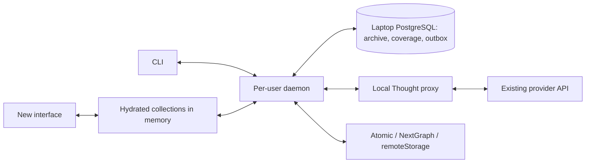

# Syncables CLI, local archive and migration design

This document records the product direction and architecture discussed with
Michiel: put a new interface over an existing platform, keep a useful local
copy through Syncables, and eventually make that copy authoritative where a
deliberate migration supports it. The first dogfooding target is GitHub issue
collections read through Local Thought.

This is a design and implementation map, not a claim that the complete daemon
or platform retirement exists. The implementation tickets are
[#565](https://github.com/ontola/atomic-plugins/issues/565) (device authentication)
and [#566](https://github.com/ontola/atomic-plugins/issues/566) (CLI and daemon).

## What exists and what is planned

Status checked against repository source on 2026-10-16:

| Area | Status and reference |
| --- | --- |
| API collection reads, local records and write queue | Existing Syncables library; see the [local-first guide](local-first.md). |
| Device-authentication backend | Merged in integration-proxy 0.4.0; [contract and operator guide](../../integration-proxy/DEVICE_AUTH.md). Production approval wiring and a successful live CLI/GitHub read remain separate checks. |
| CLI device test and replication definitions | In draft [PR #567](https://github.com/ontola/atomic-plugins/pull/567), with a [source-install/test guide](https://github.com/ontola/atomic-plugins/blob/codex/syncables-cli-auth-scaffold/syncables/docs/cli.md). Definitions are configuration only. |
| Local PostgreSQL archive, read cache and recorded-run replay | Implemented in draft #567; [cache/replay guide](https://github.com/ontola/atomic-plugins/blob/codex/syncables-cli-auth-scaffold/syncables/docs/postgres-cache.md). Not yet merged or released as part of this design document. |
| Compact collection coverage and disposable hydration | Planned for the daemon. Existing `ReadCoverage` is narrower than this design. |
| PostgreSQL outgoing outbox, persistent CLI credentials and launchd service | Planned for the daemon. Existing library outbox persistence is caller-supplied. |
| Atomic, NextGraph and remoteStorage runtime replication | Planned; configuring a destination does not establish replication. |
| Retire the source and promote the local copy | Product direction; requires a separate migration plan and implementation. |

Historical mock tests and source/CI evidence do not establish the current
localthought.io deployment state. Check live discovery and complete an approved
provider read before describing live device access as working.

## Deployment and package boundaries

Use TypeScript/Node to reuse the existing Syncables implementation. Keep the
CLI inside `syncables/` and the existing npm package, with an executable `bin`
entry and additive Node-only adapters where needed. Preserve the root and
`syncables/browser` library APIs. Importing the library must not open a
database, read credentials, install a service or start a daemon. The CLI branch
supports Node 22.11 and newer, with CI on Node 22, 24 and 26.

The laptop owns a **separate local PostgreSQL database** containing archived
responses, collection metadata and outgoing intent. The integration-proxy
keeps provider credentials and forwards authorized requests; the request and
response archive does not move into that service. Redis is not required for
the initial design: PostgreSQL provides durable transactions, indexing and
concurrent claims in one place. Start with logical owner separation and
composite indexes; introduce physical partitions only when measurements call
for them.

This diagram is the target architecture. In the current scaffold, a foreground
CLI command performs the test directly; there is no installed daemon or IPC
service yet.

## Device login and the browser approval page

Device flow fits a CLI because the CLI needs outbound HTTPS and no localhost
callback listener. Authorizing the CLI to Local Thought is separate from
authorizing Local Thought to GitHub. Provider credentials stay at the proxy.

The published pilot client ID is `syncables-cli`, with scopes
`connections:read proxy:read`. The operator must register the client using
`DEVICE_CLIENTS` and configure `DEVICE_APPROVAL_URL`. The Heroku app discussed
for this deployment is `integration-proxy`; configuring it is an operational
step, not evidence that the browser flow is complete.

The term **owner hub** in the device-auth contract means a trusted browser
application that can authenticate the existing Atomic owner and sign approval
requests with that owner's identity. It is not a separate account the CLI
creates. The proxy's `/device` page links to this application; that page alone
does not authenticate the owner.

The intended flow is:

1. The CLI discovers the authorization server and requests a device code.
2. The user opens the displayed URL and enters the user code.
3. A trusted browser application authenticates the existing owner, displays
   the client/scopes and lets the user select specific provider connections.
4. That application signs the approval requests. The CLI polls for a token,
   then discovers and reads only the approved connections.

localthought.io is a possible host for the approval UI, for example at
`/device-approval`. That path was a proposal, not an implemented page or a
usable configuration value. The source supplies an approval UI module and a
local owner bridge for dogfooding; production still needs a real owner-signer
integration. See the [concrete browser integration](../../integration-proxy/DEVICE_AUTH.md#concrete-browser-owner-integration).

The scaffold keeps tokens in memory for one command. The daemon should use
macOS Keychain for persistent credentials, serialize refreshes according to
the server's rotation/reuse contract, and report expired authorization through
status. It should not open approval prompts unattended. Bind local data to the
verified canonical owner and provider connection, with an explicit grant or
authorization-context generation for cache reuse.

## Compressed archive, cache and replay

Inject the archive through Syncables' transport/fetch boundary. Preserve the
response text before JSON parsing or mapping. Separate three behaviors:

| Mode | Meaning |
| --- | --- |
| Live/revalidation | Make an upstream read and archive its outcome. |
| Cache | Reuse a response only under an explicit freshness policy and matching authorization/representation scope. |
| Replay | Serve the exact requests of a recorded run locally; fail visibly on a missing or mismatched request and never dispatch writes. |

Use owner-scoped immutable payloads with a content hash, codec version,
uncompressed length and compressed bytes. Zstandard is a good starting codec
for JSON/text; retain tiny or incompressible bodies without compression.
Validate checksums and bound decompression/memory use.

Keep request attempts distinct from payloads. Index owner, provider connection,
authorization context, method, complete URL/query, relevant representation
headers and any supported request-body hash. A URL alone is not a sufficient
cache identity. Store run/sequence, trigger, status, headers, observation time
and outcome; distinguish upstream attempts from cache hits. Omit credentials
from archived metadata.

Allocate an attempt before dispatch and commit the response before applying
its observations in memory. Transactions, uniqueness and expiring claims
support parallel callers. Fence late workers so an old fetch cannot replace
a newer cache head. Failed or interrupted attempts remain distinguishable
from completed responses.

The #567 stage accepts bodyless GET reads. Future declared POST reads need an
explicit read classification and body identity; ordinary writes never become
cache hits. Write-precondition/conflict reads must be fresh. Preserve the
relationship between a conditional 304 and the exact matching stored body.
Extend request-purpose/provenance metadata and upstream pacing accounting
without changing existing transport behavior for other callers.

Offline replay must not start a restored mutation outbox. Keep payloads alive
while referenced by coverage, pinned runs or unresolved operations; retention
and garbage collection require that reference policy before deleting data.

## Explicit collections and compact coverage

Keep hydrated records entirely in memory when desired. Persist enough
information to rebuild them from archived API responses plus outgoing intent.
This avoids persisting a second full copy of every hydrated record.

A versioned collection definition must say exactly what it contains and how it
orders items: source/connection, parent bindings, filters, comparator, stable
tie-breakers, null/collation/time-zone rules where relevant, and API-description,
schema and mapping versions. Identify predicates and ordering executed by the
provider versus those applied locally. Different definitions cannot silently
share the same completeness assertion.

The durable membership index can use **coverage segments**, without requiring
one row per item. Each segment records its collection/query/authorization
scope, observation/run, ordered interval and inclusive/exclusive bounds,
completeness guarantee, response reference, item-array JSON pointer, count and
observation time. Hydration extracts records in that segment's active interval
and then applies the declared projection/filter/order. A bounded decoded-page
cache can avoid repeated decompression.

For example, a provider may guarantee that a response completely covers IDs
`[101, 150]` under a particular query. Persist one segment pointing to that
response, even if IDs are sparse. Merely observing a minimum of 101 and a
maximum of 150 does not establish that guarantee. An empty response proves an
empty interval only when the request/provider contract bounds it explicitly.

Use the ordering the provider actually guarantees: a compound key such as
`(updatedAt, id)` may be needed, and arbitrary IDs need not define useful
ranges. An offset page or mutable sort field does not automatically prove
stable range coverage. Separate bounded completeness at observation time from
an atomic snapshot of an entire multi-page scan.

Publish segments atomically. A newer observation supersedes only the interval
and query scope it proves; preserve older observations for uncovered ranges.
Keep mixed observation times visible. Failed/partial pages, overlaps, empty
ranges and filter-membership changes need explicit treatment. Absence from a
filtered collection is not by itself evidence that the underlying record was
deleted. Reuse source coverage across derived collections only where their
definitions and provider guarantees justify it.

## Durable outgoing intent

Persist local edits to PostgreSQL **before acknowledging them**. Rebuild a
hydrated view by overlaying pending/local intent on archived observations.
Each operation needs a stable ID, owner/connection/destination, intended
fields/body format, conflict baseline or preconditions, ordering/dependencies,
idempotency information, retry time, claim and confirmed/rejected/uncertain
outcome. Keep confirmed local-only state reconstructible when an entry settles.

The current library supports a serialized outbox through caller-supplied
storage. A PostgreSQL-backed version can be a bounded first step with one
writer. Multiple workers cannot safely update the same serialized value;
parallel delivery needs per-operation claims and explicit record/dependency
ordering. A stale claim must not overwrite a newer outcome.

An interrupted non-idempotent request may already have changed the provider.
Reconcile an uncertain result before retrying. A database transaction cannot
make an external API mutation exactly once. Record provider responses and
outcomes durably, and test interruption both before dispatch and after a
provider success whose acknowledgement was lost.

## Daemon lifecycle and replication destinations

Run one unprivileged daemon per user, in the foreground under a macOS launchd
LaunchAgent. Use a permission-restricted local socket for CLI commands, bounded
parallel work, graceful shutdown, sleep/wake recovery, backoff and bounded logs.
Service installation is explicit; npm import/install must not install
PostgreSQL or start background work. Inspect the existing pilot
`io.atomic.syncables-daemon` before installing a competing worker.

Keep Local Thought **provider connections** separate from named **replication
destinations**. The scaffold implements `replication add` and `replication list`
with collection scope and non-secret settings. Future lifecycle commands should
inspect, enable/disable and remove destinations, with real observed status.

| Backend | Runtime work beyond saving a destination |
| --- | --- |
| Atomic native sync | Compatible SDK/engine, identities and permissions, signed commits, Loro/version-vector state, subscriptions and reconnect recovery. HTTP imports alone do not establish native replication. |
| NextGraph native sync | Its SDK or wallet/verifier sidecar, encrypted commit synchronization, document permissions and durable native protocol state. Snapshot exchange alone is insufficient. |
| remoteStorage | WebFinger discovery from a user address, scoped module authorization, ETag-aware document/listing sync and conflict handling. This is document storage synchronization. |

Native SDKs may need durable protocol storage in addition to PostgreSQL.
Keep that state distinct from disposable hydrated API views and the provider
mutation outbox. Preserve stable identity/provenance across representations
and prevent replication echoes from repeatedly creating provider writes.

## From a new interface to an authoritative copy

The product can start by improving the UI while the original provider remains
authoritative. Retirement is a separate cutover: verify data and relationship
coverage, preserve identities and required history, supply replacement
permissions/business rules, and migrate consumers as well as data.

Before promotion, stop or fence competing writes, reconcile pending/uncertain
operations, establish the final accepted source state and choose the authority
for each collection. Define routing, conflict behavior and a rollback window.
An API cache or replication connection by itself does not supply these rules.
Some provider behaviors cannot be reproduced from the exposed API alone.

## Delivery sequence and validation

1. Preserve package compatibility; test mock login and a read-only API probe.
2. Add the local archive/cache and deterministic recorded-run replay.
3. Prove live device approval and a selected GitHub read independently of the
   mock; wire the trusted browser approval page before calling this complete.
4. Add versioned definitions, coverage publication and bounded hydration.
5. Persist outgoing intent and prove conflict/uncertainty recovery.
6. Add persistent authentication and launchd lifecycle; implement replication
   backends separately, then plan any source-retirement pilot.

Use real PostgreSQL tests for isolation, concurrency, stale claims, transaction
failure and restart recovery; compare paginated replay without upstream access.
Coverage tests should include sparse/compound keys, empty/overlapping ranges,
partial scans, changing membership and mixed times. Discard and rebuild hydrated
views to verify durability. Measure memory and compression on representative
invented data, and validate service lifecycle/sleep recovery on macOS. Keep
live provider evidence separate from fixture and mock results.
