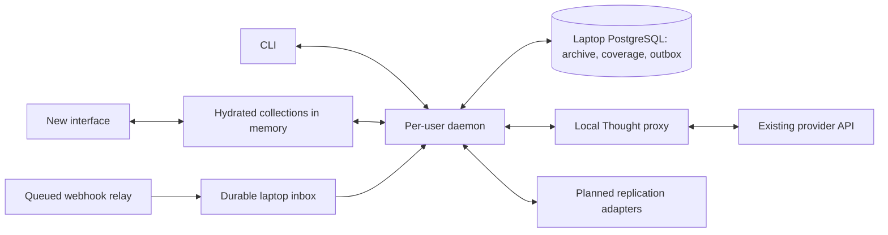
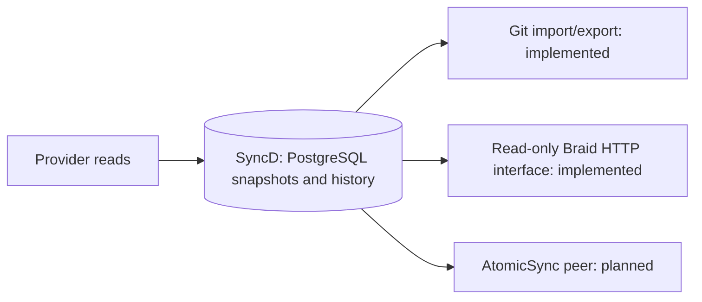

# Syncables CLI, local archive and migration design

**SyncD** is Michiel's shorthand for the standalone **Syncables Daemon**.
It names the daemon product within Syncables; the npm package, library imports
and executable remain `syncables`, including `syncables daemon`.

**2026-10-24 interface direction:** Expose **Git, Braid and AtomicSync** over
SyncD's shared PostgreSQL-backed data/history. Git import/export and
[read-only Braid serving](braid.md) are implemented; AtomicSync serving is
separate work. See the
[interface plan below](#syncd-interfaces-git-braid-and-atomicsync).

**2026-10-23 storage update:** PostgreSQL is now the canonical collection
snapshot/history store; Git is an explicit legacy import and subtree export.
See [the fetch-to-storage pipeline](daemon.md#from-a-fetch-to-stored-data) for
the implemented behavior and [the Atomic mirror milestone below](#one-way-atomic-drive-mirror-next-milestone)
for the proposed next step. Older Git/scaffold status sections remain historical
context; Atomic destination commands still configure only, without runtime sync.

This document records the product direction and architecture discussed with
Michiel: put a new interface over an existing platform, keep a useful local
copy through Syncables, and eventually make that copy authoritative where a
deliberate migration supports it. The first dogfooding target is GitHub issue
collections read through Local Thought.

This is a design and implementation map, not a claim that the complete daemon
or platform retirement exists. The implementation tickets are
[#565](https://github.com/ontola/atomic-plugins/issues/565) (device authentication)
and [#566](https://github.com/ontola/atomic-plugins/issues/566) (CLI and daemon).

## What exists and what is planned

Status checked against this implementation branch on 2026-10-20; see the
[runnable daemon guide](daemon.md) for commands and current limits:

| Area | Status and reference |
| --- | --- |
| API collection reads, local records and write queue | Existing Syncables library; see the [local-first guide](local-first.md). |
| Device-authentication backend and live read-only pilot | Merged in integration-proxy 0.4.0; [contract and operator guide](../../integration-proxy/DEVICE_AUTH.md). The laptop worker reports successful browser approval, bearer connection discovery, a proxied GitHub GET and session revocation on 2026-10-16; see the evidence below. Production owner-hub integration and live refresh testing remain follow-ups. |
| CLI device test and replication definitions | In draft [PR #567](https://github.com/ontola/atomic-plugins/pull/567), with a [source-install/test guide](https://github.com/ontola/atomic-plugins/blob/codex/syncables-cli-auth-scaffold/syncables/docs/cli.md). Definitions are configuration only. |
| Local PostgreSQL archive, read cache and recorded-run replay | Implemented in draft #567; [cache/replay guide](https://github.com/ontola/atomic-plugins/blob/codex/syncables-cli-auth-scaffold/syncables/docs/postgres-cache.md). Not yet merged or released as part of this design document. |
| Content-addressed nested JSON nodes and observed revision history | Implemented in this branch: lossless nested-hash PostgreSQL nodes and Git snapshot/item history. |
| Compact collection coverage and disposable hydration | Planned for the daemon. Existing `ReadCoverage` is narrower than this design. |
| Selected one-shot incremental fetch, webhook/poll scheduler and offline browser | Implemented in this branch: configured GET full reconciliation, a standalone query-token incremental subset, durable relay hints, polling and commit-pinned local browsing. The library reader still refuses `incrementalSync`. |
| Credentials and service lifecycle | macOS Keychain adapter and serialized refresh implemented in this branch; live laptop validation remains. Foreground daemon only; launchd/IPC deferred. |
| PostgreSQL outgoing outbox | Implemented experimental explicit CLI creates, replacements and deletes, default off. Local intent, dispatch state and receipts persist separately from accepted snapshots; see [commands and recovery](daemon-writes.md). File, Braid and AtomicSync edit ingestion remain future work. |
| Atomic, NextGraph, remoteStorage, Jazz and atproto runtime replication | Planned; only the first three have scaffold configuration commands. Configuring a destination does not establish replication. |
| Retire the source and promote the local copy | Product direction; requires a separate migration plan and implementation. |

Live evidence below is attributed to **API keys (local)** on 2026-10-16. It
establishes that tested device-flow contract and read, not continuous deployment
health, every provider permission or a persistent daemon session. Mock tests
and source/CI evidence remain separate from this live result.

## Versioned Atomic Data update (2026-10-20)

Michiel requested experimenting with all resources and schemas in Git, with
commit/tag references. Adopt commit-pinned resource and schema resolution by
default, as specified in [Versioned Atomic Data](../../docs/design/versioned-atomic-data.md).
PostgreSQL retains response logs, scheduling/inbox state and outgoing intent;
Git versions the daemon's projected Atomic data copy. The data-copy portions
of the earlier PostgreSQL revision/index proposal below are superseded by
that experiment. Neither Git history nor a JSON-AD file establishes native
Atomic synchronization or complete schema validation.

The remaining sections retain the broader architecture/roadmap. For shipped
branch behavior, the status table and runnable guide take precedence over
earlier command sketches and proposed persistence details below.

## Deployment and package boundaries

Use TypeScript/Node to reuse the existing Syncables implementation. Keep the
CLI inside `syncables/` and the existing npm package, with an executable `bin`
entry and additive Node-only adapters where needed. Preserve the root and
`syncables/browser` library APIs. Importing the library must not open a
database, read credentials, install a service or start a daemon. The CLI branch
supports Node 22.11 and newer, with CI on Node 22, 24 and 26.

The laptop owns a **separate local PostgreSQL database** containing archived
responses, collection metadata and outgoing intent. The integration-proxy
keeps provider credentials and forwards authorized requests; the request and
response archive does not move into that service. Redis is not required for
the initial design: PostgreSQL provides durable transactions, indexing and
concurrent claims in one place. Start with logical owner separation and
composite indexes; introduce physical partitions only when measurements call
for them.

Continue #567's PostgreSQL archive and executable inside the same package.
Nested content addressing adds tables and indexes to that storage. All
commands and schemas below that are not in #567's guides describe proposed
behavior, not commands available in its scaffold.



This diagram is the target architecture. In the current scaffold, a foreground
CLI command performs the test directly; there is no installed daemon or IPC
service yet.

## Device login and the browser approval page

Device flow fits a CLI because the CLI needs outbound HTTPS and no localhost
callback listener. Authorizing the CLI to Local Thought is separate from
authorizing Local Thought to GitHub. Provider credentials stay at the proxy.

The published pilot client ID is `syncables-cli`, with scopes
`connections:read proxy:read`. The operator must register the client using
`DEVICE_CLIENTS` and configure `DEVICE_APPROVAL_URL`. The Heroku app discussed
for this deployment is `integration-proxy`; configuring it is an operational
step, not evidence that the browser flow is complete.

Current service branding is **atomic.place**; the service URL and device-flow
issuer remain `https://localthought.io`. Do not change the issuer/audience or
signed URLs merely to match the brand name. Historical Local Thought wording
in source and contract links still refers to this service.

The term **owner hub** in the device-auth contract means a trusted browser
application that can authenticate the existing Atomic owner and sign approval
requests with that owner's identity. It is not a separate account the CLI
creates. The proxy's `/device` page links to this application; that page alone
does not authenticate the owner.

The intended flow is:

1. The CLI discovers the authorization server and requests a device code.
2. The user opens the displayed URL and enters the user code.
3. A trusted browser application authenticates the existing owner, displays
   the client/scopes and lets the user select specific provider connections.
4. That application signs the approval requests. The CLI polls for a token,
   then discovers and reads only the approved connections.

localthought.io is a possible host for the approval UI, for example at
`/device-approval`. That path was a proposal, not an implemented page or a
usable configuration value. The source supplies an approval UI module and a
local owner bridge for dogfooding; production still needs a real owner-signer
integration. See the [concrete browser integration](../../integration-proxy/DEVICE_AUTH.md#concrete-browser-owner-integration).

The scaffold keeps tokens in memory for one command. The daemon should use
macOS Keychain for persistent credentials, serialize refreshes according to
the server's rotation/reuse contract, and report expired authorization through
status. It should not open approval prompts unattended. Bind local data to the
verified canonical owner and provider connection, with an explicit grant or
authorization-context generation for cache reuse.

### Reported live verification, 2026-10-16

Michiel requested incorporating the handoff from **API keys (local)**, chat
`01a11a49-4322-7813-aa0d-2f70ada2be33`. Source was verified there at
[`integration-proxy-v0.4.0`, commit `eec7f752`](https://github.com/ontola/atomic-plugins/blob/eec7f7529a61239ad6adb4e5c285d2e3cc1275e9/integration-proxy/DEVICE_AUTH.md).
These results were produced on the laptop, not rerun from this cloud worker:

| Check | Reported result |
| --- | --- |
| Deployment configuration | Heroku release v97 on 2026-10-15 set only `DEVICE_APPROVAL_URL=http://127.0.0.1:11873`; the registered `syncables-cli` and unrelated configuration were preserved. Health and OAuth discovery returned 200; discovery advertised the device grant and public-client authentication `none`. |
| Existing owner and provider connection | Atomic-signed `GET /connections` returned 200 with one `github-issues` connection. |
| Browser authorization | The real public client requested a device grant, the browser followed `/device` to the local bridge, and Michiel explicitly approved that grant after reviewing the client/scopes and selecting the existing connection. |
| Bearer session | Grant redemption and bearer `GET /connections` succeeded, exposing exactly the approved connection for `connections:read proxy:read`. |
| Authenticated GitHub read | Proxied `GET /repos/ontola/usertest-findings/issues?per_page=1&state=all` returned 200. Its body was not printed. |
| Revocation | The CLI revoked its session; subsequent `GET /connections` using that access token returned 401. The test client exited 0. |
| Local bridge restrictions | Bridge page/module returned 200; an unauthorized `POST /sign` returned 403. |

The reusable components already live under `integration-proxy/`:
[owner bridge](../../integration-proxy/examples/device-login/owner-bridge.mjs),
[browser UI](../../integration-proxy/static/device-approval.mjs),
[outbound example client](../../integration-proxy/examples/device-login/login.mjs)
and the [device guide](../../integration-proxy/DEVICE_AUTH.md). Do not create a
second approval protocol in Syncables. This live handoff establishes the
protocol/example-client pilot; it does not identify a particular packed #567
executable as the client under test.

The upstream bridge expects `ATOMIC_OWNER_SEED`. The local adaptation instead
imports the laptop's atomic-drive `atomic.mjs`, calls `openAtomic()` and
`store.getAgent()`, and uses `agent.getPublicKey()` / `agent.sign(message)`.
The bootstrap obtains the existing personal identity from macOS Keychain
internally; no seed was exported, printed or written to a file, and no
replacement owner was created. It retains Atomic v2 message signing and the
Host/Origin/CSRF checks, restricted to `POST /device/challenge` and
`POST /device/approve`. The adaptation and its source manifest remain local,
not committed upstream.

Evidence retained on the owner's laptop is named
`device-login-test-2026-10-16.json`, `device-login-approved.png` and
`integration-proxy-startup-fix-2026-10-15.json`. These are private local evidence
references, not files available to this cloud executor or committed fixtures.
Device codes and access/refresh tokens stayed in process memory. The manually
started bridge was alive at test completion; this does not establish its
present availability or install a launchd service. A companion local Atomic
replica was started through its existing launcher for setup inspection.

The CLI needs outbound HTTPS and its device tokens, never the owner's private
key. Mac loopback, Keychain and the local adapter are not reachable from this
cloud executor. Production owner-hub integration, durable bridge lifecycle and
live refresh rotation remain separate follow-ups; the successful test did not
exercise refresh. This evidence records a completed grant/read/revocation,
not a request for another approval, wider access or implementation.

## Compressed archive, cache and replay

Inject the archive through Syncables' transport/fetch boundary. Preserve the
response text before JSON parsing or mapping. Separate three behaviors:

| Mode | Meaning |
| --- | --- |
| Live/revalidation | Make an upstream read and archive its outcome. |
| Cache | Reuse a response only under an explicit freshness policy and matching authorization/representation scope. |
| Replay | Serve the exact requests of a recorded run locally; fail visibly on a missing or mismatched request and never dispatch writes. |

Use owner-scoped immutable payloads with a content hash, codec version,
uncompressed length and compressed bytes. Zstandard is a good starting codec
for JSON/text; retain tiny or incompressible bodies without compression.
Validate checksums and bound decompression/memory use.

Keep request attempts distinct from payloads. Index owner, provider connection,
authorization context, method, complete URL/query, relevant representation
headers and any supported request-body hash. A URL alone is not a sufficient
cache identity. Store run/sequence, trigger, status, headers, observation time
and outcome; distinguish upstream attempts from cache hits. Omit credentials
from archived metadata.

Allocate an attempt before dispatch and commit the response before applying
its observations in memory. Transactions, uniqueness and expiring claims
support parallel callers. Fence late workers so an old fetch cannot replace
a newer cache head. Failed or interrupted attempts remain distinguishable
from completed responses.

The #567 stage accepts bodyless GET reads. Future declared POST reads need an
explicit read classification and body identity; ordinary writes never become
cache hits. Write-precondition/conflict reads must be fresh. Preserve the
relationship between a conditional 304 and the exact matching stored body.
Extend request-purpose/provenance metadata and upstream pacing accounting
without changing existing transport behavior for other callers.

Offline replay must not start a restored mutation outbox. Keep payloads alive
while referenced by coverage, pinned runs or unresolved operations; retention
and garbage collection require that reference policy before deleting data.

## Content-addressed nested JSON and revisions

Extend the owner-scoped response archive rather than replacing it. Preserve
the transport's original response text for exact replay; derive a separate
immutable JSON graph for structural sharing, inspection and history. A raw
payload hash and a normalized node hash are different identities. Whitespace
or object-member order can change the former without changing the latter.

Every object and array, including those nested inside arrays, has its own
hash-table entry. Parent nodes contain typed references to child nodes and
inline typed scalars. A candidate version-1 encoding is a compact UTF-8 JSON
tuple with a fixed domain/version prefix, a node kind, and ordered entries:

```json
["syncables-json-node",1,"object",[["id",["string","123"]],["profile",["ref","sha256:<digest>"]]]]
```

The implementation must freeze byte-level encoding and publish test vectors
before recording persistent node hashes:

- Hash canonical node bytes with SHA-256 and identify the encoding version.
  Sort decoded object keys by UTF-16 code units, preserve array order and
  length, and specify deterministic string escaping without Unicode
  normalization. Typed tuples distinguish null, booleans, strings, numbers and
  child references; provider fields named `$ref` are ordinary object members.
- Parse numbers losslessly, retaining the JSON number token as a string in a
  numeric tuple. Version 1 may distinguish `1`, `1.0` and `1e0`; it must never
  round an integer or silently merge distinct numeric values. Decoding must
  reconstruct JSON text without passing numeric tokens through JS `Number`.
- Permit scalar response roots through a typed scalar root node. Define empty
  objects/arrays, negative zero, escapes and lone surrogates explicitly. Reject
  duplicate object keys for graph indexing rather than arbitrarily choosing a
  value. A malformed, duplicate-key or otherwise unsupported JSON response
  remains archived as raw text, with an explicit indexing error.
- Key node storage by `(owner, encoding_version, hash)`. Equal content may
  share nodes across that owner's accounts/collections, but hashes do not
  authorize access or cross owner boundaries. Verify digest and decoding
  bounds when loading nodes; cap graph depth, node count and expanded size.
  Hash and compression codecs have independent versions.

Keep three concepts distinct: remote item identity, content hash and local
revision identity. Remote identity includes verified owner, provider connection,
resource and the identity's required parent bindings. A collection alias or
array position is not a remote item ID; several collections can contain the
same item. Anonymous nested objects have content identity only unless provider
metadata gives them a stable identity. Matching them across edits must not be
guessed from their position.

An observed item revision links that remote identity to a root hash, the
preceding accepted revision, local sequence, observation time and response/run
provenance. Provider version/time is additional evidence when available, not
the local sequence. A change A → B → A creates three revision occurrences but
only two content graphs. An unchanged observation adds provenance/freshness
without inventing another content change. Failed, stale or replayed reads must
not advance live revision heads. A repeated cached response is not a new
provider observation. Changes in filters or mapping versions are also distinct
from changes in the raw remote object.

History is locally observed history, not a promise to reconstruct every remote
edit between polls. A complete list can establish removal from its membership
scope; confirmed deletion, unavailable and unknown are separate observations.
Keep the last content revision available after membership removal or deletion.
Never infer a global deletion from absence in a filtered or partial response.

Do not turn this into a mandatory durable row per hydrated item. Coverage
continues to point to whole immutable responses and item-array locations. A
compact response manifest or chunked per-page index can map remote identities
and item root hashes; its content is derived from the response graph. Compare
successive manifests to append history for actual changed identities. An
optional item lookup/head index can accelerate browsing and be rebuilt from
those manifests and revision observations. Metadata per observed change is
acceptable; copying a full hydrated record per scan is unnecessary. Measure
the node/manifest overhead as well as any deduplication benefit.

Publish validated nodes, graph manifests, accepted revision observations and
coverage/checkpoint changes transactionally. Raw response archival may commit
first; a crash before indexing then leaves a resumable unindexed response,
not an advanced sync checkpoint. Retain the existing #567 payload, attempt and
304/effective-body references. Add versioned migrations and idempotent graph
backfill; mixed old/raw-only and indexed responses must remain replayable.

GC roots include retained raw responses/manifests, live coverage, retained
revision history, replay pins, unresolved outbox baselines, pending inbox work
and destination backfills. Mark reachable descendants within each owner before
sweeping. Publication and GC need a shared generation/transaction fence so a
concurrent publisher cannot attach a node after it was swept. Raw-body and
history retention are separate explicit policies; pruning old raw text can
forfeit exact replay and must not be silent. Never delete the only evidence
needed by a pending operation or retained revision.

## Explicit collections and compact coverage

Keep hydrated records entirely in memory when desired. Persist enough
information to rebuild them from archived API responses plus outgoing intent.
This avoids persisting a second full copy of every hydrated record.

A versioned collection definition must say exactly what it contains and how it
orders items: source/connection, parent bindings, filters, comparator, stable
tie-breakers, null/collation/time-zone rules where relevant, and API-description,
schema and mapping versions. Identify predicates and ordering executed by the
provider versus those applied locally. Different definitions cannot silently
share the same completeness assertion.

The durable membership index can use **coverage segments**, without requiring
one row per item. Each segment records its collection/query/authorization
scope, observation/run, ordered interval and inclusive/exclusive bounds,
completeness guarantee, response reference, item-array JSON pointer, count and
observation time. Hydration extracts records in that segment's active interval
and then applies the declared projection/filter/order. A bounded decoded-page
cache can avoid repeated decompression.

For example, a provider may guarantee that a response completely covers IDs
`[101, 150]` under a particular query. Persist one segment pointing to that
response, even if IDs are sparse. Merely observing a minimum of 101 and a
maximum of 150 does not establish that guarantee. An empty response proves an
empty interval only when the request/provider contract bounds it explicitly.

Use the ordering the provider actually guarantees: a compound key such as
`(updatedAt, id)` may be needed, and arbitrary IDs need not define useful
ranges. An offset page or mutable sort field does not automatically prove
stable range coverage. Separate bounded completeness at observation time from
an atomic snapshot of an entire multi-page scan.

Publish segments atomically. A newer observation supersedes only the interval
and query scope it proves; preserve older observations for uncovered ranges.
Keep mixed observation times visible. Failed/partial pages, overlaps, empty
ranges and filter-membership changes need explicit treatment. Absence from a
filtered collection is not by itself evidence that the underlying record was
deleted. Reuse source coverage across derived collections only where their
definitions and provider guarantees justify it.

## Configuration and one-shot incremental fetching

Persist desired collection selection separately from mutable checkpoints.
Definitions resolve the platform/catalog revision, verified account/provider
connection, resource/collection, parent bindings, remote query/body filters,
local derived filters/order, sync policy and optional poll interval. Use
aliases for convenient selection, not as the sole cache or checkpoint key.
Disabling a collection stops scheduled reads but retains its archive/history.

The proposed `syncables sync` command performs one run of all enabled
collections; explicit selectors run only those configured scopes:

```sh
syncables sync
syncables sync --collection example/personal/projects \
  --collection example/personal/tasks
syncables daemon
```

The foreground `daemon` command waits for configured polls/webhooks until
stopped; launchd can run that same process later. Validate
unknown/ambiguous selectors before dispatch. Independent scopes can progress
despite a failure elsewhere, but return a failing exit status and per-scope
results. Once a daemon exists it owns the work via local IPC. Before that,
foreground runs use the same scope leases so two processes cannot race a
checkpoint. Parent collections may be read for binding discovery; report those
dependencies and do not silently enable unrelated collections.

Choose strategies from the API's composed metadata/capabilities:

| Strategy | Checkpoint and correctness requirement |
| --- | --- |
| Sync token/change feed | Bootstrap all pages, then request changes from the committed token. Follow page tokens within each round and commit the terminal next-sync token only with accepted data. A delta never prunes unchanged members. |
| Updated-since watermark | Use declared timestamp/filter/order semantics, overlap and stable tie-breakers. Compute the next watermark from provider evidence and a completed read, not the laptop clock; obtain deletion evidence separately. |
| Conditional reads | Revalidate known representations with ETag/Last-Modified and preserve the exact 304-to-body relationship. This saves transfer but is not a change-feed guarantee. |
| Full reconciliation | Walk the selected collection when no safe incremental contract exists. Report the full scan; deduplicating stored objects does not make its network fetch incremental. |

Persist checkpoints per owner/connection/auth generation, collection and parent
scope, source-query fingerprint and relevant API-description/strategy version.
Changing remote filters, credential visibility or strategy requires
revalidation/bootstrap. A local derived view can reuse source coverage only
when its source semantics are unchanged. Persistent auth must not treat a new
login as the same authorization context without verified evidence.

Keep transient page progress separate from the last committed sync token.
Stage a bounded round in PostgreSQL without holding a transaction across
network requests; atomically publish its coverage/revisions/terminal checkpoint
under the current lease fence. Resume partial paging only where the provider
guarantees it, otherwise restart from the last committed checkpoint. Errors,
partial pages or a lost lease cannot advance it. Expired tokens trigger a
declared bootstrap, keeping the last usable local state until the replacement
is complete. Scope/token recovery and deletion rules need tests alongside the
new `incrementalSync` library support; the current reader refuses that scheme.

## Offline hierarchy and revision browsing

Provide an offline command hierarchy using configured platform and account
aliases, collection scope, then either list options or an item identity:

```sh
syncables browse
syncables browse example personal projects
syncables browse example personal projects --filter 'status = "open"' \
  --order-by 'updatedAt desc,id asc' --page 2 --page-size 50
syncables browse example personal projects item-123
syncables browse example personal projects item-123 list-revision-history
syncables browse example personal projects item-123 fetch-revision rev-42
```

These are proposed commands. #567 currently has `auth-test`, `cache` and
configuration-only `replication` commands, not this browser. Positional item
IDs are opaque arguments, including quoted IDs containing `/`; nested parent
scopes must be explicit when a collection alias does not select just one.

Browse only local data; no implicit upstream fetch or restored mutation drain.
Use a documented, bounded filter grammar, typed comparisons and definition-
specific null/collation rules. Snapshot the local publication generation for
ordering/pagination, returning it for subsequent page requests, with a stable
identity tie-breaker (for example, subsequent commands pass `--snapshot ID`).
If that snapshot has expired, ask the caller to restart
paging rather than mixing generations. Uncovered ranges and mixed provider
observation times remain visible even within one local generation.

Reconstruct rows lazily through coverage/manifests with a bounded decoded cache
and optional rebuildable query indexes. Missing local coverage is unknown,
not an empty complete result; do not claim total counts or page boundaries
that cannot be established. Revision retrieval checks item/owner membership of
the revision and returns the reconstructed original JSON plus provenance and
presence state. Historical inspection is read-only, and history remains
reachable after an item leaves the current filtered collection.

## Polling, webhooks and the durable inbox

The same scheduler runs one-shot and daemon reads. Per-scope jobs record the
trigger, next due time, attempts and lease fence. Poll intervals are optional;
webhooks can be used alone, polling alone, or both. Persist retry times and
honor provider rate limits. After wake/reconnect, re-evaluate due jobs, tokens
and inbox gaps and coalesce repeated refresh hints for each scope. Retain a
new hint that arrives during an active read so it causes a later read. Scope
leases serialize publication, while bounded independent jobs can run in
parallel. Authentication failures become actionable status.

A queued relay accepts public deliveries while the laptop is asleep and
forwards them over an outbound agent connection to a loopback receiver. Keep
the relay behind an adapter; do not implement a second provider sync engine
inside it. Candidate services and their documented limitations:

- [Webhook Relay replay on reconnect](https://webhookrelay.com/docs/webhooks/replay-on-agent-connect/)
  recovers deliveries to an offline internal agent within configured lookback
  and scan limits. [Durable retries](https://webhookrelay.com/docs/webhooks/durable-webhooks/)
  cover failed delivery attempts separately; configure both for dogfooding.
- [Hookdeck](https://hookdeck.com/docs/hookdeck-basics) provides durable queues,
  retries and plan-dependent retention, with [CLI forwarding](https://hookdeck.com/docs/cli)
  to localhost. Expired queued events are not delivered.
- Webhook Relay's [HTTP polling endpoint](https://webhookrelay.com/docs/webhooks/polling-webhooks/)
  marks events delivered when fetched. It cannot by itself guarantee local
  commit-before-ack across a crash; use a delivery path that acknowledges after
  local durable acceptance, or explicitly account for the gap and reconcile.

Before a local 2xx acknowledgement, verify ingress authenticity and routing,
persist the raw event, stable provider/relay delivery identity, receipt time
and pending work transactionally. Deduplicate by scoped delivery ID, not
payload hash; two legitimate events may contain identical content. Replay
original signatures safely: timestamped signatures may expire while queued,
so use an authenticated relay with trustworthy ingress verification evidence,
or reject the delayed delivery and reconcile. Do not silently disable signature
checks. Provider verification challenges and subscription renewals also need
explicit adapter handling.

Use the existing `InboxConsumer`/`InboxJournal` contract where applicable, and
adapt external relays to the same journal-before-ack guarantee rather than
assuming their protocol matches it. Treat events as hints for authoritative
item/collection reads via `scopedReads`; a delayed webhook body cannot blindly
replace newer state. Acknowledged-but-unprocessed work survives restarts. Dead
letters and retry status are inspectable. A retention gap or uncertain replay
window requests reconciliation; recovery can restore current state but not
unobserved historical edits. A webhook-only setup still needs a recovery read
after a known gap, and should report when it cannot establish continuity.

## Durable outgoing intent

Persist local edits to PostgreSQL **before acknowledging them**. Rebuild a
hydrated view by overlaying pending/local intent on archived observations.
Each operation needs a stable ID, owner/connection/destination, intended
fields/body format, conflict baseline or preconditions, ordering/dependencies,
idempotency information, retry time, claim and confirmed/rejected/uncertain
outcome. Keep confirmed local-only state reconstructible when an entry settles.

The current library supports a serialized outbox through caller-supplied
storage. A PostgreSQL-backed version can be a bounded first step with one
writer. Multiple workers cannot safely update the same serialized value;
parallel delivery needs per-operation claims and explicit record/dependency
ordering. A stale claim must not overwrite a newer outcome.

An interrupted non-idempotent request may already have changed the provider.
Reconcile an uncertain result before retrying. A database transaction cannot
make an external API mutation exactly once. Record provider responses and
outcomes durably, and test interruption both before dispatch and after a
provider success whose acknowledgement was lost.

## SyncD interfaces: Git, Braid and AtomicSync

SyncD can expose all three as adapters over the same accepted local data and
history. PostgreSQL remains canonical; a client need not pass through Git to
use Braid or AtomicSync. Protocol-specific identities and durable projection
state belong to each adapter, with explicit mappings back to source scopes
and snapshot revisions.

| Interface | Purpose | Current source / proposed work |
| --- | --- | --- |
| Git | Inspect, branch and exchange exported repositories with ordinary Git tooling. | Legacy history import and explicit subtree export exist. A live Git server and accepting pushed edits are not implemented. |
| Braid | Read versioned HTTP resources and subscribe to accepted changes. | Implemented experimental read-only adapter: `syncables braid` serves selected PostgreSQL collections with authenticated GETs, subscriptions and bounded replay. See [commands and limits](braid.md). |
| AtomicSync | Let native Atomic clients replicate a SyncD-backed virtual drive. | Proposed Atomic-compatible sync peer; requires a maintained native Atomic/Loro projection. Destination definitions alone do not run it. |



Git import also feeds the store; the diagram shows the outward paths. These
interfaces can coexist. The [AtomicSync peer proposal](#atomic-sync-peer-as-an-alternative-source-interface)
is an alternative to the transport used by the
[one-way Atomic mirror](#one-way-atomic-drive-mirror-next-milestone), not an
alternative to offering Braid and Git. A mirror copies into another drive;
native AtomicSync replicas share the source drive's identity.

### Braid interface: read-only first milestone

The [Braid guide](braid.md) records the implemented subset and its limits.
It uses a separate loopback process, follows committed snapshot heads and
replays at most 256 revisions along single-parent history. Merges, unknown
parents or a larger gap require an explicit full-snapshot reset. The following
maps the broader design; patches and writable adapters remain future work.

[Braid-HTTP](https://github.com/braid-org/braid-spec/blob/master/draft-toomim-httpbis-braid-http-04.txt)
adds versioning, updates and subscriptions to HTTP. It does not require a Git
repository or choose a storage engine or conflict policy. The
[braid-http implementation](https://github.com/braid-org/braid-http#readme)
provides Node handlers and a browser/Node client for headers, full-body updates,
patches and subscription framing. Reuse that protocol machinery and test an
explicit supported subset; installing it alone would not implement SyncD's
resource model, authorization or restart recovery.

Start with one configured, authenticated, read-only collection:

1. Give the collection a stable HTTP resource identity, scoped by owner and
   configured source/profile. Its body contains membership, JSON-AD records
   and bundled schemas from one pinned PostgreSQL revision. Specify a lossless
   representation for raw JSON and numeric lexemes; ordinary JavaScript number
   parsing must not silently change archived values.
2. Map each published representation to a stable Braid `Version` token and
   its causal `Parents` within that resource's history. Include scope and
   projection format in the mapping; do not treat a raw JSON content hash or
   Git export commit as a universal protocol version. Identical values can
   recur in distinct revisions. A collection revision can anchor this first
   mapping; later per-record/schema resources need their own histories and
   membership/removal rules.
3. Support an ordinary GET of the accepted representation and Braid
   `Subscribe` requests for subsequent accepted revisions. Initially send
   full-body updates, with accurate versions and parents. Add patches only
   after defining their units and baseline semantics. Never stream a partial
   provider read or expose an archive attempt as an accepted revision.
4. Follow durable committed heads and their immutable revision chains. These
   are the publication log; no separate notification queue is needed. On
   reconnect, use the client's known parent to resume within the retained
   bounded history or explicitly resynchronize with a full snapshot. Recheck
   the head after the initial body to close the read/subscribe race. Bound
   buffering; process restarts and slow clients recover from applied versions.
5. Authorize each selected scope and subscription. Begin with an explicitly
   enabled loopback listener; browser access also needs deliberate origin and
   credential handling. Serving a collection does not grant access to response
   archives, other owners or other collections. Treat collection removal
   separately from provider-wide deletion, preserving the evidence distinction.
6. Verify with an unmodified Braid client on invented data: initial GET,
   subscribe, unchanged and changed values, schema changes, removal and
   reappearance, multiple clients, a concurrent publication during subscribe,
   disconnect/reconnect, process restart and denied access. Test full-snapshot
   recovery when the requested history is unavailable.

This first interface rejects client mutations. An [explicit CLI edit queue](daemon-writes.md)
now implements local provider intent and recovery. Later writable Braid and
AtomicSync adapters, or accepted Git pushes, still need edit ingestion and an
explicit merge/authority policy over that queue.
Braid's version graph does not automatically supply a CRDT or make provider
writes safe. Keep local acceptance distinct from confirmed provider delivery;
prevent changes crossing adapters from echoing into repeated provider writes.

## One-way Atomic drive mirror: next milestone

**Plan only; runtime writes to an Atomic drive are not implemented.** Start with an explicitly
configured, one-way mirror of selected PostgreSQL collections into an existing
Atomic drive. Git export is independent of this path and is never a prerequisite.

1. Configure the destination server/drive, selected collection scopes and an
   existing local owner signer. Verify destination permissions before a run.
   Keep provider access at integration-proxy and owner signing on the laptop.
2. Pin a PostgreSQL snapshot revision. Build a projection of its records,
   collection membership and bundled schema annotations. Persist a mapping from
   `(destination, source subject/schema)` to stable native Atomic identities;
   a retry or later source revision must update the same target identities.
   Existing JSON-AD is an intermediate representation, not automatically a valid
   native drive commit. Use the supported Atomic SDK/schema and commit APIs.
3. Publish required native classes/properties and record data, preserving OAD
   provenance and links to the source snapshot. Define lossless handling of raw
   JSON and numbers that a native property datatype cannot express. Keep the
   original PostgreSQL objects authoritative rather than coercing them silently.
4. Track work and acknowledgments durably per destination, collection and source
   revision. Retry idempotently after interruption. Advance the destination
   checkpoint only after every required write is acknowledged/verified. If the
   native API cannot publish the whole collection atomically, expose an
   in-progress import and publish its completion marker last.
5. Mirror collection membership changes, distinguishing absence from declared
   deletion evidence. An item disappearing from one collection must not cause
   an unconditional drive-wide resource deletion. PostgreSQL retains its history.
6. Verify on invented data first: initial mirror, unchanged rerun, changed value,
   changed schema, removal/reappearance, interruption and resume, and denied
   permissions. Then mirror one explicitly chosen live collection/drive and
   compare source and target counts, identities and values.

The first milestone has one writer for a managed target subtree. Bidirectional
provider writes, merging user edits, native historical revision replay and
propagating component forks require separate policies. Target fields should
carry source/revision provenance so later updates can identify managed state
and report conflicting local edits rather than silently overwriting them.
Existing `replication add --backend atomic` / `replication list` commands only
persist destination definitions; they do not execute this plan.

### Atomic sync peer as an alternative source interface

A second candidate, suggested by Michiel, is for SyncD to expose an
Atomic-compatible sync peer (**AtomicSync**) backed by PostgreSQL. Consumers
could subscribe to a virtual Syncables drive through the normal Atomic
protocol. This remains a proposal; no sync endpoint is implemented by the
storage migration.

The pipeline would be PostgreSQL snapshots → maintained native Atomic/Loro
projection → sync protocol → replicas. Stable resource/schema identities,
genesis and permission metadata, signed writes, version vectors, reconciliation,
subscriptions and reconnect recovery are required. Begin with read-only access
to one collection; reject incoming mutations and advertise only supported
capabilities. Search, plugins and application hosting are outside this subset.

Reuse the existing `atomic_lib` core rather than independently implementing its
wire format, signatures and permission rules. The current sync engine takes
`atomic_lib::Db`; it has no ready-made PostgreSQL adapter. A prototype can embed
a small Atomic projection store, or factor a storage interface and persist its
native state in PostgreSQL. Fetched data/history remains authoritative in
PostgreSQL. Persistent Loro documents/oplogs and projection checkpoints are
additional derived representations: creating fresh Loro documents on every
request would lose stable operation identities and incremental reconciliation.

A native replica shares the **same drive identity**. Copying these records into
a different existing drive remains an import/projection operation; native sync
alone does not change their ownership namespace. Likewise, arbitrary local
edits and bidirectional provider writes require policies beyond the read-only
source. Prototype compatibility and restart/delta behavior with an unmodified
Atomic client before choosing this interface over direct mirroring. It can
coexist with the Git and Braid interfaces described above.

Protocol references: [Atomic sync engine](https://github.com/ontola/atomic-server/blob/66880fc53f392771761bb4d967e1e443344a7e34/docs/src/sync-engine.md)
and [wire protocol](https://github.com/ontola/atomic-server/blob/66880fc53f392771761bb4d967e1e443344a7e34/docs/src/websockets.md).

## Daemon lifecycle and replication destinations

Run one unprivileged daemon per user, in the foreground under a macOS launchd
LaunchAgent. Use a permission-restricted local socket for CLI commands, bounded
parallel work, graceful shutdown, sleep/wake recovery, backoff and bounded logs.
Service installation is explicit; npm import/install must not install
PostgreSQL or start background work. Inspect the existing pilot
`io.atomic.syncables-daemon` before installing a competing worker.

Keep Local Thought **provider connections** separate from named **replication
destinations**. The scaffold implements `replication add` and `replication list`
with collection scope and non-secret settings. Future lifecycle commands should
inspect, enable/disable and remove destinations, with real observed status.

| Backend | Runtime work beyond saving a destination |
| --- | --- |
| Atomic native sync | Compatible SDK/engine, identities and permissions, signed commits, Loro/version-vector state, subscriptions and reconnect recovery. HTTP imports alone do not establish native replication. |
| NextGraph native sync | Its SDK or wallet/verifier sidecar, encrypted commit synchronization, document permissions and durable native protocol state. Snapshot exchange alone is insufficient. |
| remoteStorage | WebFinger discovery from a user address, scoped module authorization, ETag-aware document/listing sync and conflict handling. This is document storage synchronization. |
| Jazz | Delayed adapter design: explicit CoValue/schema mapping, account/group permissions, stable identities and SDK-owned durable sync state. No configuration/runtime support is claimed. |
| atproto | Delayed adapter design: records mapped to appropriate lexicons, repository identity/authentication, writes/subscriptions and durable delivery state. A copied JSON response is not native repository synchronization. |

Native SDKs may need durable protocol storage in addition to PostgreSQL.
Keep that state distinct from disposable hydrated API views and the provider
mutation outbox. Preserve stable identity/provenance across representations
and prevent replication echoes from repeatedly creating provider writes.

Each destination independently consumes a durable local publication sequence
with its own backfill position, delivery outbox and acknowledged checkpoint.
Commit destination work with source publication; a failed destination then
does not block source ingestion or lose updates. Fence workers and make replay
idempotent according to the target protocol. Retain graph/baseline roots while
a backfill or unresolved delivery needs them. Initially export accepted source
observations one way; bidirectional editing and authority changes need their
own policy. Configuration alone must not start replication or imply permission.

## From a new interface to an authoritative copy

The product can start by improving the UI while the original provider remains
authoritative. Retirement is a separate cutover: verify data and relationship
coverage, preserve identities and required history, supply replacement
permissions/business rules, and migrate consumers as well as data.

Before promotion, stop or fence competing writes, reconcile pending/uncertain
operations, establish the final accepted source state and choose the authority
for each collection. Define routing, conflict behavior and a rollback window.
An API cache or replication connection by itself does not supply these rules.
Some provider behaviors cannot be reproduced from the exposed API alone.

## Delivery sequence and validation

1. Preserve package compatibility; test mock login and a read-only API probe.
2. Add the local archive/cache and deterministic recorded-run replay.
3. Prove live device approval and a selected GitHub read independently of the
   mock. The laptop handoff reports this read-only protocol pilot complete,
   including revocation; production owner-hub wiring and live refresh remain
   separate from the manually started approval bridge.
4. Freeze/test the lossless node encoding, add transactional graph indexing
   and migrations/backfill over the existing raw archive, and prove revision
   occurrence/retention/GC rules. Keep old responses replayable.
5. Add versioned definitions, compact coverage/manifests, bounded hydration and
   offline hierarchy/history commands without a mandatory row per scanned item.
6. Add selected one-shot fetches and provider-declared incremental checkpoints,
   with expiry/bootstrap, scope-change and partial-page recovery.
7. Add persistent authentication and the shared daemon scheduler, durable
   webhook inbox and relay adapter. Prove sleep/reconnect/retry behavior, then
   add the explicit launchd lifecycle around that foreground daemon.
8. Persist outgoing intent and prove conflict/uncertainty recovery before
   acknowledging edits; read-only dogfooding does not require provider writes.
9. Implement replication backends separately; Jazz and atproto follow the
   existing three planned backends. Plan any source-retirement pilot separately.

Steps 1 and 2 have draft implementation evidence in #567. Step 3 has the
attributed laptop live evidence above; it does not establish #567 packed-client
coverage or production hub/refresh support. Steps 4 onward are planned;
they do not claim complete daemon, incremental, browsing or replication support.

Use real PostgreSQL tests for isolation, concurrency, stale claims, transaction
failure and restart recovery; compare paginated replay without upstream access.
Coverage tests should include sparse/compound keys, empty/overlapping ranges,
partial scans, changing membership and mixed times. Discard and rebuild hydrated
views to verify durability. Measure memory and compression on representative
invented data, and validate service lifecycle/sleep recovery on macOS. Keep
live provider evidence separate from fixture and mock results.

Additional acceptance cases: every nested object/array is independently
addressable; object-key order shares nodes while array reordering changes
content; large numbers, null/string/ref distinctions and duplicate keys are
handled without lossy coercion; A → B → A retains three revision occurrences;
cross-owner hash reuse cannot expose data; graph indexing can resume after a
raw-only commit; GC races cannot delete newly published/pinned nodes. Test
checkpoint failure at each publication boundary, expired tokens, changes of
query/auth scope, duplicate/out-of-order webhooks, commit-before-ack crashes
and a hint arriving during sync. Paging remains stable while the daemon
publishes, and incomplete local coverage stays visibly incomplete. Measure
node/manifests/index/WAL overhead and reconstruction cost alongside compressed
bytes, rather than assuming nested deduplication is always smaller.
