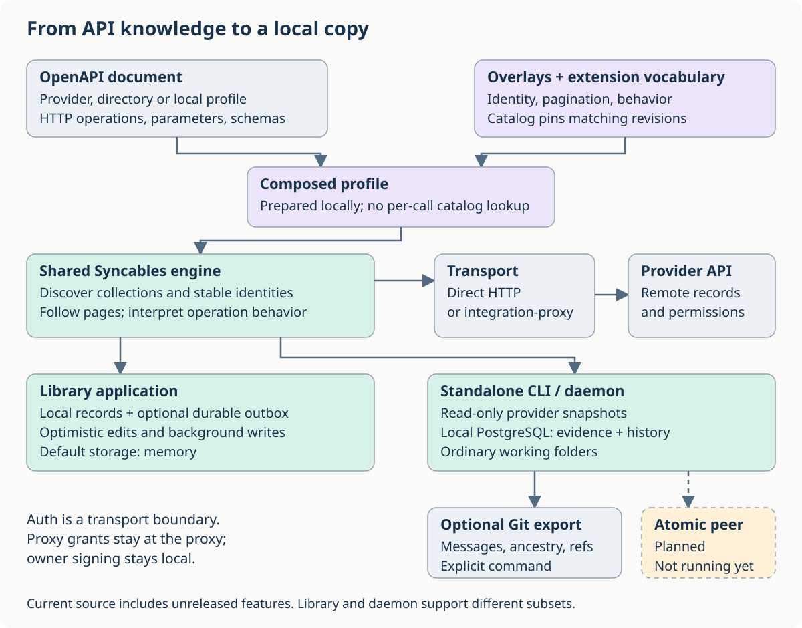
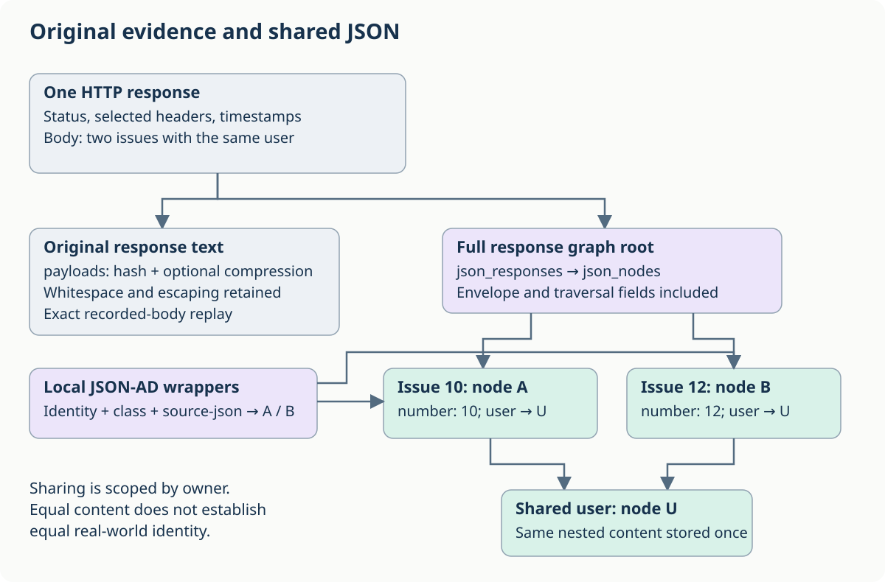
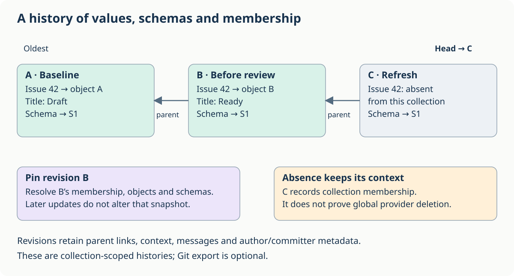
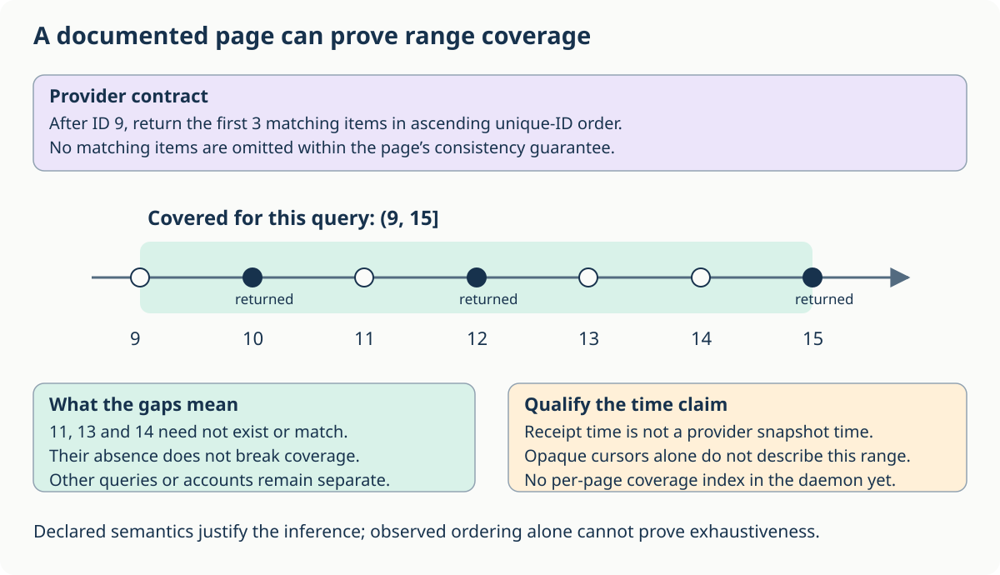

# How Syncables turns APIs into a local copy

Syncables lets an application work with a local copy of a remote API's
collections. API descriptions tell it where records live, how to join pages,
and which operations change them. Authentication and storage are separate
choices: the same library can run in a browser with local records and an
outbox, or behind a standalone command that saves read-only snapshots.
**SyncD** is Michiel's shorthand for that standalone **Syncables Daemon**;
the library and executable are still named `syncables`.

This guide explains that stack using invented GitHub issues and Keep notes.
For runnable commands, use the [local-first library guide](local-first.md) or
the [standalone daemon guide](daemon.md). These describe current source;
some features have not reached a published npm release.

## The whole path



Read the diagram from top to bottom:

1. **Describe the provider.** An OpenAPI document describes HTTP operations,
   parameters, security and response schemas. It can come from a provider,
   [our OpenAPI Directory fork](https://github.com/ontola/openapi-directory),
   or a small profile written for the operations you need.
2. **Add behavioral knowledge.** An overlay adds metadata such as collection
   identity and pagination. [Our extensions](../../openapi-extensions/README.md)
   define its vocabulary. A dated [overlay catalog](../../overlays/README.md)
   pairs particular document revisions with their matching overlays.
3. **Prepare one document.** `prepareDocument` composes supported overlay
   actions locally. A document that already contains the metadata needs no
   overlay. The directory and catalog are not consulted on every API request.
4. **Run the engine.** Syncables discovers collections, builds requests,
   follows the declared pagination and interprets the returned items.
5. **Choose a product and storage.** A library application can read and edit
   its local copy. The experimental standalone CLI/daemon currently reads
   provider data into PostgreSQL and normal working folders. It does not send
   local edits back to providers.

SyncD's [interface plan](daemon-design.md#syncd-interfaces-git-braid-and-atomicsync)
offers three ways to consume the same accepted snapshots: Git for repository
tooling, Braid for HTTP subscriptions, and AtomicSync for native Atomic
replicas. Git import/export and [read-only Braid serving](braid.md) exist in
current source; AtomicSync is planned separately. PostgreSQL remains the
canonical store for all three.

An overlay describes existing provider behavior; it does not make the provider
implement a new guarantee. Likewise, the specifications cover more than every
current reader supports. The [implementation matrix](../README.md#from-an-api-description-to-a-local-copy)
is the detailed reference for the library's supported subset.

## What the OpenAPI extensions contribute

Standard OpenAPI can say that an operation accepts a string called
`pageToken`. It does not, by itself, say which response field supplies the next
token, when enumeration ends, or how a list item gets a stable identity.

| Question | Metadata | Where it matters |
| --- | --- | --- |
| What is a record, and which collection contains it? | [CRUD Causality](../../openapi-extensions/spec/crud-causality/README.md): `components.crudResources`, identities, bindings, collection envelopes and fixed reads | Library and standalone collection discovery; `x-crud` additionally describes library writes. |
| How do I get the next page? | [Pagination Schemes](../../openapi-extensions/spec/pagination-schemes/README.md): `components.paginationSchemes`, `x-pagination` | Both readers, with different supported subsets. |
| What does this parameter select? | [Filtering](../../openapi-extensions/spec/filtering/README.md): `x-filter`, `x-collection-scope`, `x-time-zone` | Vocabulary for selection and time interpretation. Current library consumption is limited to the documented time-zone subset. |
| What can absence mean? | [Collection Completeness](../../openapi-extensions/spec/collection-completeness/README.md): `x-completeness`; [Deletion Feeds](../../openapi-extensions/spec/deletion-feeds/README.md): tombstone/feed annotations | Supported library behavior distinguishes removal from a view, unavailability and deletion. A missing item is not automatically globally deleted. |
| How should calls be paced or retried? | [Throttling](../../openapi-extensions/spec/throttling/README.md): `x-throttling` | Shared request scheduling, within its implemented subset. |
| When is a write safe? | [Write Preconditions](../../openapi-extensions/spec/write-preconditions/README.md): `x-write-precondition` | The library's declared write operations, not the read-only daemon. |
| Where do account-specific field descriptions come from? | [Runtime Schemas](../../openapi-extensions/spec/runtime-schemas/README.md): `x-runtime-schema` | Library `readCollections`; not generic validation or automatic schema migration. |
| Can this resource represent a shared ontology class? | [Produced Classes](../../openapi-extensions/spec/produced-classes/README.md): `x-produces` | Read-only metadata today; does not automatically fetch or execute a mapping lens. |
| Which events should prompt reads? | [Webhook Deliveries](../../openapi-extensions/spec/webhook-deliveries/README.md) and [Subscriptions](../../openapi-extensions/spec/webhook-subscriptions/README.md) | Receiver, inbox and consumer contracts. Registration and signature verification are separate from interpreting an event. |
| How can a user connect an account? | [Authentication profiles](../../openapi-extensions/spec/authentication-profiles/README.md), [OAuth details](../../openapi-extensions/spec/oauth-authentication-details/README.md), [API-key details](../../openapi-extensions/spec/api-key-details/README.md), [principal metadata](../../openapi-extensions/spec/authenticated-principal/README.md) | Proxy/setup consumers where implemented; not read by the Syncables core. |

Composition has its own [requirements vocabulary](../../openapi-extensions/spec/overlay-requirements/README.md).
Do not assume that every composition tool enforces every proposed constraint.
There is currently **no general sorting extension**. A standard parameter can
describe the allowed values of `sort`, while the pagination extension's
`fromLastItem` cursor can declare a checked `order` for that cursor field.
Those are narrower than a general machine-readable description of all sorting.

## Two concrete collection descriptions

The committed [GitHub profile](../examples/daemon/github-issues.json) and
[Keep profile](../examples/daemon/google-keep.json) are deliberately small,
already-composed GET-only documents. They demonstrate the metadata actually
used by these standalone snapshots, rather than every available extension.

| Detail | GitHub issues | Google Keep notes |
| --- | --- | --- |
| Request | `GET /repos/{owner}/{repo}/issues` | `GET /v1/notes` |
| Item location | The response is an array (`itemsField: null`). | The response's `notes` array; an absent array is empty (`emptyWhenAbsent: true`). |
| Stable source identity | `/repos/{owner}/{repo}/issues/{number}`, binding `number` to the item field | `/v1/{name}`, binding `name` to the item field, such as `notes/example-note` |
| Selection | Fixed `listQuery: {state: "all"}` | Configured query parameters, such as `pageSize` |
| Next page | Follow the next link in the `Link` response header. | Send response `nextPageToken` as request `pageToken`. |

For example, Keep can return:

```json
{
  "notes": [{"name": "notes/example-note", "title": "Packing list"}],
  "nextPageToken": "example-next-page"
}
```

The envelope selects the note, the binding identifies it, and the pagination
scheme supplies the next request. The token belongs to traversal metadata,
not to the note itself. GitHub's endpoint can return pull requests too: the
profile does not filter them out merely because its resource key is `issue`.

These profiles currently use full paginated reads. Neither declares a
runtime-schema source, produced-class mapping, deletion feed or the
identifier-order contract needed to derive the range claim below.

## Authentication changes the route, not the collection model

With a direct HTTP transport, the application handles provider authentication.
With [integration-proxy](../../integration-proxy/README.md), the proxy holds
the provider OAuth grant or API key and checks which operations the caller may
use. Syncables still builds the logical provider request and interprets its
response; the proxy is not the collection store or pagination engine.

For the standalone [device flow](../../integration-proxy/DEVICE_AUTH.md), the
user approves a scoped CLI session through the local owner-signing bridge.
The owner key stays local. The CLI receives session credentials rather than
the owner key or the provider's refresh token. The proxy's credential database
and the daemon's local PostgreSQL history are separate stores.

An authorization context is part of what was observed. “No matching records”
for one account or permission set does not establish absence for another.

## One response, two useful representations



The standalone archive keeps both:

* **Original response text**, hashed and compressed when useful, for exact
  recorded-body replay. This retains whitespace, escaping and numeric spelling;
  it is not a promise to retain every byte of the network exchange.
* **A structured JSON graph**, with owner-scoped content-addressed objects and
  arrays. Response roots and extracted source records can point to the same
  item and nested property nodes. Identical content within that owner is shared
  across collections and revisions.

For instance, two issues can share the same nested `user` object, while their
different issue numbers preserve two source records. Equal JSON content is not
evidence that two records identify the same real-world thing.

The graph's [v1 format](json-graph-v1.md) preserves numeric lexemes: `1`, `1.0`
and `1e0` remain distinct. Object key order and string escaping are
canonicalized; whitespace is not retained in graph nodes. Original text is
intentionally retained alongside it. Malformed JSON, duplicate keys and other
indexing refusals leave raw evidence and an indexing error, rather than a
guessed structured representation.

Each selected item gets a JSON-AD source wrapper with a stable subject, source
ID, original JSON and API-specific class. A class identifier has this shape:

```text
urn:syncables:oad:<exact-profile-hash>:class:issue
```

The daemon bundles generated Class/property resources with the records. These
describe the source wrapper and API resource kind. They are **not a complete
copy of all the OAD's field schemas**, a duck-typed schema of every response,
or a mapped Atomic ontology. Unknown response fields remain in source JSON;
full OpenAPI response validation is not performed here.

## Values, schemas, membership and messages have history



Imagine three accepted collection snapshots:

| Revision | Message | Issue 42 | Bundled schema |
| --- | --- | --- | --- |
| A | Baseline | Title “Draft” → object A | Schema S1 |
| B, parent A | Before review | Title “Ready” → object B | Same S1 |
| C, parent B | Refresh | Absent from this snapshot | Same S1 |

A snapshot revision stores its parents, context, message and author/committer
metadata. Membership maps stable subjects to immutable object roots, including
the bundled schemas. Pinning B resolves B's data and schemas even after the
head reaches C. A later reappearance can point to a previous object root or a
new one. C's absence is a collection observation, not proof of global deletion.

PostgreSQL stores those revisions, membership indexes and named refs. Git is
an optional export of a collection or item history, including messages,
ancestry, branches and tags. Normal working folders expose the accepted data
without an export. Raw HTTP history is separate and is not included in a
collection Git export.

Publication waits for the whole bounded read to succeed and advances the head
by compare-and-swap. An incomplete read retains the old head; individual HTTP
attempts may already be archived. Archive completion and snapshot publication
are separate transactions. If folder publication fails after the database
commit, `checkout` can retry it locally.

Currently these histories are collection-scoped, not independently forkable
resource histories. The process pins its configured profile bytes. Changing
those bytes changes the document hash and source scope; there is no automatic
migration that treats the new OAD/profile as an in-place schema upgrade. See
the [storage walkthrough](daemon.md#from-a-fetch-to-stored-data) and
[version resolution contract](../../docs/design/versioned-atomic-data.md).

## What a page proves: items, ranges and properties

**A documented pagination contract can establish range coverage.** Suppose it
promises: “after ID 9, return the first three matching records, in ascending
unique-ID order, without omitting matches.” Returning `10, 12, 15` then covers
**`(9, 15]` for that query and authorization context**. Numeric gaps do not
invalidate that conclusion: 11, 13 and 14 may not exist, or may not match.



The evidence has several parts:

| Part | What to retain |
| --- | --- |
| Selection | Endpoint, account/permissions, parent bindings, filters and their defaults |
| Ordering and bounds | Unique ordering field, direction, exclusive lower bound and returned upper bound |
| Exhaustiveness | The documented provider contract and any cap/truncation or incomplete marker |
| Time | Request/response observation interval; a provider snapshot token or watermark only when its documented semantics support one |
| Result | Item identities, versions and properties actually returned |

A useful way to phrase that observation is:

> Every visible item satisfying `account=savings AND status=booked AND
> 9 < id ≤ 15` in the API view used to answer this request was returned,
> under the provider's declared consistency contract.

“Known to this API server at this moment” is an informal shorthand for that
view, not a claim about everything already committed at the provider. A
replica, cache or search index may not yet include a recent change. The time
we received the answer is an observation time, not automatically the view's
effective time or a server-wide snapshot time. A single response need not
represent one coherent instant unless the provider guarantees it.

Successive requests within one pagination loop may use different snapshots,
or replicas at different stages of propagation. Independently exhaustive
pages therefore need not describe one common instant. Insertions, deletions
or changes to the filter/order field can matter between requests; sorting
alone does not give the loop snapshot isolation.

The [pagination specification](../../openapi-extensions/spec/pagination-schemes/README.md)
already distinguishes last-item cursors and checked order from opaque tokens.
A `nextLink` or opaque token alone does not describe an arbitrary identifier
interval. A documented `rangeWindow` can establish completeness inside its
requested window when the answer is below the declared cap; a full capped
answer may be truncated and must be subdivided. The general library supports
this subset; the current standalone daemon refuses `rangeWindow` reads.

The [filtering proposal](../../openapi-extensions/spec/filtering/README.md)
can connect a request parameter to an item field and predicate using
`x-filter`. It does not invent a filter from a parameter's name, or assume an
unfiltered view when optional parameters are absent. Combining these declared
contracts could support a persistent coverage index. **The standalone daemon
does not yet publish that per-page negative-coverage index**: it archives the
requests/responses and accepted collection snapshots.

[Issue #686](https://github.com/ontola/atomic-plugins/issues/686) tracks an
explicit coverage contract, including empty pages, final tails, consistency
and finality. Exhaustive observation today does not rule out tomorrow's
backdated bank posting; closure requires a separate documented guarantee.

Property presence has a similar distinction:

| Returned JSON | Direct observation | Extra contract needed for a stronger claim |
| --- | --- | --- |
| `{"id": 10, "title": "Draft"}` | `id` and `title` were returned. | Whether this endpoint returns all fields. |
| `{"id": 10, "title": null}` | `title` was explicitly null. | Whether null denotes an empty, hidden or unavailable value. |
| `{"id": 10}` | `title` was omitted. | Projection/permission/default semantics before treating omission as deletion. |

The archived graph preserves these differences. It does not yet turn them
into a separate explicit property-coverage assertion. Likewise, range coverage
for one filtered view does not establish global deletion; that depends on
the separate [completeness contract](../../openapi-extensions/spec/collection-completeness/README.md).

### Repeated observations and append-only collections

Without stronger provider guarantees, periodic rereads let us retain a series
of observations rather than a claim of continuous visibility. Identical
results mean only that we observed the same selected/projected state twice.
They do not prove that nothing changed between observations. Even “a change
must have been undone” requires fresh, complete observations of that state:
a lasting change might still be hidden by lag, and an event outside the
selection or projection might never be observable there. Without a common
snapshot, two equal pagination-loop results need not even be two coherent
endpoint states.

If a fresh authoritative state is genuinely the same at two instants, an
intervening change affecting that state must have had no net effect by the
second instant. State polling still cannot reconstruct every intervening
event. Periodic rereads can eventually discover persistent changes when the
provider converges, the records remain observable and the affected region
continues to be revisited. Event/change feeds with retention and cursor
guarantees can offer stronger history than state polling alone.

For a genuinely append-only selected set, membership cannot disappear, so
reliable comparable observations support stronger conclusions. Distinguish
these independent contracts:

| Contract | What it adds |
| --- | --- |
| Append-only membership | An observed member remains in the selected set. This does not imply that all its properties are immutable. |
| Immutable records and stable selection/auth scope | The selected/projected state grows without updates, removal or permission-driven hiding. |
| Ordered visibility or a closed-prefix watermark | Once a key prefix is closed, no previously unseen member can later appear inside it. Only then can a cursor safely retire that prefix permanently. |

For fresh, complete, comparable observations of a fixed append-only view,
equal membership at two instants rules out additions to that view between
them: an addition could not have disappeared again. Stale or mixed-snapshot
observations do not establish those premises.

An auto-increment identifier alone establishes none of those lifecycle or
visibility guarantees. For example, transaction A allocates ID 10 but has
not committed; transaction B allocates 11 and commits first. A read returns
11, then A commits. Continuing only with `after=11` misses 10 even though no
record was ever deleted. This is an illustrative consequence of
[PostgreSQL's sequence and transaction visibility rules](https://www.postgresql.org/docs/18/transaction-iso.html),
not a statement that every API uses PostgreSQL. Replication or indexing can
also expose records out of order. A `status=booked` filter can gain an older
pending record later even when the underlying record set is create-only.

Under a documented append-only, stable-view, closed-prefix contract, an
observed prefix can be retained and only the tail needs traversal. Without
that contract, rereads or a change feed remain necessary; a fixed overlap
is a policy and not proof against arbitrarily late visibility.

## Editing, notifications and the next layers

In a library application, a local edit updates the local view and enters the
outbox. Supported `x-crud` operations and write preconditions govern the
background send and reconciliation. Configure persistent storage to retain
records and queued writes across restarts; the default is memory. The
[local-first guide](local-first.md) explains the lifecycle and recovery.

Webhook delivery can prompt smaller reads. A receiver handles verification
and subscription lifecycle; library inbox consumers interpret supported event
metadata. The standalone daemon currently queues authenticated loopback hints
for rereads. That is not automatic provider webhook registration.

Two further layers are useful but remain proposals:

* **Atomic synchronization.** A native peer backed by a maintained projection
  could expose PostgreSQL data at the Atomic sync level. Stable identity,
  schemas, signing, persistent sync history and recovery still need work.
  [Issue #684](https://github.com/ontola/atomic-plugins/issues/684) tracks it;
  replication configuration alone does not implement replication. Git is not
  a prerequisite.
* **Cross-collection reconciliation.** Separate source records may describe
  one person, document or event, or related parts of one event. A derived,
  versioned layer could retain match evidence and ambiguity without changing
  provider identities. The [bank-transfer investigation](cross-collection-linking.md)
  works through duplicate amounts, delayed arrivals and the role of coverage.

The current path here uses REST/OpenAPI. GraphQL support is separate planned
work, not an implicit capability of these readers.
